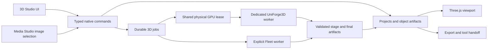

# 3D Studio: complete application plan

Research date: 18 October 2026. Proposed application name: **3D Studio**. Initial generation engine: **UniForge3D**.

Build a distinct top-level Machdoch application for turning object photographs into inspectable, editable, reusable 3D assets. Give it its own projects, object library, generation jobs, engine settings, and viewport, alongside Chat and Media Studio. This interprets “separate app within Machdoch” as a separate application in the existing shell; a separate desktop executable is outside this proposal.

This document defines the complete product and its implementation requirements. Capability groups describe the finished suite, without delivery phases. **Required** means part of that suite; **optional** identifies additional features with independent value. **Verified** describes source inspection, not a successful local inference run. Proposed behavior and acceptance targets are design decisions, not upstream capabilities.

## Product decision

The application should combine five responsibilities: prepare photographs, generate objects, inspect geometry and materials, create useful derivatives, and deliver assets to other tools. A user should be able to reopen an object months later and recover its inputs, generation settings, original output, edits, and exports.

UniForge3D is a credible initial engine, with an important commercial constraint: its source is MIT licensed, but its released weights are labeled CC BY-NC 4.0. The authors explicitly identify VGGT-derived checkpoints as noncommercial and the default BRIA background remover as requiring separate commercial authorization. A generally available commercial integration requires a resolved rights position for the complete model stack. An install acknowledgement cannot supply missing rights. [Authors’ license statement](https://github.com/xibushu/UniForge3D/blob/8b6094780e202b8a6b1d239e0997552e18547026/README.md#license), [released weights](https://huggingface.co/xibushu/UniForge3D).

The other central product constraint is input evidence. UniForge3D targets sparse, unposed **multiple views of the same object**. Its published evaluation uses four photographs per object. The paper also identifies severe occlusion, reflections, and extreme lighting as limitations. Single-image quality, arbitrary view counts, and real-world reliability must be measured rather than inferred from the application category. [Paper, experimental setup and limitations](https://arxiv.org/html/2610.15357v1).

## Research findings

The project website still shows placeholder paper and code links. The authors’ repository and model distribution are already available. Use the repository, its source files, and the model cards as implementation evidence. [Project website](https://xishuxishu.github.io/uniforge3d-project/), [official repository](https://github.com/xibushu/UniForge3D).

The inspected source revision is `8b6094780e202b8a6b1d239e0997552e18547026`; the inspected UniForge3D weights revision is `a084333f2aae0213e85b9a4541752d1221d618db`. The accompanying [research snapshot](artifacts/image-to-3d-2026-10-18/research-snapshot.json) records observed revisions, weight sizes, and configuration defaults.

| Area | Verified finding | Consequence for Machdoch |
| --- | --- | --- |
| Entry point | The supplied CLI processes object folders and writes `prediction.glb`. | Build a native application around a dedicated worker; the CLI is a reference, not the product API. |
| Inputs | The CLI recognizes PNG, JPEG, WebP, BMP, and TIFF. It sorts filenames. | Store explicit view order and object grouping; do not let filenames silently define the anchor. |
| Pipeline | The Python pipeline performs feature extraction, sparse structure, shape at 512, shape at 1024, then texture generation and baking. | Preserve stage artifacts and provide meaningful progress and recovery. |
| Seed | The Python API accepts a seed; the example CLI does not expose one. | Pass seeds through Machdoch’s worker directly. |
| Memory | Low-VRAM mode moves models between CPU and GPU; CUDA is selected explicitly. | Treat offloading as a measured execution profile, with RAM and transfer costs. |
| Outputs | The normal public run returns a final GLB path. | Mesh editing, previews, job persistence, and format conversion are application work. |

Sources: [CLI](https://github.com/xibushu/UniForge3D/blob/8b6094780e202b8a6b1d239e0997552e18547026/infer.py), [pipeline implementation](https://github.com/xibushu/UniForge3D/blob/8b6094780e202b8a6b1d239e0997552e18547026/uniforge3d/pipelines/uniforge3d_image_to_3d.py).

| Capability | Current evidence | Product treatment |
| --- | --- | --- |
| Multiple unposed images | Central supported workflow; four-view paper evaluation. | Core generation experience. |
| One image | The input API accepts a sequence; that alone establishes no quality guarantee. | Preserve single-image drafts; enable generation only for a measured engine profile that supports it. Do not duplicate a photo to simulate multiple views. |
| Maximum input views | No explicit public limit established by this inspection. | Publish a tested per-profile range and enforce it at submission. |
| Anchor selection | Source configuration uses anchor index zero. | A “Set front view” action changes ordered inputs and creates a new recipe revision. |
| Text prompts or negative prompts | No such public input in the inspected run API. | Omit prompt controls for this engine. |
| Geometry-only results | A coarse shape exists internally, but the normal run continues to the final textured result. | Add an explicit worker operation and validate its output contract. |
| Texture-only regeneration | Internal shape latent and view routing are reused during texture generation. | Implement artifact retention and a geometry-preserving rebake operation; it is not a ready-made public command. |
| Resume, cancellation, streamed previews | No application-level contract in the inspected run API. | Implement in Machdoch’s worker and job manager. |
| Training, rigging, animation, CAD solids | Not established as UniForge3D integration capabilities. | Do not promise these as engine features. |

These distinctions follow the [configuration](https://github.com/xibushu/UniForge3D/blob/8b6094780e202b8a6b1d239e0997552e18547026/uniforge3d/configs/pipeline.json) and the [pipeline](https://github.com/xibushu/UniForge3D/blob/8b6094780e202b8a6b1d239e0997552e18547026/uniforge3d/pipelines/uniforge3d_image_to_3d.py). Conditional capabilities are readiness requirements, not implied promises of upstream support.

## Complete product scope

| Area | Required finished behavior |
| --- | --- |
| Projects | Named collections of source views, object candidates, revisions, saved inspection views, and export recipes; autosave and portable project packages. |
| Input preparation | File, clipboard, folder, and Media Studio import; explicit object grouping; view ordering; foreground masks; crop and orientation tools; input validation. |
| Generation | UniForge3D installation and readiness, local execution, explicitly selected Fleet execution, seed variants, saved recipes, batch jobs, cancellation, recovery, and useful intermediate previews. |
| Inspection | Interactive PBR viewport, geometry and material modes, image reference panel, synchronized candidate comparison, dimensions, mesh statistics, and actionable validation findings. |
| Object refinement | Orientation, pivot, scale, component selection, explicit cleanup and repair, simplification, levels of detail, texture rebaking, and material adjustments. |
| Library | Search, collections, favorites, tags, provenance, immutable originals, revisions, duplicates, trash, restore, and storage management. |
| Delivery | GLB, glTF, OBJ packages, STL, PLY, texture packages, screenshots, turntables, export presets, and verified handoff to external tools. |
| Operations | Persistent jobs, resource scheduling with other Machdoch workloads, offline generation after complete setup, model management, diagnostics, accessibility, and native desktop packaging. |

The application owns asset preparation and practical finishing. Sculpting, hand-built topology, skeletal animation, simulation, and parametric modeling remain external-tool workflows. “Full suite” should mean the complete image-to-object lifecycle, with clear boundaries for specialist authoring.

## Navigation and screen composition

Add **3D Studio** to Machdoch’s application rail with its own activity indicator and command-palette action. Switching applications must preserve drafts, selections, viewport position, and ongoing work.

Use three primary destinations: **Projects**, **Objects**, and **Jobs**. Opening a project enters its workspace. Engine installation and device selection belong in app settings, with direct access from an unavailable Generate action.

```text
Machdoch rail | Project name                         Compare   Export
              |------------------------------------------------------
Project list  |                                      | Selection
and objects   |              3D viewport             | inspector
              |                                      |
              |                                      | Geometry
              |                                      | Materials
              |------------------------------------------------------
              | Source image strip                   | Generate
```

This is a layout proposal, not interface copy. The primary work surface is the object. Controls should remain in stable locations as a draft becomes a generated result.

On a wide window, use a resizable project sidebar, flexible viewport, collapsible inspector, and a source strip whose height can expand. At Machdoch’s current 960-pixel minimum desktop width, turn the inspector into an overlay and the project sidebar into a drawer. At 200% zoom, all primary actions remain reachable without horizontal page scrolling. Browser and Fleet layouts can use a single active panel on smaller screens.

Keep Generate, Cancel, Compare, and Export visible when relevant; do not place a primary action beneath a long image list. The image viewer must provide previous/next controls and keyboard navigation in its visible frame. The source strip scrolls independently of the viewport and controls.

## Image preparation

Import should create an autosaved draft immediately. One import group represents one physical object, with an explicit way to split accidentally mixed objects. A folder batch offers a grouping preview before job creation; grouping guesses never silently become submitted jobs.

Required controls and behavior:

- Add, remove, reorder, include, and exclude views; show the selected front view with a functional selection treatment.
- Inspect each image at useful zoom, with original and foreground-mask views. Preserve originals and identify each prepared derivative by hash.
- Rotate in 90-degree increments, correct EXIF orientation, crop, and select the foreground. Manual mask brush, erase, feather, reset, and undo must work without an inference GPU.
- Offer automatic foreground extraction as an explicitly selected, licensed operation. Preserve supplied transparency and let users refine it.
- Detect unreadable files, unsupported decoding, fully transparent masks, oversized decoded images, and exact duplicates before generation. Bound both encoded bytes and decoded pixel counts.
- Show a recoverable error on the affected view. Blurry photographs, clipping, or weak coverage can receive dismissible, measured warnings; uncertain heuristics must not block valid images.
- Treat same-object consistency and view diversity as quality checks. Do not claim camera coverage percentages without actual pose evidence.
- Offer an optional capture reference showing overlapping angles and stable lighting. Keep it out of the normal workspace once it is unnecessary.
- Accept the formats the shipped decoders actually support. HEIC/AVIF support requires a deliberately packaged decoder and license review; omit those import promises until verified.

Prepared inputs must reproduce the engine’s expected preprocessing, including alpha handling and its trained background composite. A checkerboard used for editing is only a display treatment. Do not silently recolor, relight, mirror, or synthesize missing views. The upstream crop and mask construction should have parity fixtures before substitution. [Preprocessing implementation](https://github.com/xibushu/UniForge3D/blob/8b6094780e202b8a6b1d239e0997552e18547026/uniforge3d/utils/preprocessing.py).

There is a concrete upstream integration issue: the pipeline initializes `BackgroundRemover` during construction, even when every input already contains transparency. Avoiding BRIA download, access requirements, and initialization requires changing that initialization path. Use a reviewed, lazy preprocessing integration that can accept prepared RGBA inputs; merely passing PNGs is insufficient. Any replacement cutout model needs its own license and quality verification. This does not resolve the separate restrictions on UniForge3D’s generation weights. [Pipeline construction](https://github.com/xibushu/UniForge3D/blob/8b6094780e202b8a6b1d239e0997552e18547026/uniforge3d/pipelines/uniforge3d_image_to_3d.py).

## Generation controls and behavior

The normal inspector contains the input set, front view, execution device, variation count, and Generate. With one engine installed, its name is a selection value, not an extra card or repeated badge. Advanced controls are collapsed and searchable through the command palette.

Advanced controls include seed locking, per-stage sampling parameters, memory profile, output texture size, and export geometry budget only where the worker validates and supports them. Use current upstream settings as the reference configuration:

| Parameter | Inspected default |
| --- | --- |
| Seed | 42 |
| Sparse structure sampling | 12 iterations; guidance 7.5 |
| Shape at 512 | 20 iterations; guidance 3.0 |
| Shape at 1024 | 20 iterations; guidance 6.5 |
| Texture sampling | 20 iterations; guidance 2.5 |
| Baked texture | 2048 × 2048 |
| Mesh simplification setting | `decimation_target = 1,000,000` |
| Low-VRAM mode | Enabled by the example CLI |

Do not describe 512 and 1024 as interchangeable finished quality presets: the released run uses both. Do not advertise higher texture dimensions as newly inferred detail. The simplification setting also needs an observed output-count check before labeling it a guaranteed triangle budget. [Engine configuration](https://github.com/xibushu/UniForge3D/blob/8b6094780e202b8a6b1d239e0997552e18547026/uniforge3d/configs/pipeline.json), [CLI defaults](https://github.com/xibushu/UniForge3D/blob/8b6094780e202b8a6b1d239e0997552e18547026/infer.py).

Every submission freezes input order, masks, source hashes, seed, effective configuration, model revisions, worker version, and target device. Editing the draft afterward creates a new recipe; it cannot alter the running job. Variations create separate candidates with recorded seeds and shared parentage. Repeated clicks with the same submission token cannot create duplicate jobs.

Show elapsed time and real stage progress. A coarse mesh can appear when a complete stage artifact exists; it must be distinguishable from the final result. The viewport should not jump the camera on every update. Estimates require measured data for the relevant device, memory profile, view count, and workload; otherwise show elapsed time without a fabricated ETA.

## Viewport and inspection

Use one renderer for the project viewport, object library previews, comparison views, and captured images. **Three.js with its glTF loader** is the proposed renderer, kept behind a small viewport component with explicit resource disposal. WebGL2 is the initial required rendering backend; do not introduce a second renderer speculatively. [Three.js glTF loader](https://threejs.org/docs/pages/GLTFLoader.html).

Required viewport behavior:

- Orbit, pan, zoom, fit selection, reset camera, orthographic/perspective switching, and front/back/left/right/top/bottom views.
- Textured PBR, neutral clay, wireframe, normals, and material-channel inspection. Channel choices reflect maps that actually exist.
- A useful neutral environment, lighting rotation, background color/transparency, optional ground/grid/axes, and saved inspection views.
- An orientation gizmo and selection outline; clicking empty space clears selection without changing the object.
- On-demand triangles, vertices, connected components, materials, texture dimensions, bounding dimensions, and file size in the inspector.
- Reference-image comparison beside the model. Calibrated overlays require valid camera information; do not invent alignment for ordinary unposed photos.
- Two-candidate comparison with linked cameras, projection, scale, and lighting. Preserve an independent-camera option for detailed inspection.
- Mesh and texture decoding outside interaction-critical work; cancel stale loads and dispose GPU resources on replacement.
- A static thumbnail and recoverable renderer error if WebGL is unavailable or its context is lost. Jobs, sources, and export remain usable.

Keep authored geometry and display geometry distinct. A reduced viewport proxy can improve interaction without replacing the original asset or changing export defaults. Frame the complete object after initial loading and preserve the user’s camera during inspector edits.

Opacity needs particular care: upstream bakes alpha but constructs materials with opaque mode. Provide an explicit material alpha mode, and verify transparent materials in the viewport and exports. Preserve the base-color and metallic/roughness channel conventions, UV orientation, handedness, and axis conversions. Normal or ambient-occlusion maps may be derived by an explicit bake; they are not native maps simply because a PBR inspector exists. [Material construction and coordinate conversion](https://github.com/xibushu/UniForge3D/blob/8b6094780e202b8a6b1d239e0997552e18547026/uniforge3d/utils/texture_baking.py), [glTF specification](https://registry.khronos.org/glTF/specs/2.0/glTF-2.0.html).

## Geometry, materials, and useful finishing

Every applied operation creates a derived revision. Keep the generated master immutable, with undo/redo for the editing session and saved revision history after reopening.

| Operation | Required behavior and boundaries |
| --- | --- |
| Orientation and pivot | Set front/up, center pivot, place the base on the ground, and bake or preserve transforms deliberately. |
| Scale and dimensions | Set units and a known dimension, with proportional scaling. Photographs alone supply no verified real-world size. |
| Components | Inspect, select, hide, isolate, and remove connected parts explicitly. Small components can be intentional. |
| Cleanup | Remove duplicate or degenerate elements, repair normals, and merge vertices within an explicit tolerance. Preview effects before applying. |
| Repair | Identify boundaries, holes, nonmanifold regions, and self-intersections; offer targeted supported repairs. Never silently fill intended openings or erase thin details. |
| Simplification | Target a polygon budget, compare silhouette and UV/material preservation, and retain the source. Treat count and deviation as measured results. |
| Levels of detail | Save a named set of derivatives with actual counts and a shared source; allow controlled texture downscaling. |
| UV and texture baking | Inspect UVs, rebake when topology changes, and preserve texture seams and channel color spaces. |
| Material adjustments | Base-color tint, roughness/metallic multipliers, opacity mode, double-sidedness, and reset to generated values. |
| Texture regeneration | Reuse retained shape state. Preserve the selected mesh topology and transforms by baking new attributes onto it; upstream remeshing must not silently violate a “keep geometry” action. |
| Print inspection | Check closedness, orientation, minimum thickness where measurable, and scale before geometry-only export. A printability check is not a manufacturing certification. |

Complex repairs should report what could not be repaired and keep the original available. There is no universal “game ready,” “print ready,” or “CAD accurate” status inferred from a successful generation job.

## Object library and projects

The object grid shows a useful thumbnail, name, and current job state only when it affects selection. Offer a list view for sorting by date, triangles, file size, engine, or collection. Search names and tags; filter by favorites, project, engine, and validation findings. Avoid permanent technical labels on every thumbnail.

Each object detail view provides its original output, selected revision, candidates, source images, recipe, derived files, and export history. A saved inspection view controls thumbnails and turntables without modifying object orientation.

Projects autosave draft edits and recover after interruption. Portable project packages include selected sources, masks, meshes, textures, recipes, manifests, and required notices. Model weights and access tokens are excluded. Large retained inference artifacts are an explicit package option with an accurate size estimate.

Deleting an object moves its owned assets to trash. Removing an imported view never deletes the original user file. Permanent deletion states the actual consequences and respects other projects’ references. Cache cleanup distinguishes reproducible previews from retained state needed for texture regeneration or stage recovery.

Duplicate detection starts with file hashes. Geometric similarity is optional and cannot automatically merge distinct revisions or objects.

## Export and external-tool handoff

GLB is the generated master. Provide deliberate export profiles for common downstream needs without making engine output dependent on a particular external application.

| Output | Finished-suite requirement |
| --- | --- |
| GLB | Single-file textured asset; preserve material semantics. Offer PNG/JPEG texture encoding for target portability as a current explicit export choice. |
| glTF | Manifest, buffers, and textures exported as an atomic folder/package with validated relative paths. |
| OBJ package | Geometry, UVs, MTL, and available textures; disclose material features the target representation cannot carry at export time. |
| STL | Geometry-only output; require an explicit units/scale choice and show relevant mesh findings. |
| PLY | Geometry and supported vertex attributes; do not imply UV/PBR equivalence. |
| Texture package | Available source and derived maps with dimensions, packing convention, and color-space metadata in the manifest. |
| Project package | Reopenable Machdoch project including provenance and selected retained state. |
| Images and video | Transparent or solid-background screenshots; turntables with chosen duration, framing, dimensions, and background. |

Native GLBs use WebP texture export. Support that extension in the viewer and independently test target importers. A PNG/JPEG profile is a purposeful export transformation, not a hidden retry path. [Upstream GLB export](https://github.com/xibushu/UniForge3D/blob/8b6094780e202b8a6b1d239e0997552e18547026/uniforge3d/utils/mesh.py).

Use **glTF Transform** for explicit glTF inspection and transformations where suitable, with packaged codecs for compression options. Keep lossy compression opt-in per export recipe and retain the master. Use the **Khronos glTF Validator** to generate structural reports; validate extension handling separately where the validator cannot establish target support. [glTF Transform](https://gltf-transform.dev/), [glTF Validator](https://github.com/KhronosGroup/glTF-Validator).

“Open in Blender” and equivalent actions export the selected revision and invoke a configured application with safe arguments. They require a detected executable and a verified import profile. Establish round trips with Blender, Godot, Unity, and Unreal for any corresponding preset; this research did not perform those checks. Automatically launching an application must not substitute for verifying its import behavior.

USDZ, FBX, and 3MF are optional export extensions. Each requires an identified converter, licensing, packaged dependencies, and output validation before becoming available. Do not add empty format choices or silently upload assets for conversion.

## Jobs, cancellation, and recovery

Use a durable backend job queue shared by all windows of 3D Studio. Switching apps, closing a panel, or losing a frontend connection must not abandon work. App exit offers the existing Machdoch behavior for active work, including a clear choice to keep the process running or stop it; do not imply jobs survive termination without a persistent worker host.

Internal job states are `queued`, `waiting-for-device`, `running`, `cancelling`, `succeeded`, `failed`, `cancelled`, and `interrupted`. A stage is separate from the job state. Installer progress is separate from generation progress. User-facing presentation can collapse these into the few meaningful current states.

Required invariants:

- Persist a job and its frozen recipe before dispatch; use a submission token and an execution lease to prevent concurrent duplicate attempts.
- Acquire a physical-device lease before loading GPU stages. Media Studio, 3D Studio, training, and retained models must participate in the same admission rules.
- Keep a GPU lease while its resident worker still occupies protected memory; idle unload and release must complete before another exclusive job is admitted.
- Reordering affects queued work only. Queue pause prevents new dispatch; it does not pretend to pause a CUDA kernel.
- Cancellation sets a durable request, waits for safe stage boundaries, and has a bounded escalation to supervised process termination. Clean up children, temporary outputs, GPU residency, and leases.
- A late success event cannot override an acknowledged cancellation. Outputs arriving after cancellation are quarantined from normal publication.
- Commit completed artifacts atomically after validation. A missing or corrupt GLB cannot produce a succeeded object.
- A failure after geometry completion can preserve a clearly identified geometry artifact. It remains a failed textured generation, with a specific retry or export action.
- Resume only from a complete, compatible saved stage with its inputs, model/config hashes, routing data, tensors, and relevant random-generator states. Otherwise show Restart as an explicit new attempt.
- Detect a dead worker or expired execution lease and reconcile it before retrying. Retrying an export or transfer must not rerun inference.
- Persist bounded diagnostics and stage timings; redact secrets and user paths before sharing support bundles.

No arbitrary same-job model substitution, automatic cloud redirection, guessed low-memory configuration, or infinite retry loop. Recovery preserves the user’s chosen operation and makes changed settings a new recorded recipe.

## Runtime and hardware requirements

The upstream setup creates Python 3.10 and installs PyTorch 2.6.0, torchvision 0.21.0, CUDA 12.4 wheels, Transformers 4.57.3, PEFT 0.17.1, FlashAttention 2.7.3, and trimesh 4.6.3. It builds nvdiffrast 0.4.0, CuMesh, FlexGEMM, and O-Voxel, with pinned repository commits for the latter source dependencies. A CUDA-enabled PyTorch install alone does not supply all required build/runtime components. [Setup script](https://github.com/xibushu/UniForge3D/blob/8b6094780e202b8a6b1d239e0997552e18547026/setup.sh).

The pinned FlashAttention documentation names Linux and NVIDIA Ampere/Ada/Hopper support for the CUDA implementation, with additional uncertainty around Windows compilation. TRELLIS.2’s documented reference requires Linux and at least 24 GB of NVIDIA GPU memory. **That is dependency guidance, not a verified UniForge3D minimum.** [FlashAttention 2.7.3](https://github.com/Dao-AILab/flash-attention/blob/v2.7.3/README.md#installation-and-features), [TRELLIS.2 prerequisites](https://github.com/microsoft/TRELLIS.2#prerequisites).

| Execution environment | Proposed product support contract |
| --- | --- |
| Linux x86-64 with NVIDIA CUDA | Primary runtime target; qualify the exact GPU, driver, libraries, and complete inference path. |
| Windows Machdoch with NVIDIA through WSL2 | First-class target architecture using the same Linux worker pack; complete integration and inference testing are required before claiming support. |
| Windows native Python/CUDA | Unverified; do not promise or install as an alternate path. |
| AMD, Intel, Apple MPS, or CPU generation | No confirmed implementation in the inspected pipeline. Do not derive support from unrelated PyTorch or FlashAttention backends. |
| Machines without a qualified generation GPU | Input preparation, library, exports, and inspection where WebGL is available; explicitly selected qualified Fleet worker for generation. |

Microsoft documents CUDA-enabled frameworks inside WSL2, but this does not validate the full UniForge3D stack. The Windows integration must handle distribution readiness, GPU visibility, driver compatibility, Linux storage, path conversion, memory allocation, cancellation, and process ownership. Keep working tensors and model caches in the Linux filesystem; transfer only validated inputs and published outputs through the bridge. Do not silently modify WSL configuration or OS features. [CUDA on WSL](https://learn.microsoft.com/en-us/windows/ai/directml/gpu-cuda-in-wsl).

Qualify at least a 24 GB consumer GPU, a 48 GB workstation GPU, and an 80 GB server GPU if those are advertised deployment classes. Include 64 GB and 128 GB host-RAM configurations for offload measurement; these are proposed test allocations, not discovered minimums. Smaller GPUs and newer architectures need their own evidence. Do not present an out-of-memory run as evidence that an entire GPU family is unsupported.

For each profile, record import time, cold/warm load, peak GPU and system memory, temporary disk peak, per-stage and total latency, and behavior under simultaneous viewport rendering. Include multiple view counts and dense/thin geometry. Admission limits must reflect these observations and available memory, not only a GPU marketing name.

## Installation, downloads, and storage sizing

Distribute a dedicated, versioned UniForge3D runtime pack with a locked Python environment and reproducible native dependencies. Do not run the upstream setup script on the user’s general Python environment or mix it with Media Studio’s environment. Prefer verified prebuilt runtime artifacts where redistribution permits; any source-build mode is an explicit developer operation, not a normal install fallback.

Observed minimum model payload:

| Component | Weight bytes |
| --- | ---: |
| UniForge3D’s nine `.pt` checkpoints | 26,933,888,261 |
| TRELLIS.2 structure base | 2,584,426,920 |
| TRELLIS.2 shape decoder | 948,490,494 |
| TRELLIS.2 texture decoder | 948,458,812 |
| TRELLIS sparse-structure decoder | 147,591,972 |
| DINOv3 ViT-L/16 model | 1,212,559,808 |
| BRIA RMBG-2.0 model in the default stack | 884,878,856 |
| **Identified weights total** | **33,660,295,123** |

This is about **33.66 GB / 31.35 GiB of weights**, derived from public file metadata, excluding configuration/code, Python, Torch/CUDA libraries, native modules, installer archives, duplicate staging, caches, and generated assets. It is a planning lower bound, not an installed-size estimate. The snapshot includes the source endpoints and arithmetic inputs. [UniForge3D metadata](https://huggingface.co/api/models/xibushu/UniForge3D?blobs=true), [TRELLIS.2 metadata](https://huggingface.co/api/models/microsoft/TRELLIS.2-4B?blobs=true), [TRELLIS metadata](https://huggingface.co/api/models/microsoft/TRELLIS-image-large?blobs=true), [DINOv3 metadata](https://huggingface.co/api/models/facebook/dinov3-vitl16-pretrain-lvd1689m?blobs=true), [RMBG metadata](https://huggingface.co/api/models/briaai/RMBG-2.0?blobs=true).

The config references these external model sources; the default stack needs more than the UniForge3D repository. Some external revisions are pinned upstream, while DINOv3 and RMBG names need explicit revision locking in Machdoch. [Checkpoint resolution](https://github.com/xibushu/UniForge3D/blob/8b6094780e202b8a6b1d239e0997552e18547026/uniforge3d/models/loaders.py).

The install experience must show the actual download size, required destination, available disk space, access requirements, and applicable terms at the point of installation. Download manifests enumerate exact files, byte sizes, hashes, and revisions. Resume verified partial downloads; publish an installation only when all required artifacts and kernel probes pass. Cancellation leaves no “ready” model and never deletes a shared cache entry still in use.

Compute capacity per volume: remaining download bytes + unpacked runtime + unshared model copies + measured job workspace + retained outputs + an explicit reserve. For WSL, check both the Linux filesystem and the host volume backing its growing disk image. Account for atomic replacement and concurrent installs.

Offer import of an existing verified model folder, relocation through a controlled move, repair of missing/corrupt files, and uninstall with dependency references. After setup, a complete local run must work with network access disabled. No surprise downloads during Generate.

## Model access and rights

| Component | Observed terms/access | Implementation requirement |
| --- | --- | --- |
| UniForge3D source | MIT | Preserve source notices and modifications; separate from weight rights. |
| UniForge3D released weights | CC BY-NC 4.0 model card | Resolve intended distribution and use; never label the overall engine commercially unrestricted. |
| VGGT-derived weights | Original VGGT model card is CC BY-NC 4.0; acknowledged by UniForge3D | Rights resolution must include these derived components. |
| DINOv3 | Custom DINOv3 license; gated access request | Open the official access page and use the user’s approved credentials; review the actual license for redistribution/use obligations. |
| BRIA RMBG-2.0 | Gated access; noncommercial self-hosted weights with separate commercial terms | Account for permission and initialization; an alternative mask path must be explicit and independently evaluated. |
| TRELLIS/TRELLIS.2 | MIT metadata for the inspected base models | Retain notices; audit included source modules and transitive dependencies individually. |
| Native modules, Python, codecs, HDR environments, fixtures | Individual packages and assets | Record licenses in the shipped notices and software bill of materials. |

Sources: [UniForge3D README](https://github.com/xibushu/UniForge3D/blob/8b6094780e202b8a6b1d239e0997552e18547026/README.md#license), [UniForge3D model card](https://huggingface.co/xibushu/UniForge3D), [VGGT model card](https://huggingface.co/facebook/VGGT-1B), [DINOv3 model card and license link](https://huggingface.co/facebook/dinov3-vitl16-pretrain-lvd1689m), [BRIA model terms](https://huggingface.co/briaai/RMBG-2.0).

Model access approval, model-use rights, and input/output ownership are separate concerns. Record model and license versions with the recipe and export manifest. Do not claim the model license automatically determines every output’s copyright or guarantees ownership; any such product policy needs its own review. A commercial license for background removal alone does not clear the generation stack.

User-facing terms belong in installation, engine details, and export situations where they affect the decision. Avoid permanent licensing banners in the viewport. Credentials stay in the platform credential store and never enter project packages, worker logs, or Fleet artifacts.

## Machdoch architecture

Repository inspection used Machdoch HEAD `8c631d0f8a1f95bf5d3fe684c446875f4654e25d` and the working-tree files listed below. These are existing integration points, not claims that 3D support exists.

| Existing location | Observed responsibility | Planned integration |
| --- | --- | --- |
| [`app-rail.tsx`](../apps/client/src/tauri/ui/app-shell/app-rail.tsx) | Top-level application navigation and activity | Add the independent 3D Studio entry and activity. |
| [`chat-session-shell.tsx`](../apps/client/src/tauri/ui/chat-session-shell.tsx) | Lazy application loading and app selection | Load the 3D package on demand; preserve per-app drafts and route state. |
| [`shell-store-normalizers.helper.ts`](../apps/client/src/tauri/ui/lib/_helpers/shell-store-normalizers.helper.ts) | `MainAppId`, app state, last-viewed timestamps | Add the current app identifier and persistence behavior. |
| [`packages/product-ui`](../packages/product-ui/package.json) | Shared application shell and UI primitives | Reuse navigation, layout, dialogs, theme, and responsive behavior. |
| [`packages/media-studio`](../packages/media-studio/package.json) | Existing separate media package | Follow its package ownership pattern; exchange typed image references through a deliberate boundary. |
| [`media/runtime_setup`](../apps/client/src-tauri/src/media/runtime_setup/mod.rs) | Runtime install and verification infrastructure | Extract only operations genuinely shared by the two applications. |
| [`media/subject_cutout.rs`](../apps/client/src-tauri/src/media/subject_cutout.rs) | Existing foreground extraction, including BiRefNet | Evaluate reuse through a shared image operation; do not inherit its fallback priority path into the new app. |
| [`media/model_memory.rs`](../apps/client/src-tauri/src/media/model_memory.rs) | Media worker residency and resource handling | Integrate with a cross-app physical-device lease; current module ownership is media-specific. |
| [`child_process.rs`](../apps/client/src-tauri/src/child_process.rs), [`atomic_file.rs`](../apps/client/src-tauri/src/atomic_file.rs), [`sleep_inhibition.rs`](../apps/client/src-tauri/src/sleep_inhibition.rs) | Shared process, file publication, and sleep protection | Reuse these existing responsibilities. |
| [`packages/fleet-protocol`](../packages/fleet-protocol/package.json) | Typed Fleet communication | Add explicit 3D operations and artifact descriptors. |
| [`tauri.conf.json`](../apps/client/src-tauri/tauri.conf.json), [`capabilities/default.json`](../apps/client/src-tauri/capabilities/default.json) | Desktop resources and frontend permissions | Package the worker and constrain file/asset access. |
| [`scripts/licensing`](../scripts/licensing/generate.mjs) | Shipped license generation | Cover new JS, Python, native, model, and asset components. |

Proposed ownership:

```text
packages/three-d-studio/
  src/core/             projects, recipes, jobs, object metadata, contracts
  src/ui/               workspace, sources, viewport, inspector, library
  src/platform/         typed application transport boundary

apps/client/src-tauri/src/three_d/
  commands.rs           validated application operations
  database.rs           metadata and durable jobs
  jobs.rs               dispatch, state, cancellation, recovery
  engine.rs             UniForge3D worker integration
  artifacts.rs          validation, publication, provenance
  exports.rs            export operations and handoff

apps/client/src-tauri/python/three_d/
  worker.py             versioned worker protocol
  uniforge_engine.py    reviewed engine operations
  preprocessing.py      prepared input integration
  stage_artifacts.py    complete stage persistence
```

These paths are proposed additions. Keep files split by responsibility as complexity warrants. Share image operations, download verification, and device leasing only where both applications actually consume them. They belong in common modules/packages, not behind Media Studio’s domain types. Do not introduce a universal plugin framework, a second job architecture inside the frontend, or multiple engine implementations for hypothetical compatibility.

The dedicated Python environment is part of the engine pack. Frontend rendering and editing must load independently of Python readiness. A missing runtime should affect generation, not opening the application.



## Data and command contracts

Use app-owned SQLite metadata and content-addressed files. Large geometry, images, tensors, and textures stay out of JSON IPC and frontend stores. Native code resolves application asset handles to authorized local paths; the browser receives narrowly scoped URLs or bounded binary responses.

| Entity | Essential fields and invariants |
| --- | --- |
| Project | ID, name, timestamps, object membership, draft recipe, revision token, saved viewport state. |
| Source view | Original hash, prepared hash, mask hash, decoded dimensions, color profile, orientation transform, inclusion/order, front-view membership. |
| Recipe | Exact ordered view references, effective engine/configuration revisions, resolved seed, execution profile, preprocessing version, operation kind. |
| Job and attempt | Frozen recipe ID, submission token, state/stage, device lease, owner, timestamps, cancellation request, diagnostic code, event cursor. |
| Stage artifact | Kind, hash, sizes, producing recipe/stage, tensor/config schema, compatibility identity, completeness marker, retention policy. |
| Object candidate | Master artifact, source job, parent object, named revisions, preferred thumbnail, geometry/material statistics. |
| Edit revision | Parent revision, explicit operation/settings, generated artifacts, coordinate/unit transformations, authoring timestamps. |
| Export | Source revision, format/profile, conversion versions, output hashes, target destination, validation report. |
| Engine installation | Source/weight/runtime identities, file hashes, access state, license records, device probe results, advertised capabilities. |

A portable project manifest contains the same identity and provenance data without absolute machine paths. Validate schemas at boundaries and reject unsupported current-contract versions explicitly. No legacy import path or compatibility aliases are needed for a new application.

Proposed application commands cover project/library operations, source preparation, engine inspection/installation, job submission/cancellation/reordering, object inspection/derivation, and export. Use typed domain requests, not arbitrary shell commands or raw Python configuration blobs from the UI.

The engine capability response should report its measured view-count range, supported operations, allowed parameter schemas, available output channels, device profile identity, and readiness reason. Keep declared capabilities distinct from installed readiness. A missing credential is not the same as an unsupported operation.

Worker transport uses a single versioned protocol: request ID, operation, immutable recipe/artifact references, and target device; structured responses and progress events include job ID, attempt ID, monotonically increasing sequence, stage, and a typed payload. Keep logs on stderr and protocol messages separate. Limit message size and validate artifact descriptors before opening files.

Error codes should distinguish model access, missing files, invalid input, unsupported profile, kernel failure, out-of-memory, disk-full, cancellation, interrupted ownership, invalid output, conversion failure, and unavailable target application. UI messages provide the specific recovery action, while diagnostic details remain expandable.

## Engine worker requirements

Integrate the pinned public Python API and the reviewed stage boundaries, with one canonical Machdoch execution path. Do not scrape terminal progress or depend on the example CLI’s filename traversal. Maintain any necessary source changes as a small, identified patch set against the pinned revision.

The worker must:

- Probe actual CUDA, BF16, attention, sparse convolution, mesh processing, rasterization, and texture-baking operations on the selected device.
- Verify complete model presence and schemas before advertising readiness; importing Torch or detecting `nvidia-smi` is insufficient.
- Resolve every external model to a verified local revision. For offline execution, set local-only loading consistently and test with network access disabled.
- Load reviewed model code locally. The current preprocessing requests remote model code; never execute an unpinned repository’s Python during a generation job.
- Preserve strict weight loading and safe checkpoint handling. Upstream uses `weights_only=True` for `.pt` files; arbitrary user checkpoints must not become executable plugin input.
- Persist complete stage outputs and relevant random states for supported recovery; invalidate caches when any conditioning input or execution contract changes.
- Emit geometry previews only after validation and throttled event delivery. The final material preview must reference the final asset, not an earlier mesh.
- Expose full generation, supported geometry extraction, material regeneration, and explicit postprocessing as distinct operations.
- Release model residency and temporary resources according to the selected policy, and cooperate with device leasing and cancellation.

The default numerical path should match the authors’ reference before product presets change it. Record any reproducibility limits across drivers, devices, native kernels, and library versions; a seed alone does not establish bit-identical output. [Model loading](https://github.com/xibushu/UniForge3D/blob/8b6094780e202b8a6b1d239e0997552e18547026/uniforge3d/models/loaders.py).

## Fleet and cross-app workflows

Fleet execution is part of the complete suite, selected explicitly for a job. Reuse authenticated device enrollment and transport, while adding 3D-specific request and artifact types. Do not represent a mesh as an image/video result just to fit an existing API.

The target worker advertises engine identity, complete installation state, supported view range, available disk and GPU resources, and operation capabilities. Validate the recipe on the target before dispatch. Credentials for gated downloads belong on that worker; do not transfer the user’s Hub token with each request.

Upload only required prepared inputs through resumable, hash-verified transfers. Use durable leases, attempt IDs, event replay, and explicit cancellation so reconnecting cannot launch duplicate inference. Transfer final objects and requested intermediates separately; importing a verified final object can complete even if an optional thumbnail fails.

Show the selected destination when images will leave the current machine. A disconnected worker has a truthful recoverable state; it does not trigger a local run or another provider automatically. Local and remote copies share content identity and record ownership for cleanup.

Cross-app actions include **Create 3D object** on selected Media Studio images and **Use as reference** on a rendered object image. Exchange source handles and provenance through shared contracts. A generated turntable or screenshot can be saved to Media Studio as a normal image/video asset. RALPH or CLI automation uses the same validated commands and returns durable job/object IDs.

## Privacy and desktop delivery

Keep local images, masks, geometry, and diagnostics local by default. Installing models contacts their download hosts; local generation after complete setup should not. Fleet transfer and any optional hosted operation show the actual destination and consequences at submission.

Project archives, imported meshes, texture references, and worker outputs are untrusted files. Bound decoded sizes and mesh complexity; reject traversal, symlink escapes, external resource fetches, executable content, and paths outside authorized roots. Do not allow a GLB/glTF material to fetch arbitrary network URLs when opened in the viewport.

Use Tauri’s narrow capability and asset access model. Do not solve local texture loading by granting the frontend access to the entire filesystem. Validate commands in native code even when the UI hides an operation. [Tauri capability model](https://v2.tauri.app/security/capabilities/).

Desktop packaging must include the worker entry point, schemas, engine manifest, required frontend decoders, notices, and model-management resources. Keep downloadable weights separate from the normal Machdoch installer. Verify Windows path quoting, Unicode filenames, long paths, Linux permissions, WSL lifecycle, and app updates with queued or active jobs. Never replace an engine pack while a job still holds it.

Telemetry, if enabled under Machdoch’s existing policy, can measure durations and failures without uploading images, meshes, prompts, file paths, or tokens. Support bundles are user initiated, previewable, and redacted.

## UI states, interaction quality, and accessibility

| Situation | Interface behavior |
| --- | --- |
| Empty project | One primary Add images action with a drop target. No feature tour or sample content inserted into the project. |
| Valid draft | Sources, front view, and Generate remain visible; sensible recorded defaults supply technical parameters. |
| Single-view draft without qualified support | Preserve the draft and give the specific supported input requirement beside Generate; do not imply a temporary processing failure. |
| Engine not installed | Inline setup action at Generate opens engine installation while preserving the draft. |
| Access pending or denied | Link to the specific model’s access page and offer recheck; do not conflate it with a broken GPU. |
| Unsupported device/profile | State the actual unmet requirement and offer explicit selection of a qualified Fleet device if available. |
| Queued or running | Show position or active stage, elapsed time, and Cancel. Other projects remain usable. |
| Geometry preview ready | Keep camera stable; identify the current preview state without a page-wide banner. |
| Final result | Enable export, refinement, and comparison; retain the source strip and provenance access. |
| Failed stage | Keep usable inputs/artifacts; show the specific recovery action and expandable diagnostics. |
| Disk full | Preserve committed work and offer storage location or cleanup actions; retry the affected operation. |
| Dirty edit/revision conflict | Autosave normal edits; if competing windows conflict, preserve both revisions and let the user choose. |

All controls need accessible names and visible keyboard focus. Source reordering, camera presets, candidate switching, and exports must be operable without drag-only interaction. Provide keyboard and pointer alternatives for orbit and image inspection. Do not rely on color alone for selection or errors. Respect reduced motion, use nonintrusive live announcements for job transitions, and avoid announcing every iteration. Focus returns to the initiating control after dialogs close.

Use the existing theme, density, and typography. Avoid decorative badges, explanatory subtitles, engine-internal jargon, and repeated status text. Tooltips should reveal genuinely hidden shortcuts or consequences, not restate labels. Error copy answers what failed and what action can recover it.

Proposed measurable interaction targets are under 100 ms for immediate control feedback, at least 30 FPS while interacting with a representative 250k-triangle display proxy at 1440p on the declared reference viewer device, and a visible cancellation acknowledgement within one second. These are design targets requiring measurement, not verified performance or final engine runtime promises. Record the tested hardware, viewport size, texture load, and concurrent workload with results.

## Optional features with independent value

These are additions to the complete suite, not a phased roadmap or prerequisites for ordinary image-to-object work.

| Feature | User value | Dependency or boundary |
| --- | --- | --- |
| Phone capture through an authenticated local session | Get consistent object views directly into a project. | Camera access, explicit pairing, local transfer, orientation handling; no obligatory cloud account. |
| Video-to-view selection | Extract useful angles from a turntable or handheld clip. | Existing video tooling plus sharpness/diversity selection; preview selected frames before submission. |
| Evidence visualization | Inspect which source view contributed to a surface region. | Persist real voxel routing and an audited mapping to the final mesh; routing is not calibrated confidence. |
| Aligned reference overlays | Find shape mismatches directly against photographs. | Retained or estimated valid camera information and coordinate alignment; never pretend arbitrary images are calibrated. |
| Smart capture suggestions | Suggest the missing angle most likely to improve a result. | Measurable geometry/coverage evidence, not invented certainty from thumbnails. |
| Selective material repair and texture painting | Fix a small defect while preserving useful results. | Dedicated editing/baking tools; model-based local regeneration needs separately validated conditioning support. |
| Retopology and collision proxies | Reduce manual work for engine integration. | Identified algorithms or configured external tools; validate topology and shape preservation. |
| Multi-object staging | Arrange generated assets for comparison or product imagery. | Scene transforms and lighting; keep source asset provenance and revisions. |
| AR preview and USDZ/3MF/FBX delivery | Inspect real-world placement or reach additional destinations. | Verified converters, units, material support, and destination tests. |
| Named benchmark and preset comparisons | Compare devices/settings using repeatable reference objects. | Rights-cleared fixtures and stored measurements; benchmark scores are not object-quality guarantees. |
| Additional generation engines | Broaden input, licensing, or hardware choices. | Implement an explicit current engine adapter and qualify it independently; no hidden fallback provider. |
| Synthetic additional views | Explore one-image workflows. | Separate generation model, explicit user choice, recorded synthetic provenance, rights and resource/cost disclosure. |
| Hosted GPU execution | Offer compute without owned hardware. | Actual licensed service, upload consent, credentials, quota, cost bounds, retention, and cancellation semantics. |

No optional idea becomes a visible disabled placeholder. Present it only when its implementation and dependencies are available.

## Quality and verification contract

The application is complete when its capability claims match tested operations across the supported environment matrix. A model catalog entry or a mocked successful job is insufficient.

| Area | Required evidence |
| --- | --- |
| Engine parity | The same prepared inputs and effective defaults produce a structurally and visually comparable result to the pinned upstream reference on a qualified device. Investigate differences rather than rely on exact file hashes across GPUs. |
| Input range | Real runs for every advertised view-count class, including one view only if single-image support is claimed. Verify order/front-view changes and repeated-view rejection behavior. |
| Preprocessing | Fixtures for opaque RGB/RGBA, true transparency, EXIF rotation, soft masks, empty masks, crop boundaries, and the reviewed background-remover initialization path. |
| Core generation | Textured GLB with valid indices, finite coordinates, nonempty bounds, materials, textures, UVs, expected channels, and a complete provenance record. |
| Geometry and texture operations | Geometry-only output works independently; geometry-preserving texture regeneration retains topology/transforms and creates a new material revision. |
| Real-world quality | Rights-cleared fixtures covering hard surfaces, thin structures, handles/openings, asymmetry, fine detail, glossy/transparent objects, dark surfaces, occlusion, and uneven lighting. Record failures and useful operating boundaries. |
| Fidelity evaluation | Where ground truth is available, measure aligned geometry and held-out views; do not confuse a plausible unseen side with measured reconstruction or metric scale. |
| Resource support | Complete cold/warm runs, peak RAM/VRAM/disk measurements, available-memory admission, offload, repeated jobs, and simultaneous viewport use on each claimed profile. |
| Reliability | Cancel in each major stage, worker crash, app restart, disk-full, invalid artifacts, export failure, stale events, duplicate submit, two windows, and interrupted install. No false success or orphaned device lease. |
| Shared GPU behavior | Media Studio residency and 3D work cannot overcommit an exclusive device; queued jobs, cancellation, and idle unload release resources correctly. |
| Stage recovery | A resumed job and an uninterrupted job use matching conditioning and random-state contracts; incompatible state is rejected with an explicit restart action. |
| Exports | Validate GLB/glTF structure and extension handling; verify scale/axes/UVs/materials in every advertised target. Test OBJ/STL/PLY feature loss and geometry integrity. |
| Offline and access | A complete installed model runs without networking; missing gated access is actionable; setup never reports ready with absent files or untested kernels. |
| Fleet | Hash-verified uploads/downloads, worker-side validation, authentication, reconnect, event replay, cancellation, and prevention of duplicate active attempts. |
| UX and accessibility | Focused Playwright scenarios for import/grouping/front selection, blocked Generate recovery, job state transitions, comparison, revision editing, and export; keyboard and zoom checks. |
| Installed product | Exercise the packaged desktop app, bundled worker and codecs, model paths, notices, and native/WSL/Fleet routes actually claimed. Source-tree checks cannot establish installed-binary support. |

Use small contract/unit tests for recipes, state transitions, cache identity, and path validation. Use tiny licensed static meshes to test the viewport and exporters without a generation GPU. Mocked workers can verify UI states, but real engine tests must remain an explicit release qualification. Prefer one focused browser project per changed interaction; expand only for concrete platform behavior.

Do not run heavyweight model inference for every interface edit. Keep engine/device qualification separate from ordinary frontend validation, retain useful results, and rerun only when relevant source, model, dependency, or profile changes invalidate them.

## Unresolved evidence and release constraints

| Open matter | Current finding | Evidence required to close it |
| --- | --- | --- |
| Commercial use and redistribution | Noncommercial weights and separately governed components are present. | A documented rights basis for the intended product use and distribution, covering all necessary rights holders. |
| Single-image generation | No successful local run or published single-view evaluation established here. | Repeated real single-view tests and a defensible quality claim, or an explicitly qualified additional engine. |
| Supported view counts | Four-view research evaluation; no measured product range. | Device/profile matrix with limits for memory, latency, and quality. |
| Minimum VRAM and RAM | No UniForge3D-specific product minimum established. | Complete pipeline runs and peak measurements, including baking and offload. |
| Windows through WSL2 | Suitable architectural candidate, not verified end to end. | Packaged runtime install, paths, native kernels, inference, cancellation, disk sizing, and update/recovery checks. |
| Model access | DINOv3 and BRIA have gated access requirements. | Real approved access or an intentionally supported, independently qualified alternative preprocessing path where applicable. |
| Final asset interoperability | Source exports GLB with WebP textures and opaque material mode. | Destination-specific imports, transparency/axis tests, and verified export profiles. |
| Refinement and retained state | Application extensions are needed. | Working geometry-only, texture-preserving, revision, cache, and recovery operations with tested invariants. |
| Complete install size and runtime | Weight lower bound is known; runtime and workspace costs are unmeasured. | Reproducible packaged installs and representative resource/latency measurements. |

These are concrete implementation and release constraints, not reasons to reduce the product to an upload-and-download demo. The full design remains the independent 3D Studio described here. Its readiness indicators and published support matrix must reflect evidence as it becomes available.

## Investigation record

This task inspected the official project page, paper, source, setup script, inference entry point, preprocessing, model loading, pipeline configuration, mesh/material export code, public model metadata, dependency documentation, and Machdoch integration points. The research snapshot records the significant observed versions and payload arithmetic.

No model weights were downloaded, no gated access was requested, no Python/CUDA runtime was installed, no inference or target-tool round trip was performed, and no development server was started. This is a researched implementation specification. Hardware performance, installed-app behavior, rights clearance, and generation quality remain unverified as identified above.
