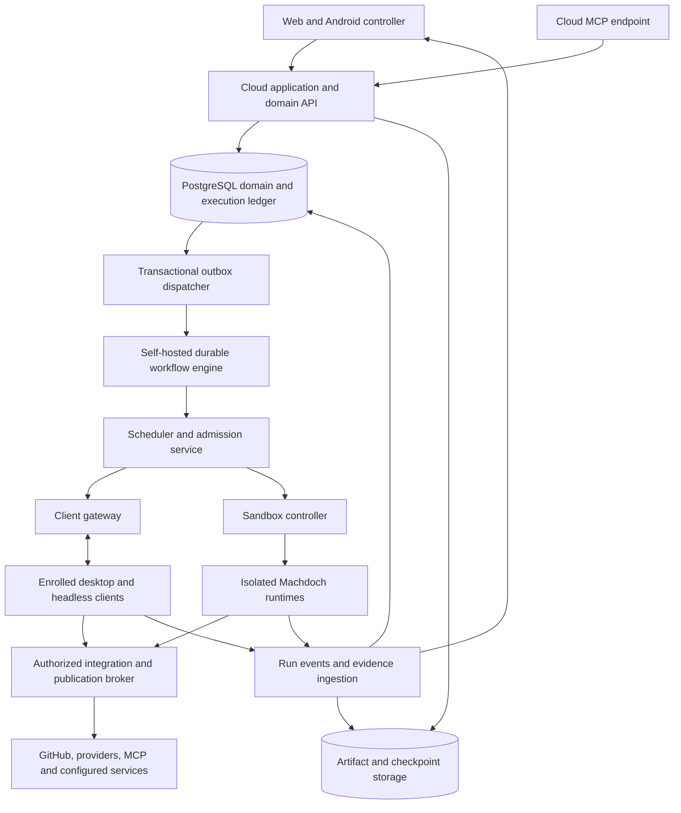

# Architecture and integration

## A-01 — Inspected foundation and preservation contract

The inspected code is a TypeScript/React/Next.js Fleet service with a custom Node server, a Rust/Tauri desktop client, Node/headless client execution, shared TypeScript/Rust contracts, and shared product components. Fleet persists to SQLite and its initial identity schema permits exactly one owner. This is a source inspection, not a new runtime verification.

| Existing area | Evidence in this repository | Target treatment |
| --- | --- | --- |
| Fleet server and persistence | [server entry](../../apps/fleet-manager/src/server.ts), [database](../../apps/fleet-manager/src/server/database.ts), [initial schema](../../apps/fleet-manager/src/server/migrations/001-initial.sql) | Evolve the web application; replace single-owner/SQLite service persistence with the organization model in PostgreSQL. |
| Outbound gateway and command correlation | [gateway](../../apps/fleet-manager/src/server/gateway.ts), [relay](../../apps/fleet-manager/src/server/instance-relay.ts), [protocol package](../../packages/fleet-protocol/src/index.ts) | Reuse transport and bounded flow control; add authenticated run/lease/event contracts. |
| Durable placement | [Fleet sessions](../../apps/fleet-manager/src/server/fleet-sessions.ts), [route schema](../../apps/fleet-manager/src/server/migrations/005-fleet-session-routes.sql) | Preserve command identity and pinned placement; extend to a durable execution ledger. A session route alone is not a run scheduler. |
| Local scheduling and events | [scheduler](../../apps/client/src/core/scheduler.ts), [event matching](../../apps/client/src/core/_helpers/scheduler-event-trigger-matching.helper.ts), [RALPH watches](../../apps/client/src/core/ralph-watches.ts), [shared scheduler contract](../../packages/fleet-protocol/src/scheduler-contract.ts) | Reuse authoring, tested recurrence/condition concepts and step execution; cloud ownership/receipts must follow AU-01–AU-09. See the [source audit](integration-audit.md). |
| Shared UI | [product UI package](../../packages/product-ui/package.json), [client UI package](../../packages/client-ui/package.json) | Keep canonical reusable product components; add domain-specific cloud screens. |
| Desktop remote commands | [Fleet control](../../apps/client/src-tauri/src/fleet_control.rs) and its modules | Preserve native implementations and workspace checks; enforce per-user delegated rights at the gateway and device. |
| Headless projects and service | [project library](../../apps/client/src/core/fleet-projects.ts), [service](../../apps/client/src/core/fleet-service.ts) | Use for supervised client runners and project provisioning. Do not mistake a filesystem library for cloud project identity. |
| Provider and agent execution | [provider adapters](../../apps/client/src/core/_helpers/provider-adapters.ts), [runtime contract](../../apps/client/src/core/runtime-contract.generated.ts), [parallel capabilities](../../apps/client/src/core/parallel-agent-capabilities.ts) | Extract genuinely shared runtime components; keep one provider behavior implementation. |
| Isolated RALPH work | [worktree preparation](../../apps/client/src/core/_helpers/ralph-run-worktree.helper.ts), [Git operations](../../apps/client/src/core/_helpers/ralph-worktree-git.helper.ts) | Reuse proven parts; add explicit run ownership, independent environment state, and distributed recovery. Existing dirty-source snapshot behavior must not become the default for cloud issue jobs. |
| Local MCP | [local MCP server](../../apps/client/src/core/local-mcp/server.ts) and core MCP modules | Preserve local tool access; implement the current cloud MCP binding and evaluate required client SDK changes. |
| Remote parity | [October 6 audit](../fleet-manager-parity-audit-2026-10-06.md), [RALPH evidence](../fleet-manager-ralph-editor-verification-2026-10-05.md) | Keep the feature matrix and its unresolved gaps as acceptance inputs, not as proof of complete parity. |

The latest inspected parity audit documents remote native settings, instructions, workspace tools, previews, attachments, context packs, RALPH, and shared shell/composer work. It also identifies headless workspace/context-pack/adaptive-control gaps, separate transcript/session implementations, and unverified physical audio, Android, GPU/media, and paid-provider paths. These need implementation review and actual verification during delivery.

No application code was changed for this specification. Existing unrelated working-tree edits were not incorporated into a commit or modified.

## A-02 — Target components

Use a modular application for product domains, with separately supervised workers where lifecycle or security requires process isolation. Do not split every product feature into a microservice.

Required deployment responsibilities:

| Component | Owns | Must not own |
| --- | --- | --- |
| Web/domain API | Issues, planning, permissions, settings, search, durable command admission | Agent child-process lifetime |
| Gateway | Device sessions, authenticated command delivery, streaming, previews, backpressure | The only copy of job state |
| Workflow service | Durable sequencing, timers, signals, retries, waits, compensation | Independent competing issue/run authority |
| Admission/scheduler | Eligibility, slots, budgets, run/attempt claims, policy checks | Arbitrary LLM-based authorization decisions |
| Runner supervisor | Processes, isolated workspaces, heartbeat, checkpointing, termination | Long-lived organization credentials |
| Sandbox controller | Provisioning, resource/network boundaries, reaping, image lifecycle | Product identity and issue workflow |
| Integration broker | Scoped external side effects, receipts, publication, credential use | Unchecked forwarding of arbitrary privileged requests |
| Artifact service | Immutable evidence, quotas, ACL enforcement, retention | Executable content under the application's trusted origin |

**Recommended stack:** retain Next.js/React and Node/TypeScript for the application, PostgreSQL for authoritative domain/admission data, self-hosted Temporal for durable workflow execution, S3-compatible object storage, and a Linux microVM runner pool. Preserve Rust/Tauri and headless Node clients. Use PostgreSQL full-text search first as the canonical text index; a semantic index is a derived, authorized projection. This is an architectural recommendation, not a claim that the current repository implements it.

Temporal persists workflow/activity lifecycles but does not make external actions exactly once. The domain ledger, idempotency contracts, and reconciliation remain required. [Temporal activity execution](https://docs.temporal.io/activity-execution).

AU-02 defines the single cloud recurrence path: canonical recurrence evaluation and PostgreSQL occurrence cursors driven by Temporal durable timers. AU-09 defines the RALPH/interpreter boundary, replay-safe activities, bounded history and drain/checkpoint upgrades. Existing private client schedules keep their own explicitly separate authority.

## A-03 — Domain and storage model

Every organization-owned record carries `organization_id`. Composite foreign keys enforce matching organizations on relationships, including issue/project, run/issue, attempt/run, workspace/project, and artifact/run. Global user identity is separate from organization membership.

| Domain | Required entities |
| --- | --- |
| Identity | Organization, User, Membership, Team, TeamMembership, RoleGrant, ServicePrincipal, AuthIdentity, Session |
| Planning | Initiative, Project, ProjectTeam, Milestone, Issue, IssueRelation, WorkflowState, Label, TypedFieldDefinition, Cycle, CycleScopeEvent |
| Collaboration | Document, DocumentRevision, Comment, Subscription, Notification, Customer, CustomerRequest, SourceLink |
| Poker | PokerSession, PokerRound, Participant, Vote, EstimateDecision |
| Source and execution placement | Repository, RepositoryConnection, WorkspaceBinding, Device, DeviceCapability, RunnerPool, EnvironmentDefinition, EnvironmentRevision, EnvironmentInstance |
| Agent operation | AgentDefinition, AgentRevision, Run, RunAttempt, Subtask, ExecutionGrant, Lease, ImplementationReservation, ResourceReservation, Checkpoint, Handoff, RunEvent |
| Delivery | ChangeSet, RepositoryChange, PullRequestLink, ReviewDecision, ValidationResult, DeploymentLink, Release |
| Automation and integration | Automation, AutomationRevision, Schedule, ScheduleRevision, Occurrence, EventReceipt, TriggerDecision, TriggerState, AutomationExecution, StepExecution, ScheduleTransfer, IntegrationInstallation, WebhookInbox, OutboxEvent, ExternalActionReceipt |
| Test orchestration | TestPlanRevision, TestCampaign, TestShard, TestDatasetRevision, TestBaseline, ValidationResult |
| Governance | SecretReference, PolicyRevision, Budget, BudgetReservation, UsageEntry, AuditEvent, RetentionPolicy, ExportJob |

Important constraints:

- A unique active `ImplementationReservation` for `(organization_id, canonical_issue_id)` prevents a second implementation owner through waiting, pause, cancellation and reconciliation. Terminal outcome and reservation release commit together only after authority/effects are settled. Duplicates merged into a canonical issue share this identity. Admission resolves in-progress merge races under transaction locks.
- A run has one typed subject. Issue implementation requires `canonical_issue_id`; project research, maintenance and test work retain their explicit subject without a fabricated issue. Every type follows the same grant/budget/attempt ledger. Validation children cannot acquire the issue's implementation authority.
- Research/review subtasks belong to that run, or are explicitly read-only runs; they cannot acquire an implementation checkout or write branch.
- Unique command keys are scoped by organization and actor/operation. Reuse with a different request digest returns a conflict.
- Each attempt has a unique placement ID, monotonically increasing fencing epoch, immutable input/context manifest, and explicit terminal reason.
- Branch ownership uses canonical repository ID plus branch/ref, not project ID. Distinct projects pointing at one repository cannot acquire the same writer ref independently.
- Every external action records intended parameters, expected resource revision, actor/grant, fencing epoch, state, and reconciliation result.
- Events have per-run monotonic sequence numbers and immutable IDs; observation time and server receipt time are distinct.
- Accepted run events receive authoritative server sequence numbers; source-local sequence/epoch remains separate evidence. EventReceipt, TriggerDecision, occurrence and external-action keys follow AU-06; pruning logs cannot erase consumption/ownership authority.
- `updated_at` alone is not concurrency control. Mutations use revision numbers or equivalent compare-and-swap checks.

Do not use a cache, WebSocket presence map, or queue delivery status as the authority for permission, duplicate prevention, or execution completion. Avoid a distributed transaction between PostgreSQL and the workflow engine: commit the run plus outbox atomically, dispatch with a stable workflow ID, and reconcile until the workflow start is confirmed.

The PostgreSQL ledger owns admission, authorization, leases, publication receipts, and user-visible transitions. Temporal owns durable workflow history and drives transitions through idempotent domain commands. A workflow cannot claim success without the accepted transition and evidence in the ledger. No second scheduler may mutate lifecycle state through a competing path.

## A-04 — API and event contracts

Expose one versioned domain API used by browser, CLI, integrations, and MCP adapters. Generate schemas and typed clients from canonical contracts, including matching Rust types where clients need them.

Representative contracts:

| Operation | Contract |
| --- | --- |
| `POST /api/v1/issues/{id}/runs` | Revision-checked admission; idempotency key; returns accepted run or the existing conflicting run |
| `GET /api/v1/runs/{id}` | Lifecycle, attempts, target, policy revision, budget, evidence pointers, permitted actions |
| `POST /api/v1/runs/{id}/commands` | Typed steer, answer, pause, resume, cancel, or handoff command with its own identity |
| `GET /api/v1/runs/{id}/events?after=...` | Authorized ordered replay; explicit cursor-expired response and snapshot resync |
| `POST /api/v1/projects/{id}/workspace-bindings` | Device-verified repository/path binding; never trust a browser-provided path alone |
| `POST /api/v1/poker/rounds/{id}/votes` | Round revision and participant identity; hidden result projection |
| `POST /api/v1/poker/rounds/{id}/decision` | Facilitator-only finalized estimate and expected issue revision |
| `POST /api/v1/change-sets/{id}/publish` | Verified evidence, current policy, branch ownership, external action ledger |
| `POST /api/v1/runs` | Typed project/maintenance/test subject; same admission service and execution invariants as issue runs |
| `POST /api/v1/automations/{id}/commands` | Revision-checked publish/enable/disable/run-now/cancel/backfill command; durable execution or transfer receipt |
| `POST /api/v1/automations/{id}/simulate` | Bounded event/schedule evaluation in a separate namespace; no production effects |
| `POST /api/v1/test-campaigns` | Candidate-bound plan, required matrix/shards, data/environment revisions, budget and target grants |

A run admission body specifies `issueRevision`, `agentRevisionId`, `environmentRevisionId`, an execution target policy, repository/base references, a budget policy reference, and any authorized context attachments. The server generates authority and canonical IDs. Browser-supplied organization IDs, role names, costs, or timestamps are not trusted facts.

Use normal HTTP semantics: unauthorized/forbidden; conflict for stale revisions or competing runs; validation failure for impossible targets; accepted for durable asynchronous work. Return typed error codes, the object's accessible URL, and a specific recovery action. Do not retry non-idempotent requests automatically without their original key.

Events support resumable streams, bounded retention, snapshot recovery, and backpressure. Stream loss is not run loss. Large logs/diffs/artifacts are chunked through object storage with checksums and scoped grants, not embedded unboundedly in gateway messages.

## A-05 — Runtime sharing and extraction

Make the existing Machdoch execution runtime usable without the desktop shell. Extract only components actually consumed by both client and cloud: provider/harness adapters, instruction delivery, tool contracts, execution events, usage tracking, checkpoints, and shared RALPH semantics.

Suggested ownership:

- Existing `apps/fleet-manager` evolves into the cloud application; perform a coherent product/package rename during implementation, with no duplicate Fleet server left running.
- A shared agent-runtime package contains the canonical execution machinery now under client core.
- A shared cloud-contract package owns issue/run/lease/handoff contracts; the existing Fleet protocol evolves to carry remote device operations and the required new messages.
- A supervised cloud-worker application hosts that runtime inside execution environments.
- Existing `packages/product-ui` and `packages/client-ui` remain the home of genuinely shared UI.
- Cloud planning, identity, and domain persistence remain cloud-owned; local-only operating-system behavior stays client-owned.
- Shared recurrence/conditions and RALPH step semantics have current canonical contracts; device-private persistence and cloud occurrence/admission storage remain in their owning modules. Avoid porting the entire large scheduler module into the web process.

Package extraction must preserve instruction delivery guarantees. Every admitted attempt records the effective instruction revision/digest, context manifest, runtime version, provider/harness version, and tool catalog. The supervisor verifies receipt before granting execution. Native provider subagents are enabled only where instruction delivery and scope attenuation can be established; otherwise the selected mode must explicitly use Machdoch-managed agents or fail capability validation.

## A-06 — Client connection and device protocol

Keep the outbound client-initiated TLS connection so clients behind NAT do not require inbound ports. Enroll each device with a one-use grant, create a device identity, and rotate/revoke credentials independently from human login. Require a deliberate administrative action to transfer a device to another organization.

The gateway handles reconnect with connection generations, sequence cursors, bounded local spool, jittered backoff, and credential errors that stop retrying. Reconnecting a device reports attempt inventory, last accepted commands, checkpoint manifests, and capabilities before receiving new work.

Capabilities describe actual OS/architecture, runtime version, provider availability, sandbox strength, workspace bindings, CPU/RAM/disk/GPU slots, service support, and user-set limits. Version numbers alone do not imply capability. Unsupported current contracts require an upgrade; no implicit old execution path.

Cloud dispatch is a claim/acknowledge protocol, not an untracked `start` message. A device persists an accepted claim before spawning work. It rechecks the grant at launch and before consequential operations. Duplicate delivery returns the same receipt.

Reserve gateway bandwidth/queue capacity for heartbeat, cancel, status, and authority changes independently of previews, terminal output, media, and artifacts. Large preview traffic must not cause lease loss. Horizontal gateways use a durable connection-directory lease so a stale gateway cannot keep dispatching to a superseded connection.

Remote previews and terminals use dedicated scoped channels. They do not expose arbitrary host ports, permit general-purpose proxying, or inherit the viewer's full device rights.

## A-07 — Cloud MCP server

Implement a first-class authenticated MCP endpoint at the installation's configured HTTPS origin. Target the current **2026-07-28** specification: stateless requests, per-request capabilities, discovery, and Streamable HTTP. Do not build the cloud contract around the removed protocol-level session/initialization model. [Current specification](https://modelcontextprotocol.io/specification/2026-07-28), [transport binding](https://modelcontextprotocol.io/specification/2026-07-28/basic/transports).

The MCP endpoint delegates to the same domain services and authorization checks as the normal API. Tools should be narrow and typed:

| Tool group | Operations |
| --- | --- |
| Discovery | Search/list/get issues, projects, cycles, permitted clients, runs, and artifacts |
| Planning | Create/update issues, relations, documents, cycle assignments, and finalized estimates within role limits |
| Execution | Start a run, inspect status/events, supply input, steer, cancel, request an authorized handoff |
| Review | Read diffs/evidence, create review comments, request follow-up work; merge remains separately privileged |
| Context | Read immutable run manifests and permitted project documents; no credential values |
| Automation and tests | Read/draft/publish permitted definitions, preview/simulate, run/cancel/backfill, inspect campaigns; activation and replay have separate grants |

Use pagination, query budgets, optimistic concurrency, operation IDs, resource links, and explicit side-effect classifications. Read-only annotations describe behavior but do not enforce permissions. A model cannot choose a different organization by changing tool arguments.

Expose long-running operations through the current Tasks extension when negotiated, with durable handles backed by cloud run records. Ordinary `start_run`/`get_run` domain tools also have short request lifetimes by design. These are two valid current interfaces to one run service, not a legacy transport shim. Disconnecting a request does not mean canceling the business run; cancellation is an explicit authorized domain command. [Tasks extension](https://modelcontextprotocol.io/extensions/tasks/overview).

Authorization follows the current MCP HTTP authorization contract, including protected-resource discovery, audience/resource validation, PKCE where applicable, and scoped tokens. Never pass a cloud access token through to an unrelated downstream server. [MCP authorization](https://modelcontextprotocol.io/specification/2026-07-28/basic/authorization).

## A-08 — Direct client MCP integration and external agents

When a user connects a client to an installation, offer the installation's cloud MCP connection through the normal client integration registry. Bind authentication to that user/organization; enrollment credentials must not become the user's MCP credential. Device enrollment and cloud tool access are independent grants.

An executing agent receives a narrowed run token and relevant project resources. It cannot enumerate arbitrary client workspaces or run a cloud job from an untrusted tool result. Locally initiated work can attach cloud issues and context after authorization without uploading the rest of local chat history.

Cloud agents may use configured remote MCP servers or local tools exposed through a scoped client bridge. Each bridge advertises explicit tool schemas and grant boundaries. Do not turn Fleet's relay into a general tunnel to every local MCP server. Server metadata changes require revalidation; tool renames/schema changes do not silently gain new rights.

Provide an external agent integration API with installation scopes, agent identity, delegated sessions, progress, questions, artifacts, and cancellation. A2A 1.0 can be a tested adapter for compatible external agents; it does not replace Machdoch's run leases or the Fleet device transport. ACP is relevant to supported coding-harness/client integration, while MCP exposes tools and context. Keep these roles separate. [A2A specification](https://a2a-protocol.org/v1.0.0/specification/).

## A-09 — Providers and execution modes

Separate **model**, **agent harness**, and **execution location** in configuration and capability checks. They are not interchangeable.

| Mode | Harness location | Tool/code location | Required integration |
| --- | --- | --- | --- |
| Machdoch API agent | Machdoch runner | Cloud sandbox or enrolled client | Existing OpenAI, Anthropic, Google, and Langdock adapters; current APIs and model capability validation |
| Native coding harness | Supervised local process | Cloud sandbox or enrolled client | Codex, Claude, and Copilot CLI/SDK adapters; event, cancellation, credential, and instruction contracts |
| Managed provider agent | Vendor service | Vendor environment or supported self-hosted environment | OpenAI Agents API / Claude Managed Agents adapter, explicit data-flow policy and vendor session reconciliation |
| Research agent | Machdoch or selected external service | Approved web/tools and optional sandbox | Perplexity Agent/Search API, cited results, usage, attachment and connector policies |
| Specialized external agent | External system | Advertised location | Scoped integration/A2A adapter with explicit limits and artifacts |
| Local/open-weight inference | Approved client or owned inference endpoint | Selected Machdoch runner | Capability-tested model/tool adapter; no claim that an OpenAI-shaped endpoint guarantees equivalent behavior |

The first two modes are the canonical owned execution path. Managed-provider modes are supported explicit choices, not hidden failover. Preview APIs require an installation opt-in and certified adapter version. Native cloud authentication uses supported account/API mechanisms; never copy desktop session cookies or personal credential stores into a shared worker.

For every advertised adapter, test initiation, continuation, cancellation, provider interruption, usage, structured tool calls, attachment handling, instruction delivery, checkpoint semantics, and supported native subagents. A provider with an unavailable feature is visibly ineligible for that policy. Do not advertise it as supported solely because its model appears in a picker.

Provider retirement or entitlement changes block incompatible new work and offer an explicit revised selection. Do not silently change models, region, harness, reasoning level, or data destination. A configured routing policy may select among approved options; record its version and actual selection on each attempt.

## A-10 — GitHub and other integration contracts

GitHub installations store host, app/installation IDs, selected repositories, granted permissions, webhook configuration, and connection health. Mint narrowly scoped installation tokens when needed; keep the App's private key outside runners. [GitHub installation authentication](https://docs.github.com/en/apps/creating-github-apps/authenticating-with-a-github-app/authenticating-as-a-github-app-installation).

Ingest signed webhooks into a durable inbox before processing. Deduplicate by delivery ID, tolerate out-of-order arrival, fetch authoritative state where ordering matters, and reconcile periodically. Acknowledge quickly; GitHub documents a ten-second response limit. Its documentation also requires explicit handling of missed deliveries, so do not assume provider redelivery will repair every outage. [Webhook practices](https://docs.github.com/en/webhooks/using-webhooks/best-practices-for-using-webhooks).

Two-way issue/comment sync needs field ownership, source IDs, revision checks, deletion rules, and loop prevention. Start with cloud as planning authority and GitHub as repository/PR authority. An installation can enable a defined issue-sync policy; absent that policy, link rather than duplicate mutable records.

Use the same inbox/outbox/receipt pattern for email, Slack/Teams, incident tools, external poker, and outgoing webhooks. Outgoing webhook registration is privileged; validate destinations against SSRF and use signing, delivery history, rotation, retry budgets, and replay controls.

## A-11 — Data portability and installation boundaries

Export organization data, documents, issue relations, cycle history, poker decisions, repository mappings, run manifests, evidence, and audit references in documented versioned formats. Exclude plaintext secrets. Include a manifest and integrity hashes, and verify restoration into an isolated installation.

Do not treat all device-local history as cloud data. Store cloud execution records and explicitly shared attachments centrally; keep unrelated private local sessions local. A removed binding does not delete the user's folder. Project deletion, repository unlinking, user removal, and device revocation have separate retention consequences.

The one-time Fleet cutover imports owner/account mapping, devices, managed profile revisions, encrypted secret references, and route mappings. Existing secret encryption keys are required to decrypt/re-encrypt into the new store. If they are unavailable, report the affected items and require credential replacement; never produce an apparently successful empty import.
