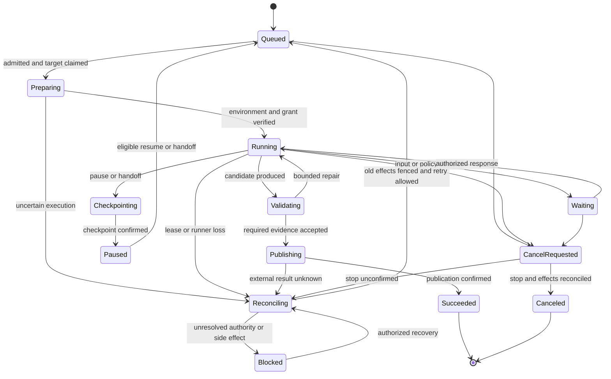

# Execution, isolation, and recovery

## E-01 — Non-negotiable invariants

1. One canonical issue has at most one active implementation run. Multiple users, agents, triggers, devices, or HTTP retries cannot bypass this constraint.
2. Every writer has a distinct checkout, branch, process group, runtime state directory, and resource allocation. Ordinary cloud-managed work never edits the user's active workspace.
3. A current lease and fencing epoch are required for shared side effects. A heartbeat is evidence of liveness, not ownership by itself.
4. A run has immutable input revisions and an attributable execution grant. Changes in instructions or requirements create explicit amendments/checkpoints, not silent prompt replacement.
5. External actions are assumed to be at-least-once delivery with possible ambiguous outcomes. Do not claim universal exactly-once execution.
6. A timeout, disconnected stream, expired lease, or canceled HTTP request does not prove that a process or vendor action stopped.
7. A second attempt is not permitted to publish until the previous writer and its in-flight actions are fenced or reconciled.
8. An issue marked complete, a successful model response, a successful run, an approved PR, a merged PR, and a deployed release are different facts.
9. Child agents inherit a subset of authority and a share of the parent's budget. Delegation cannot increase either.
10. Cleanup requires proof of ownership and recoverable evidence. Uncertainty must not trigger deletion of user files or another attempt's environment.

These guarantees apply to the managed execution path and its controlled side-effect channels. An administrator of a personal client can bypass local controls; an arbitrary program with ambient credentials can act outside Machdoch. The product must not claim hard fencing for such an environment. Managed jobs either obtain the required isolation and credential mediation or are ineligible for unattended handoff/failover.

## E-02 — Run, attempt, and issue lifecycle

The logical run owns its typed subject outcome and budget. Repository implementation binds a canonical issue; project research, maintenance and test campaigns use the same execution model without inventing issues (AU-01). An attempt owns one placement. Several attempts may occur sequentially after recovery or handoff; they remain one run. Explicit subtasks can run in parallel under that run, but each implementation shard has its own branch and reservation.

The diagram shows primary transitions. Failed and timed-out terminal outcomes are also possible from executing states after cleanup/fencing; every transition is validated by the same domain state machine. A canceled run cannot later become successful because an old worker uploads a delayed result.

`Waiting`, `Paused`, `Blocked`, `CancelRequested`, and `Reconciling` retain the explicit implementation reservation. Cancellation, failure and success remain proposed outcomes until authority and outstanding publication operations are resolved; the terminal transition and reservation release then commit atomically. A UI status string is never the lock. This intentionally favors safety over immediate availability during an ambiguous external side effect.

A normal implementation run succeeds when its specified deliverable and required evidence are durably available, often a draft PR. Human PR review can then continue without occupying a runner. A later review-fix request creates an explicitly linked continuation run, reacquires branch ownership, and verifies the current PR head. The issue remains in review until its completion policy is met.

If a run's own policy requires approval before publication, it waits within that run. If it includes merge/deployment, success requires those specific outcomes. Do not hold compute during a purely human wait; release or suspend the sandbox after a checkpoint while preserving logical ownership.

## E-03 — Transactional admission and duplicate prevention

Admission performs the following in a database transaction:

1. Authenticate the actor, resolve the canonical issue, and lock its admission record.
2. Validate organization, issue revision, project/repository access, executable scope, current policy, provider entitlement, and target constraints.
3. Look up the idempotency key. The same digest returns the original result; a different digest is a conflict.
4. Reject a competing nonterminal implementation run and return its accessible identifier. Do not reveal a private conflicting run to an unauthorized caller.
5. Reserve the run's budget and create the run, immutable manifest, command receipt, and workflow-start outbox record atomically.

Dispatch begins only after commit. A crash between commit and workflow start leaves an outbox entry that is safely retried using the run's stable workflow ID. A crash after the workflow starts but before receipt confirmation is reconciled against that same ID.

Automatic trigger decisions use source event identity plus stable automation/trigger slot identity, with the evaluated revision stored on the decision. A revision edit cannot make the same event new. Scheduled occurrences and intentional replays have distinct identities under AU-06. A new transport command ID does not bypass the per-issue constraint. Preserve admission receipts beyond queue retry and webhook replay windows; compact tombstones or rejected closed source epochs prevent old redeliveries from resurrecting work after log compaction.

When two issues are merged as duplicates, lock both canonical admission records in deterministic order. If both have active runs, merge planning records only with a recorded execution-resolution decision; do not silently select one winner and leave the other publishing.

## E-04 — Placement, claims, leases, and fencing

Placement eligibility is deterministic: organization/project grant, repository access, required OS/architecture/toolchain, sandbox policy, provider/harness capability, resource capacity, working hours, and data-egress policy. Rank only eligible targets by locality, queue delay, cost, and affinity. Persist the selection before sending a claim.

The placement protocol is:

1. Scheduler reserves a target slot and creates an attempt with epoch `n`.
2. Target receives a signed, scoped claim; persists it and returns a durable acceptance receipt.
3. Scheduler records acceptance and grants execution. Replayed claims return that receipt without spawning another process.
4. The supervisor renews a lease tied to run, attempt, target, and epoch; reports progress and event cursor separately.
5. The integration broker checks current epoch, policy, and cancellation state at each consequential operation.

Proposed operational defaults: heartbeat every 15 seconds, lease expiry after 90 seconds, local fail-closed deadline no later than 60 seconds after the last successful renewal, and 30 seconds for cooperative process termination before supervised force termination. These are configurable initial values to validate under real pauses and network latency, not existing measured guarantees.

Use server/database time for expiry and monotonic local elapsed time for the supervisor. Laptop sleep, clock rollback, and resume force revalidation before tools resume. A sandbox cannot grant itself more time. Background shell processes, browser drivers, provider-native subagents, and service processes all belong to a tracked process/job group.

Expiry marks an attempt suspect and fences its broker authority. It does not instantly unlock the issue for another publisher. Confirm termination, reconcile vendor work, and settle in-flight broker operations before a replacement receives write authority. Stale events may be retained as diagnostic evidence but cannot change authoritative state.

Where the host cannot enforce process termination or side-effect mediation, disable unattended transfer to another writer. A human may detach abandoned local work as an explicitly untrusted artifact after revoking credentials and resolving external effects; that is not a normal automatic retry.

## E-05 — Workspace isolation decision

| Situation | Required workspace approach | Why |
| --- | --- | --- |
| Trusted client, conventional single repository | Per-attempt Git worktree and unique branch from a runner-managed repository | Efficient sharing of objects while separating working files/indexes |
| Submodule-heavy repository or unsupported worktree topology | Explicit independent-clone environment profile | Avoid depending on incomplete worktree/submodule behavior |
| Cloud sandbox, untrusted repository, external contribution | Independent clone inside a per-attempt isolated environment | Separate Git metadata and operating-system authority |
| Same project on different machines | Each machine obtains its own checkout at a recorded commit | Worktrees cannot be shared over the network as a coordination mechanism |
| Non-Git artifact work | Per-attempt directory/snapshot; explicit publication contract | No claim of branch or merge guarantees |
| Hardware-bound task | Dedicated capable client/worker with device reservation | GPU, audio, USB, emulator, or licensed-tool ownership is external to Git |

Git worktrees share repository-level state and refs; the official manual also warns about incomplete submodule support. Select a supported isolation profile before launch rather than attempting a worktree and silently changing behavior when it fails. [Git worktree documentation](https://git-scm.com/docs/git-worktree).

The client uses a managed repository/cache separate from the user's checkout for unattended cloud jobs. Each attempt records canonical repository ID, base commit, managed repository root, worktree/clone root, branch, source workspace binding, and ownership marker. Never check out the same branch in two live writers.

Pin commits, image digests, lockfiles, and relevant configuration. Default to committed source. Including local dirty changes is an explicit user operation that creates a bounded, reviewed source snapshot, excluding secrets and runtime files and recording provenance. Never stash, reset, clean, or switch the user's original checkout as a scheduling convenience.

## E-06 — Isolation beyond Git

Every attempt isolates:

- Temporary files, agent session databases, memory writes, sockets, PID files, home/config directories, and provider caches that contain credentials.
- Service ports, preview hostnames, browser profiles, cookies, container names, and test databases/schemas.
- Mutable package/build caches or their writable layer. Shared caches are content-addressed, access-controlled, and protected against cross-run poisoning.
- GPU, device, emulator, deployment, and shared-environment reservations where those resources cannot be namespaced.

Repository-wide Git metadata mutations use short host-local coordination. Do not run pruning/garbage collection while active attempts depend on shared objects. Path validation accounts for symlinks, Windows junctions/UNC paths, case-insensitivity, long paths, and nested repositories. File cleanup compares resolved paths and an ownership manifest before removal.

A worktree provides file separation, not protection from a malicious process running as the same OS user. Policies distinguish an isolated VM/container execution boundary from a trusted personal-client worktree. The UI exposes that distinction only where it affects placement or authorization.

## E-07 — Cloud sandbox lifecycle

Use dedicated execution pools with VM-level isolation for untrusted code and an explicitly selected hardware-virtualization backend. Firecracker is a suitable Linux/KVM foundation where its host-hardening requirements are met. Windows pools can use QEMU/WHPX for Linux guests under the same image, broker, quota, watchdog, and cleanup requirements. Build and operate the sandbox controller, image lifecycle, networking, storage, and cleanup around the selected backend. [Firecracker](https://firecracker-microvm.github.io/), [QEMU security requirements](https://www.qemu.org/docs/master/system/security.html), [WHPX](https://www.qemu.org/docs/master/system/whpx.html).

Lifecycle: reserve resources → provision from an immutable image → attach run-scoped volumes → fetch repository at a pinned commit → execute authorized setup → validate readiness → run agent → collect evidence/checkpoint → revoke credentials → terminate → retain or remove owned resources under policy.

Required controls include non-root execution where possible, host isolation, patched guest/host images, no host Docker socket, no control-plane mounts, CPU/RAM/PID/disk/IO/network limits, controlled DNS/egress, and blocked cloud metadata endpoints. Builds and dependency installation are untrusted code too and execute inside the boundary.

Setup-only secrets are issued separately from task credentials and removed before snapshots/warm images. General egress is denied unless the profile permits it. Private package mirrors and internal services use explicit grants; a repository cannot widen its own network policy by changing a file.

Maintain reusable environment builds, image scanning, build logs, and prewarmed capacity. Warm images must contain no run/customer data or active credentials. Snapshot reuse is scoped by trust/organization and invalidated on security updates.

If the selected backend's hardware virtualization is unavailable, that pool reports unavailable until an appropriate runner is attached. Do not silently switch to CPU emulation, privileged containers, or host-process execution. Native Windows/macOS and GPU workloads use explicitly capable worker/client pools; a Linux guest does not provide those capabilities merely because its host has them.

Previews use unique authenticated origins, isolated cookies, a revocable run grant, and bounded HTTP/WebSocket proxying. Never serve generated HTML, repository content, or arbitrary preview JavaScript on the application's authenticated origin.

## E-08 — Agent steps and bounded parallelism

Represent implementation as steps with explicit inputs, outputs, dependency edges, and acceptance evidence: investigate, plan, implement, validate, review, publish. Tasks may skip unnecessary steps through a declared workflow, but cannot skip required verification or authority checks.

Parallelize independent research, isolated implementation shards, and review. Dependent code changes use stacked branches/PRs or a deliberate integration step. Do not let multiple agents directly edit one checkout and rely on chat coordination to prevent corruption.

The parent supplies each child a subtask contract: goal, allowed repository paths/tools, base commit, output format, evidence requirements, instruction digest, deadline, budget, and maximum descendants. Child scopes can narrow, never expand. A completed child contributes a candidate result; the parent cannot treat an absent or unverified result as success.

Cap parallelism at run, project, runner pool, provider, and organization levels. Waiting parents release scarce compute slots before waiting for child slots. Integration uses a dedicated candidate checkout and verifies the combined result; individually passing patches can still conflict semantically.

Research supports bounded multi-agent decomposition, but does not establish that more agents always improve outcomes. Treat specialist activation and alternative-candidate exploration as measured policies, not mandatory fan-out. [MAST failure taxonomy](https://arxiv.org/abs/2503.13657).

## E-09 — Checkpoints and handoffs

A checkpoint is an immutable manifest whose components refer to one consistent boundary:

| Component | Required content |
| --- | --- |
| Source | Repository/base/head commits, staged/unstaged patch if any, permitted untracked artifacts, checksums |
| Execution context | Goal, accepted requirements, completed/pending steps, explicit decisions, open questions, tool observations, event cursor |
| Environment | Image/toolchain/configuration revisions, dependency state or reproducible setup, services and restoration instructions |
| Authority | Policy and instruction digest, actor chain, spent/reserved budget, epoch; credential references only |
| Evidence | Commands/checks, outcomes, logs, screenshots where relevant, artifact hashes, known failures |
| External work | PR/branch identifiers, provider session IDs, outstanding side-effect receipts, unresolved operations |

Publish the checkpoint manifest only after all referenced data is durable. Drain or explicitly suspend tools before capture. A filesystem snapshot taken while a tool continues writing is not a consistent checkpoint. Reissue secrets after restore; do not store provider tokens or live browser sessions in portable bundles.

The recent SPROUT work pairs execution state and agent context at settled tool boundaries. Its filesystem-restoration design assumes synchronous tools without background processes. Machdoch supports services and browsers, so it must also stop/checkpoint/recreate those resources and cannot claim that copying the checkout reproduces a running machine. [SPROUT, October 9, 2026](https://arxiv.org/html/2610.14405v1).

Handoff protocol:

1. Record the authorized target and reason. Validate its policy, resources, provider, repository access, and data destination before interrupting useful work.
2. Stop new source-side actions, settle in-flight tools and broker operations, and publish a consistent checkpoint.
3. Fence the old attempt, confirm process/vendor termination or an enforceable external-effect boundary, and record handoff readiness.
4. Claim the destination with a new epoch, restore source/context/environment, validate hashes and prerequisites, and reissue scoped credentials.
5. Resume from the declared boundary and preserve the complete attempt chain. Release source resources only after the durable handoff contract is satisfied.

A handoff that fails before fencing can remain paused at the source. One that fails after fencing remains paused and retries destination provisioning without reactivating the old epoch. Do not ping-pong between targets automatically.

A provider's native session may be resumable only in its original harness/account/environment. Cross-provider or cross-OS transfer uses the portable checkpoint and a new provider session, reruns relevant checks, and records any lost capabilities. Do not promise transfer of private model reasoning, open processes, or vendor-internal state.

## E-10 — Publication and external side effects

All managed writes to GitHub, shared branches, deployment targets, and privileged connectors pass through a broker with current authorization. Agents can prepare local commits and requests; they do not receive an organization-wide write token.

Before a publish action, reserve the canonical repository/ref, verify the current attempt epoch, expected upstream SHA, approved diff and evidence, current policy, and absence of an unresolved action for the same target. Persist the intent before making the external request.

Where the provider offers idempotency or conditional updates, use them. Otherwise use stable action identifiers in metadata, deterministic branch/PR associations, and authoritative lookup before retry. A GitHub timeout after PR creation must reconcile that PR instead of blindly opening another.

Fencing cannot retract an HTTP request already accepted by an external provider. Therefore an in-flight action retains its resource reservation until reconciled. Changing epochs must not let a successor race it. If the external service cannot prove the outcome, show `action outcome unknown`, preserve the issue reservation, and escalate for a bounded recovery decision.

Only the designated integration step updates the canonical candidate branch. Use conditional ref updates and verify the final head. Never force-push another user's branch or overwrite the default branch to resolve conflicts. Changes in upstream content or review decisions invalidate stale evidence as appropriate.

Untrusted forks and modified CI workflow files do not receive privileged CI secrets. Publication does not grant permission to run privileged repository automation; GitHub's trust and protection rules remain authoritative.

## E-11 — Validation, review, and completion

Define required evidence before implementation, using repository configuration plus issue acceptance criteria. Evidence includes exact commands, environment, source SHA, exit status, output digest, timestamps, and artifact references. Tests edited by the implementing agent are visible in review.

Checks run in a clean validation environment where required, especially before merge. Use targeted checks during iteration and the repository's required checks before publication/merge. Browser changes require an interaction-level check when a suitable browser target exists. Failure to run a required check is a blocked result, not a pass.

The [remote-testing contract](remote-testing.md) defines required matrix/shard coverage, platform evidence, isolated accounts/data, live inspection, repair limits and environment cleanup. Test campaigns bind a candidate manifest; missing or stale shard results cannot satisfy the run's acceptance criteria.

Protect acceptance checks from being trivially deleted, skipped, or redefined by the candidate under review. Keep an independently managed test/evaluation layer for agent performance and high-risk automation. Review policy may require a separate reviewer; using a different model alone does not establish independence or correctness.

Completion carries what changed, verified outcomes, unverified requirements, remaining risks, cost, and relevant links. The final result is backed by stored artifacts rather than a transient final chat message. Human rejection, failed deployment, or later regressions remain linked to that result and inform future evaluations.

## E-12 — Timeouts, retries, cancellation, and livelock

Different deadlines serve different purposes:

| Deadline | Required behavior |
| --- | --- |
| Queue admission/start | Expire or notify when no eligible capacity appears; do not quietly change target policy |
| Provision/setup | Stop failed preparation, retain diagnostics, reap owned partial resources |
| Tool/provider request | Classify safe retry, unsafe retry, and unknown outcome |
| Progress | Distinguish legitimate long computation from repeated ineffective work |
| Run active/wall time | Enforce both actual computation budget and elapsed calendar limit |
| Human wait | Notify/escalate, checkpoint and release compute, then expire under configured policy |
| Cancellation | Graceful stop → forced process-group termination → external-effect reconciliation |
| Artifact/cleanup | Retry independently and expose residual resources; never erase execution failure history |

Initial policy defaults proposed for validation: setup 15 minutes, queue wait 24 hours, implementation active time 2 hours, and total wall time 24 hours from admission. Every phase uses the earlier of its own deadline and the total wall deadline; waiting/paused time counts toward wall time but not active computation. A policy permitting a seven-day human wait must explicitly extend the total wall deadline to accommodate it. Longer multi-day work is supported through explicit project/run policies and checkpointed continuation. Per-step timeouts must fit the selected workflow; do not impose a universal short shell timeout on legitimate builds.

Retry only classified transient failures with exponential backoff, jitter, a finite attempt count, and remaining-budget checks. Invalid credentials, missing permission, unsupported capability, deterministic setup errors, and policy denials require correction. A provider change requires an explicit routing/handoff policy, never an undocumented retry behavior.

Detect livelock using repeated tool errors, unchanged candidate hashes, repeated failed checks, cyclic plans, and exhausted repair budgets. Preserve diagnostics and request a new decision when progress stalls. Output verbosity and heartbeat traffic are not progress.

Cancellation is durable and idempotent. It stops children, services, provider work, future retries, and queued publication. Already committed external actions remain visible; compensating actions require their own authorization. UI state stays canceling/reconciling until the actual stop boundary is known.

## E-13 — Deadlock prevention and fairness

Declare resource reservations: issue writer, repository/ref, environment, shared deployment, hardware, provider slot, and budget. Acquire short database locks in a canonical sorted order; never hold them across network calls or human waits.

Use expiring durable reservations for long work, not open database transactions. Construct subtask/dependency graphs and reject cycles before dispatch; detect new cycles when links change. An agent cannot wait on a child that is waiting for a slot or resource the parent can release.

Schedule fairly across projects and organizations with per-user/team quotas, aging, bounded priorities, and separate interactive/recovery capacity. Avoid starvation from one project's thousands of subtasks. Document the resource holder and wait reason so an operator can diagnose blockage without guessing.

Reapers are idempotent workflows. They confirm lease/epoch and ownership before removing a checkout, branch, snapshot, port grant, or sandbox. Failed cleanup creates a visible operational item with storage cost; cleanup does not change a failed run into success.

## E-14 — Automation and offline behavior

Automations use the same admission path as humans and MCP. Persist causation IDs and prevent self-trigger loops, repeated incident storms, and duplicate CI repairs. Workflow revisions, trigger snapshots, schedule timezone, DST interpretation, catch-up policy, and maximum fan-out are explicit.

[AU-01–AU-14](automation.md) define the normative recurring/event workflow contract: one scheduling authority, canonical recurrence, durable ingress and trigger receipts, independent misfire/overlap policy, per-subject trigger state, scoped replay, bounded action graphs and current-interpreter upgrades. Temporal owns durable sequencing; RALPH and the runner cannot independently retry the same lifecycle.

During a cloud outage, clients may continue independent local work. Cloud-managed jobs stop new shared side effects when their lease authority expires and checkpoint as their supervisor permits. Reconnect reconciles inventory before issuing new work. A user can explicitly detach work into a local private task, but it cannot continue publishing as the former cloud attempt.

Support offline reading/drafts under the user's data policy. Queue only explicitly safe edits with revision checks; do not queue hidden run starts, merges, or expired approvals for surprise execution after reconnect.

## E-15 — Failure matrix

| Failure or edge case | Required response and evidence |
| --- | --- |
| Two users, MCP, and automation start the same issue | One admitted implementation run; other requests link to it or conflict. |
| Queue delivers a claim twice | One persisted attempt and process group; replayed receipt. |
| Manager crashes between DB commit and dispatch | Outbox restarts the same workflow identity. |
| Client accepted work but acknowledgment was lost | Query/replay the same claim; no alternate placement until reconciled. |
| Client sleeps, clock changes, or VPN disconnects | Monotonic watchdog, expired authority, revalidation on resume. |
| Old runner returns after a new epoch exists | Retain diagnostics; reject writes and authoritative state transitions. |
| Worker dies during setup | Discover partial sandbox/checkout by owned ID; retain setup logs and clean safely. |
| Provider keeps working after local cancellation | Poll/cancel vendor session; suppress publication; retain unknown state if not confirmable. |
| Network times out after creating a PR | Find the external result through action identity; do not duplicate publication. |
| User edits the original local checkout | Managed attempt remains isolated; no reset/stash/overwrite of user work. |
| Two tickets change the same API or schema | Independent branches plus combined integration checks; semantic conflicts block merge. |
| Test database/port/cache collides | Per-attempt namespacing or explicit exclusive resource reservation. |
| Repository renamed, moved, deleted, or access revoked | Resolve canonical identity; pause/reject, revoke tokens, and relink only through authorized action. |
| Git submodules, LFS, sparse checkout, huge repository | Use a declared supported profile, explicit fetch budgets and source manifests. |
| Fork PR changes workflows or setup scripts | Treat setup as untrusted; keep privileged tokens and CI secrets outside it. |
| User or service principal is deprovisioned mid-run | Re-evaluate execution grant; stop or transfer authority explicitly. |
| Agent rewrites tests to pass | Independent acceptance layer and diff review; no self-certified completion. |
| Approval arrives for an outdated diff | Reject stale approval; require current head/revision. |
| Costs arrive late or provider streams usage incompletely | Reserve conservatively; retain estimated/unknown versus reconciled usage. |
| Budget exhausted while children execute | Stop new children/calls, cancel or checkpoint running work under policy. |
| Workflow triggers itself through a status/comment | Causation/recursion guard and deduplicated trigger identity. |
| DST, missed schedules, duplicate scheduler leadership | Durable schedule identity and explicit bounded catch-up. |
| Parent/child or resource dependency cycle | Reject or surface deadlock with holders; release eligible reservations. |
| Partial cross-repository implementation | Track required PR set; no fictitious atomic merge across repositories. |
| Artifact storage full or checkpoint upload interrupted | No confirmed checkpoint until manifest references are durable; stop safely. |
| Database restored while workers still have old leases | New installation recovery epoch; old leases/tokens rejected before work resumes. |
| Gateway flooded by logs/previews | Bounded data streams and reserved control capacity preserve cancel/lease processing. |
| Cleanup finds a changed path/ownership marker | Quarantine cleanup; preserve data and report the discrepancy. |
| Document/issue changes during a long run | Pin original revision; require explicit amendment and impact review. |
| Private issue moved into a less-restricted project | Re-evaluate linked artifacts/comments/notifications; do not widen access silently. |
| Human takes over a browser/terminal | Agent relinquishes the control grant; no simultaneous input race. |
| Remote target is unsuitable for the task's OS/GPU | Explain unavailable placement; never pretend equivalent hardware exists. |

The [delivery scenarios](delivery.md) turn these requirements into executable acceptance campaigns, including injected failures and real client/provider runs.
