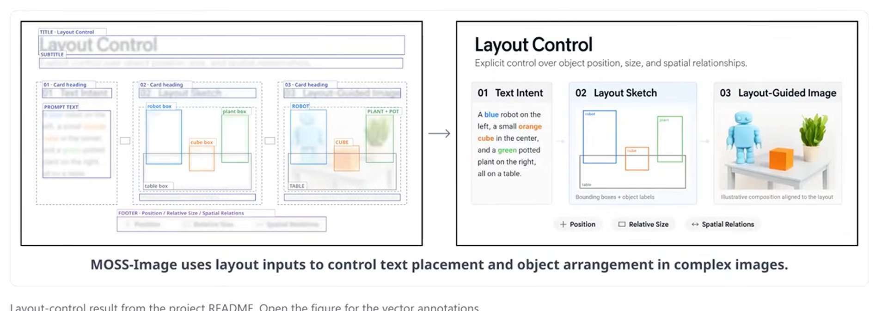
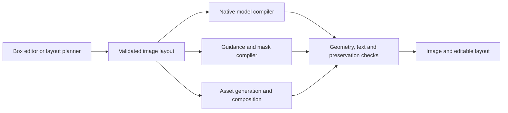

# Layout control in Machdoch

Research date: 2026-10-18. This is an implementation investigation, not a shipped feature or an inference benchmark. Vendor documentation, public inference code, and Machdoch's current source were examined. Recommendations and proposed behavior below are engineering conclusions; they have not been demonstrated with image-generation runs.

## Recommendation

Build one editable image-layout document and compile it into the input accepted by the selected execution method. Start with **Ideogram 4**, which already has a Machdoch runtime profile and documented native box conditioning. Add **MOSS-Image Base/SFT** as a permissively licensed native option. Evaluate **FLUX 3 Image Klein** for local generation and editing, and the **FLUX 3 Image API** for hosted operation. All three families have explicit layout formats; these formats are different. [Ideogram prompting](https://github.com/ideogram-oss/ideogram4/blob/main/docs/prompting.md), [MOSS guide](https://github.com/OpenMOSS/MOSS-Image/blob/main/USERGUIDE.md), [FLUX box API guide](https://docs.bfl.ai/flux_3/flux3_image_bounding_boxes).

Offer virtual support through two explicit methods:

1. **Guided generation:** compile the layout into a composition image, per-region prompts/masks, or sequential edits, according to the actual model adapter's capabilities. This aims for coherent photographs and illustrations, with approximate geometry.
2. **Composition:** generate individual assets, cut them out, place them ourselves, and render text and vector elements ourselves. This provides controlled placement and editable typography across a much wider range of generators, with tradeoffs in lighting, interactions, and realism.

An LLM can plan the layout, but a planner alone does not make an image model obey boxes. The strongest product combines native conditioning or guided generation with deterministic assembly and measured verification. LayoutGPT and LLM-grounded Diffusion establish the distinction between planning and rendering. [LayoutGPT](https://arxiv.org/abs/2305.15393), [LMD](https://github.com/TonyLianLong/LLM-groundedDiffusion).

## What the supplied image establishes

The screenshot contains two related layout problems: the entire infographic, including headings, cards, arrows, body copy and footer; and the smaller robot/cube/plant/table scene inside it. A good implementation needs to address both. The illustration is linked from the official MOSS README to an annotated SVG; it is an example of a generated result, not an independent accuracy evaluation. [Original figure and README](https://github.com/OpenMOSS/MOSS-Image#layout-generation), [annotated SVG](https://github.com/OpenMOSS/MOSS-Image/blob/main/assets/showcase/layout-bboxes.svg).

For the complete infographic, deterministic card geometry and text rendering are especially valuable. Generate the photographic/illustrative asset inside its card, then assemble the page. For the physical scene, joint generation is more likely to preserve shared lighting, shadows, depth, and contact between objects. These are different rendering decisions using the same layout document.

The accompanying [example scene](artifacts/layout-control-2026-10-18/scene.json) reconstructs the small scene conceptually on a 1024×768 canvas. Its coordinates are illustrative, not measurements recovered from the screenshot or MOSS's original generation inputs. It introduces no extra visible text.

## What counts as support

| Method | What reaches the generator | Control that can reasonably be promised |
| --- | --- | --- |
| Native learned layout | The model's documented structured caption with element boxes | Model understands box semantics; placement and spelling still require checking |
| Trained controller | Additional grounding/region weights plus matching pipeline | Explicit spatial conditioning for the supported backbone/checkpoint |
| Regional inference | Region prompts, masks, and changes to attention or denoising | Spatially restricted conditioning; visible objects may still spill, disappear, or merge |
| Reference guidance | A rendered composition, sketch, silhouette/depth map, or initial image | Approximate composition; depends on reference/edit/ControlNet support |
| Sequential masked editing | A base image plus one edit region at a time | Local changes; exact preservation requires restoring pixels ourselves or a documented restoration mechanism |
| Deterministic composition | Generated/existing assets transformed and assembled by Machdoch | Exact layer transforms, clipping, page geometry, and text from supported fonts |
| Prompt-only approximation | Prose describing left/right, scale, count, and relations | Best-effort instruction following; no box-conditioning guarantee |

Do not describe all of these with one Boolean `supportsLayout`. Also distinguish a generator's published capabilities, a library implementation, Machdoch's adapter, installed model availability, and a verified run. None implies all the others.

## Models with documented native support

| Model | Interface and coordinates | Machdoch status | Assessment |
| --- | --- | --- | --- |
| Ideogram 4, including NF4 | Structured JSON string; `compositional_deconstruction.elements`, `type`, `bbox`, `desc`, optional literal `text`; normalized 0–1000 **yxyx** | `ideogram-4` profile and `Ideogram4Pipeline` loading path exist; no layout editor/compiler or layout verification | Smallest initial integration candidate; weight access and intended use require the applicable license |
| MOSS-Image Base | JSON string in the normal prompt; `summary` and `items`; centered absolute pixel **yxyx** | No MOSS architecture/profile/loader found | Straightforward format adapter; new local model integration required |
| MOSS-Image SFT | Same layout interface and pipeline as Base | Not integrated | Evaluate alongside Base rather than assume fine-tuning improves every layout |
| FLUX 3 Image | Caption with `<element_id>` references followed by JSON rows containing `id`, `bbox`, `desc`; API boxes use normalized 0–1000 **yxyx** | No BFL image provider or FLUX 3 profile found in the inspected paths | Strong hosted native generation/edit candidate |
| FLUX 3 Image Klein / Base | Local reference and Diffusers `boxes` inputs use normalized 0–1 **yxyx**; compiled captions use the model's 0–1000 representation | Not integrated; existing `flux-2` support does not cover this family | Strong local candidate, but requires a distinct runtime adapter |

Sources: [Ideogram schema and format](https://github.com/ideogram-oss/ideogram4/blob/main/docs/prompting.md), [MOSS Base guide](https://github.com/OpenMOSS/MOSS-Image/blob/main/USERGUIDE.md), [MOSS SFT card](https://huggingface.co/OpenMOSS-Team/MOSS-Image-SFT), [FLUX API boxes](https://docs.bfl.ai/flux_3/flux3_image_bounding_boxes), [FLUX reference implementation](https://github.com/black-forest-labs/flux-3-image-klein), [Diffusers FLUX 3 pipeline](https://github.com/huggingface/diffusers/blob/main/docs/source/en/api/pipelines/flux3.md).

### Ideogram 4: the existing integration opportunity

The model was trained with structured captions and explicit boxes. Preserve its field ordering, including within `style_description` and object/text entries; use its published `CaptionVerifier` during adapter development. Text entries separate literal text from its visual description. This should be a real schema compiler, not an LLM asked to improvise a compatible JSON shape. [Prompt schema](https://github.com/ideogram-oss/ideogram4/blob/main/docs/prompting.md), [verifier](https://github.com/ideogram-oss/ideogram4/blob/main/src/ideogram4/caption_verifier.py).

The vendor advises modest element counts for best quality and explicitly describes boxes as guides rather than pixel-perfect crops. Dense page layouts should also be tested as separately generated panels plus deterministic assembly. Published benchmark numbers are not Machdoch measurements. [Ideogram guide](https://ideogram.ai/blog/ideogram-4-json-prompting/).

Machdoch currently sends `effective_prompt` to this pipeline without an Ideogram-specific layout transformation. Consequently, a well-formed native JSON prompt is a plausible immediate manual experiment through the existing text prompt path, subject to the 8,000-character worker limit. This is a source-based conclusion, not a successful live layout run. Automatic natural-language enhancement must not rewrite already compiled layouts.

### MOSS: native prompting is learned behavior

The inspected public `encode_prompt` tokenizes the provided string and obtains text-encoder hidden states; the generation call exposes no separate boxes tensor, reference-image input, or layout solver. Its JSON layout format is therefore a learned prompt interface. The model can have native layout ability even though boxes travel as text. Sending the same JSON to an unrelated model does not reproduce that learned ability. [Public pipeline](https://huggingface.co/OpenMOSS-Team/MOSS-Image-Base/blob/main/pipeline_moss_image.py).

Base's layout feature is described as experimental. The guide recommends dimensions divisible by 16, roughly 1–2 million pixels, at least 50 steps, CFG 3 and shift 5. For a pixel box `[x0,y0,x1,y1]`, compile `[y0-H/2,x0-W/2,y1-H/2,x1-W/2]`. Keep the generation dimensions equal to the layout canvas. [MOSS guide](https://github.com/OpenMOSS/MOSS-Image/blob/main/USERGUIDE.md).

Changing a layout and regenerating is not evidence of bitmap-preserving editing. The inspected pipeline does not take the original image. Preserve unchanged pixels with an actual editing adapter or compositing rather than promise continuity from a repeated seed.

### FLUX 3: separate API and local contracts

FLUX 3 Image Klein was released on October 15, 2026, with base and distilled checkpoints. BFL's reference implementation lists 50 steps/CFG 4 for Base and 16 steps/no CFG for distilled. The Diffusers implementation uses a modular pipeline and documents different recommended base guidance. Use the chosen implementation's pinned settings rather than combine defaults across implementations. [Release](https://bfl.ai/blog/flux-3-image-klein), [reference code](https://github.com/black-forest-labs/flux-3-image-klein), [Diffusers implementation](https://github.com/huggingface/diffusers/blob/main/docs/source/en/api/pipelines/flux3.md).

Hosted layout rows are embedded in `prompt`. Editing adds source and target boxes, allowing keep, move, new/replacement and removal operations. The local implementation exposes floating-point normalized boxes and uses `"target"` for a newly created element; API examples use `null` in that position. These require explicit adapter translation. [API examples](https://docs.bfl.ai/api-reference/utility/generate-an-image-with-flux-3-klein), [local reference README](https://github.com/black-forest-labs/flux-3-image-klein#prompting).

BFL documents preservation behavior, and the API includes pixel restoration. Do not assume that a raw local checkpoint automatically reproduces the service's restoration behavior. For local editing, measure changes outside the editable region and restore source pixels where required. [Klein release and API behavior](https://bfl.ai/blog/flux-3-image-klein).

## Controllers and related models

| Candidate | Evidence and useful scope | Integration implication |
| --- | --- | --- |
| GLIGEN | Trained grounding layers accept phrases and boxes; original released checkpoints are based on SD1.4 | A specific grounded pipeline/checkpoint, not a generic flag for every Stable Diffusion model; mature research baseline [repository](https://github.com/gligen/GLIGEN) |
| MIGC / MIGC++ | Multi-instance control with published SD-family controller checkpoints, including SDXL | Evaluate exact checkpoint/backbone pairs and adapters; training-based addition [repository](https://github.com/limuloo/MIGC) |
| InstanceDiffusion | Instance prompts plus boxes, points, scribbles, or masks | Dedicated instance-controlled checkpoint/pipeline; not arbitrary model support [repository](https://github.com/frank-xwang/InstanceDiffusion) |
| Regional-Prompting-FLUX | Training-free regional attention for FLUX.1 | Closest inference-only approach to extending an existing local FLUX generator; original implementation pins an old Diffusers commit [repository](https://github.com/instantX-research/Regional-Prompting-FLUX) |
| EliGen | Regional attention plus entity annotations and LoRA training on FLUX.1-dev | More than a normal LoRA load: matching regional inputs and implementation are required [publisher card](https://huggingface.co/modelscope/EliGen) |
| ControlNet | Trained spatial conditioning using compatible maps/checkpoints | Boxes must become meaningful conditioning signals; a rectangle outline is not an object silhouette [paper](https://arxiv.org/abs/2302.05543) |
| AnyText2 | Text generation/editing with controllable visual attributes and placement | Useful for text embedded in natural scenes; separate model integration, not a universal typography switch [repository](https://github.com/tyxsspa/AnyText2) |
| LayoutDiffusion | Dedicated layout-to-image architecture | Research comparator; does not directly extend the current general-purpose engines [repository](https://github.com/ZGCTroy/LayoutDiffusion) |
| Ideogram 4.5 Precise Edit | Documented masks and pixel-coordinate `context_window` for localized editing | Hosted regional-edit candidate; this evidence alone does not establish the same native generation schema as Ideogram 4 [API](https://developer.ideogram.ai/api-reference/images/precise-edit/ideogram-4-5) |

### What should not be advertised as native box support

FLUX.2's official structured prompting uses descriptions and semantic positions. That is useful, but it is insufficient evidence of the explicit FLUX 3 box contract. [FLUX.2 guide](https://docs.bfl.ai/guides/prompting_guide_flux2).

GPT Image supports image editing and masks, but its documentation still identifies precise composition as a limitation. No native object-box generation contract was established in the inspected documentation. Machdoch's OpenAI edit adapter uploads references but currently does not send a mask. [OpenAI guide](https://developers.openai.com/api/docs/guides/image-generation), [current adapter](../apps/client/src-tauri/src/media/provider_openai.rs#L98).

Gemini image generation supports sketch/image-guided generation. Treat this as visual guidance until an explicit supported box-generation contract is verified. A vision model returning detection boxes is a separate capability from an image generator accepting layout boxes. [Gemini generation](https://ai.google.dev/gemini-api/docs/image-generation), [image understanding](https://ai.google.dev/gemini-api/docs/image-understanding).

For Qwen, GLM-Image, Krea, HiDream, SANA, Z-Image, Anima and SD-family base engines, this investigation does not establish a universal native box schema. Qwen image editing and compatible ControlNet pipelines provide additional paths, but family names are insufficient to establish weight compatibility across generations. In particular, Qwen-Image ControlNet support does not establish compatibility with Qwen-Image 2.1. [Qwen pipelines](https://huggingface.co/docs/diffusers/main/api/pipelines/qwenimage), [Z-Image Turbo controller](https://huggingface.co/alibaba-pai/Z-Image-Turbo-Fun-Controlnet-Union-2.1).

## Current Machdoch coverage

The [machine-readable matrix](artifacts/layout-control-2026-10-18/model-support-matrix.json) contains every image-generation/edit profile in `open_media_models.json`, the additional inspected built-in image architectures and provider entries, and the proposed native additions. Its proposed routes are research assessments, not enabled runtime capabilities. Each row records its current source-declared capabilities separately.

| Current family or profile group | What Machdoch currently exposes in the inspected source | Proposed virtual route |
| --- | --- | --- |
| Ideogram 4 NF4 | Text-to-image profile | Compile native JSON; compose exact page text afterwards |
| SD1 / SD2 / SDXL / Pony imported base architectures | Image/reference editing and masked paths; IP-Adapter roles vary | Sequential masks, composition guidance and assembly; regional attention is additional work |
| Illustrious, NoobAI, Juggernaut, RealVis, DreamShaper XL | Individual profiles declare text-to-image | Asset generation and assembly first; explicitly qualify any later edit/controller support per profile |
| SD-Turbo, SDXL Turbo, SDXL DMAD 1/4-step | Text-to-image profiles with specific sampling behavior | Asset generation and assembly; validate distilled regional methods separately |
| SD3 import / SD3.5 Large Turbo | Base architecture / text-to-image profile | Assembly initially; compatible controller integration needs its own validation |
| FLUX.1 imported base architecture | Composition reference and masked edit paths | Guided/sequential editing; optional regional attention port |
| FLUX.1 dev / schnell named profiles | Profiles currently declare text-to-image | Assembly initially; do not inherit base-architecture edit readiness automatically |
| FLUX.2 klein 4B built-in | Composition/reference and masked edit paths | Composition reference, sequential edits and assembly |
| FLUX.2 klein Base 4B / 9B / Base 9B / dev named profiles | Text-to-image and multi-reference edit capabilities | Composition images plus assembly; test masks per exact profile |
| Qwen-Image / 2512 | Text-to-image profiles | Assembly; optional matching ControlNet integration |
| Qwen Edit 2511 / Qwen 2.1 / Qwen 2.1 Turbo | Reference/edit routes; no current worker native-mask entry for these profiles | Image-guided composition, assembly; add a tested mask adapter separately |
| Krea 2 imported base architecture | Reference and masked latent-edit paths | Guided/sequential edits; source existence is not independent quality evidence |
| Krea 2 Raw / Turbo named profiles | Text-to-image profiles | Assembly initially |
| GLM-Image | Text-to-image plus multi-reference edits | Image-guided composition and assembly |
| Z-Image Base/Turbo, SANA/Sprint, HiDream-I1, HunyuanImage 3, Anima | Text-to-image profiles | Generate assets and assemble; add architecture-specific control only after validation |
| GPT Image 2.5 Sunburst | Hosted generation and reference editing adapter | Composition-image guidance and assembly; mask upload needs implementation |
| Codex CLI image generation | Current catalog declares text-to-image only | Prompt approximation or separately generated assets plus assembly; do not infer editing from the underlying service |

An imported user model also needs its actual architecture, adapter, installed weights, and license checked. The matrix covers the inspected source catalog, not an inventory of models installed on this machine. SVG-only, video, audio, and utility models are outside this image-generator matrix.

## Reuse and gaps in the codebase

| Existing code | Relevant finding | Required change |
| --- | --- | --- |
| [contracts](../packages/media-studio/src/core/media/contracts.ts#L47) | `MediaCapability` has reference/mask/pose concepts but no image-layout capability | Add a typed layout document and method-specific capability descriptor |
| [flow layout](../packages/media-studio/src/core/media/contracts.ts#L380) | `MediaFlowLayout` means graph-node/editor positions | Keep image scene geometry in a distinct `MediaImageLayout` type |
| [node registry](../packages/media-studio/src/core/media/node-registry.ts), [workflow nodes](../packages/media-studio/src/core/media/workflow-nodes.ts) | Masks, ControlNet, segmentation and visual checks exist | Add a layout source/port and connect it to generation/editing |
| [reference capabilities](../packages/media-studio/src/core/media/reference-conditioning.ts#L21) | Existing composition role differs by engine | Reuse real capability decisions rather than accept all guidance images |
| [model profiles](../apps/client/src-tauri/python/open_media_models.json), [loader](../apps/client/src-tauri/python/media_open_models.py#L14) | Ideogram exists; MOSS/FLUX 3 do not; ordinary profiles load standard pipelines | Add explicit model packages and loaders for new families |
| [worker](../apps/client/src-tauri/python/media_diffusers_worker.py#L2661) | Prompt limit is 8,000 characters; native mask architecture list is restricted | Carry structured layout separately and enforce adapter-specific token budgets |
| [ControlNet worker path](../apps/client/src-tauri/python/media_diffusers_worker.py#L2767) | Canny/Depth is restricted to `stable-diffusion-1`; pose accepts a few SD families | New model/controller pairs require actual loading and inference changes |
| [Rust local adapter](../apps/client/src-tauri/src/media/provider_local_diffusers.rs#L1344) | Runnable reference and inpainting IDs are computed separately | Layout readiness must depend on the selected adapter and installed components |
| [composite node](../packages/media-studio/src/core/media/node-registry.ts#L2237) | Current foreground is fitted and centered over the whole canvas | Extend to explicit destination boxes, placement order and clipping |
| [text overlay](../apps/client/src-tauri/src/media/transform.rs#L202) | Five anchors, bitmap glyphs, limited character coverage | Add explicit text regions and proper font shaping/rendering for exact page design |
| [visual review](../apps/client/src-tauri/src/media/workflow_visual.rs) | Pass/fail/unknown criteria assessments exist | Add measurable object matching, geometry and OCR evidence |
| [mask/pose UI](../packages/media-studio/src/tauri/ui/media/components/media-image-mask-editor.tsx), [pose workspace](../packages/media-studio/src/tauri/ui/media/components/media-pose-workspace.tsx) | Relevant canvas interactions already exist | Reuse interaction conventions for box editing without confusing the graph canvas |

Machdoch pins Diffusers to `4295ee3ec58efa6577bc459e9b84ca3f63aa9a96`, dated September 24, 2026. The expected FLUX 3 modular-pipeline module path at that revision returned HTTP 404 during inspection. Current upstream documentation is not evidence that the pinned runtime can load it. [Pinned requirements](../apps/client/src-tauri/python/media_diffusers_requirements.txt#L1), [upstream revision](https://github.com/huggingface/diffusers/commit/4295ee3ec58efa6577bc459e9b84ca3f63aa9a96).

MOSS's documented quick start uses custom pipeline code. Machdoch's ordinary local loader uses `trust_remote_code=False`, so simply adding a model name is insufficient. Integrate a reviewed, pinned implementation with the necessary notices, or a tested upstream implementation; do not enable unrestricted remote-code loading globally. FLUX 3 needs a modular-pipeline adapter for component loading, guidance, callbacks and returned output state. [MOSS pipeline](https://huggingface.co/OpenMOSS-Team/MOSS-Image-Base/blob/main/pipeline_moss_image.py), [FLUX modular API](https://github.com/huggingface/diffusers/blob/main/docs/source/en/api/pipelines/flux3.md).

## Proposed shared layout contract

Use a flat list of objects and text regions with a defined canvas, stable IDs, appearance descriptions, top-left pixel `xyxy` boxes, and explicit compositing order. Add literal text only to text entries. Asset references and edit-source/target boxes should be typed optional data when those workflows are introduced. Keep relations in a separate list when the user actually specifies them; never silently move user boxes to satisfy a planner's interpretation.

Why pixel coordinates: they make exact page assembly and editing easy to review. Native adapters can normalize or recenter them. Resolution changes must use an explicit scale/anchor rule applied to every element and mask; changing the canvas dimensions alone must not silently change the layout's meaning.

| Destination | Conversion from canonical `[x0,y0,x1,y1]`, canvas `W,H` |
| --- | --- |
| MOSS | `[y0-H/2, x0-W/2, y1-H/2, x1-W/2]`, centered absolute pixels |
| Ideogram 4 | `round([1000*y0/H, 1000*x0/W, 1000*y1/H, 1000*x1/W])` |
| FLUX 3 API prompt rows | Same normalized 0–1000 **yxyx**, with FLUX IDs/descriptions |
| FLUX 3 local `boxes` | `[y0/H, x0/W, y1/H, x1/W]` |
| GLIGEN | Normalized `[x0/W,y0/H,x1/W,y1/H]`; different axis order [Diffusers API](https://huggingface.co/docs/diffusers/v0.29.2/api/pipelines/stable_diffusion/gligen) |
| Masks/compositor | Rasterize/place using the original pixel boxes at the declared canvas size |

Validate finite coordinates, positive area, canvas bounds, unique IDs, text requirements and supported fields at the boundary. Overlap is valid: the table and objects in the example intentionally overlap. Rounding can collapse tiny normalized boxes; reject such requests or require an explicit user adjustment. Avoid applying an alphabetical JSON canonicalizer to Ideogram's model-facing prompt, where documented key order matters.

Store the immutable layout and digest with the execution method, model revision, actual compiled prompt, generated guidance/masks, seeds and output geometry. A retry should use that same layout; an LLM may revise descriptions but must not rewrite user IDs, boxes or literal text without an explicit edit.

## How virtual support can work

### 1. Layout-to-reference guidance

Render a clean scene proxy from the layout: approximate shapes, subject cutouts or a rough scene composition with the intended scale and occlusion. Send it as a composition reference or edit source to a model that actually accepts images. Keep the editor's labels, selection handles and bounding-box outlines out of the conditioning image; otherwise they can appear in the result. A labeled diagram can be a separately identified reference only for a model tested to interpret it.

When a matching ControlNet exists, derive valid conditioning maps from meaningful silhouettes, poses or proxy geometry. Do not send colored rectangles as if they were a valid semantic segmentation map, or estimate depth from bare boxes and call it real scene depth. Boxes specify 2D extent, not 3D shape.

This is the fastest virtual experiment for FLUX.2, Qwen editing, GLM-Image and other existing reference routes. It can preserve composition approximately while allowing the target generator to create a coherent style. High edit strength can erase geometry; low strength can preserve placeholder shapes. Measure the tradeoff rather than hard-code a universal strength.

### 2. Sequential object insertion and repair

Generate the background, then add the table, then objects in a deliberate depth order. Each step gets the current image, the object description, surrounding context and a bounded mask. Preserve previous object cores and allow contact-shadow regions deliberately. Composite original pixels back outside the authorized edit region after each step for exact decoded-pixel preservation.

The editable area for moving an object must include its old location, new location, and any allowed shadow/contact repair region. Erase the original before placing its moved cutout; otherwise duplicate objects remain. A box is not an instance mask, so segmentation or user mask correction is necessary for overlapping objects.

Use this method for models with tested editing support. A model with only text-to-image cannot be assumed to support inpainting. An explicitly selected separate editor can harmonize a result, but that changes the execution plan, dependency set and possibly the privacy/cost boundary.

Without retries, background generation plus `n` insertions and one optional harmonization takes roughly `n+2` generation/edit calls. The calls are dependent; they are not a single-shot native equivalent. Cache assets and completed steps, expose cancellation, and bound repair attempts.

### 3. Generate, cut out, place, then harmonize

This is the broadest practical virtual support. Generate each required subject with the selected generator, segment it, trim to the foreground alpha bounds, scale with preserved aspect ratio into its destination region, and composite using explicit depth order. Use transparent output where verified; otherwise use a tested cutout model. Present a failed cutout as a failed step rather than accept a rectangular background silently.

Layer geometry is deterministic. Natural object geometry is not: a subject may leave margins inside the box, a mask may miss an arm, or an object may fail to generate. Report both requested layer bounds and detected visible-object bounds. Fit, crop and stretch are different user choices; default to preserving aspect ratio.

For realism, run an optional tightly masked harmonization step around seams/shadows while protecting object cores. Whole-image refinement can move objects and corrupt text. Render all exact text and vector elements after refinement, and recheck geometry afterwards. Exact spelling, chosen fonts, and panel positioning are achievable with our own renderer; coherent reflections, body interactions and occluded details remain hard.

For the supplied infographic this is likely the most dependable production path: assemble cards/arrows/headings ourselves, generate the small scene as one image, then place it in its card. For a product arrangement, assemble assets when geometry is more important than physical interaction; use joint native generation when interactions dominate.

### 4. Regional attention and MultiDiffusion

For open local diffusion models, encode global and per-region prompts, rasterize masks at the model's latent/token resolution, and restrict regional text conditioning to the intended image regions. Retain global scene context to avoid isolated-looking patches. Overlap handling, region strength and conditioning schedules must be defined, not left to the order of array entries. [Regional-Prompting-FLUX](https://github.com/instantX-research/Regional-Prompting-FLUX).

MultiDiffusion instead coordinates region-specific denoising paths within a shared sampling process. It is training-free but still requires access to model internals and a compatible scheduler. It is not implementable by sending several ordinary requests to a hosted image API. Both approaches need architecture-specific integration and tests for quantization, offload, attention kernels and any active LoRAs. [MultiDiffusion paper](https://arxiv.org/abs/2302.08113), [implementation](https://github.com/omerbt/MultiDiffusion).

The original FLUX regional implementation modifies transformer code and pins an older Diffusers version. Port the relevant algorithm to Machdoch's chosen runtime in a focused module; do not install an old parallel Diffusers stack or carry a second legacy generation path. Distilled/turbo models have fewer opportunities to apply regional schedules, so compatibility must be measured rather than inferred from the parent architecture.

### 5. Gradient-based attention guidance

BoxDiff and related cross-attention guidance methods penalize attention outside the requested regions or missing within them, updating latents during inference. They offer another way to add box sensitivity without retraining. Their attention/gradient access adds memory and compute, and dense attention maps can conflict with fused kernels or inference-only quantization. They are a research branch after native adapters and simpler guided workflows, not the first implementation. [BoxDiff](https://github.com/showlab/BoxDiff), [cross-attention guidance](https://arxiv.org/abs/2304.03373).

### 6. Train an adapter when repeated workloads justify it

A trained grounding/region adapter can improve consistency for one chosen backbone. Collect appropriately licensed image/caption/box data, distinguish visible extent from full-object extent, validate annotations, and train on varied counts, scales and overlap. EliGen is a concrete example of regional attention combined with LoRA training. An ordinary style LoRA without a regional input path does not implement layout control. [EliGen methodology](https://huggingface.co/modelscope/EliGen).

Do not begin by training a new universal layout model. First determine where existing native options and explicit virtual methods fail. Training, synthetic data and distillation must be covered by the source models' licenses; code support does not grant those rights.

## A proportionate implementation sequence

1. **Shared layout and native Ideogram prototype.** Add the layout type, validation, box editor, source port, native compiler and run evidence. Preserve structured JSON exactly. Use the supplied scene and one full-page poster as different test cases. Confirm actual Ideogram runtime behavior and applicable model access before marking it available.
2. **Composition workflow.** Extend positioned image composition and region-based text rendering. Reuse asset references, cutout and mask operations. Support object transforms and exact text without relying on generator-specific typography. This is the broadest virtual route.
3. **MOSS Base/SFT adapter.** Pin the implementation and weight revisions, integrate loading/sampling/offload, compile centered pixel boxes and validate token length. Evaluate both checkpoints using the same scenes.
4. **FLUX 3 Klein / hosted FLUX 3.** Implement one selected local modular runtime and/or a new BFL provider with its asynchronous submission/result flow. Keep API and local box/edit contracts explicit. Qualify restoration independently.
5. **Guided edits and measured repair.** Add scene-proxy guidance and mask insertion to tested existing edit adapters. Resolve OpenAI mask transport and exact local architecture/profile readiness where used.
6. **Optional regional controller research.** Port FLUX.1 regional attention or one SDXL controller when it improves measured results for models users actually need. Train only after those experiments establish a specific gap.

This is an ordering of deliverable slices, not a time estimate. The smallest initial feature is a native Ideogram layout compiler/editor; the most widely applicable feature is deterministic composition.

Keep the UI to a canvas, an element list, selected-element fields and the execution choice when it matters. Use labels such as `Layout`, `Object`, `Text`, `Generate` and `Compose`. Show unavailable methods with their actual missing prerequisite at the point of selection. Technical adapter names, JSON coordinate systems and verification internals belong in execution details, not permanent interface copy.

## Verification that distinguishes real support from appearance

Use eight scene/layout cases with four fixed seeds per method as an initial research set: the supplied three-object scene; a dense poster; same-class objects with different attributes; small objects; portrait/landscape variants; overlapping objects; multilingual text; and moving/removing one object. Run the ordinary prompt baseline and each candidate method with recorded budgets. Equal seed numbers across unrelated models do not imply equal starting noise or comparable randomness.

Match detections to requested instances one-to-one by class/description, attributes and geometry; duplicate objects and missing objects count as failures. Record detector uncertainty and allow manual review for stylized scenes. GroundingDINO is one candidate for open-vocabulary detection; it is not a ground-truth oracle. [Official implementation](https://github.com/IDEA-Research/GroundingDINO).

Measure:

- Box IoU together with center error, width/height error and containment, in a common coordinate space. Avoid IoU alone for a small object deliberately placed inside a generous region.
- Correct counts, attribute binding, left/right/above relationships and intended overlap order. Do not infer physical support from bounding-box overlap alone.
- Text exact match/character error, line breaks, clipping and rendered placement; OCR uncertainty is distinct from confirmed spelling errors.
- Pixel differences outside the authorized edit region on decoded lossless images; do not use encoded PNG byte equality or JPEG for preservation claims.
- Wall time, calls, repair count, peak VRAM/RAM and actual provider cost where available.
- Human assessment of visual coherence, shadows, object interactions and overall usability.

Proposed initial gates, to be calibrated against the research set: all requested objects present with no duplicates; center error at most 5% of the image diagonal; normalized width/height errors at most 10% for tight boxes; exact text when deterministic text rendering is selected; zero changed decoded pixels outside a hard edit region. Keep detector `unknown` separate from `pass`. These are proposed engineering targets, not achieved measurements.

For deterministic composition, unit checks should verify transforms, clipping, alpha behavior, font selection, invalid boxes and resize rules. Native adapters need coordinate-conversion and serialization checks. A focused UI check should draw/move/resize a box, save/reopen the layout, generate or compile, and confirm that immutable coordinates reached the selected adapter.

A bounded generate–detect–repair loop can improve results. It must stop when the budget is exhausted and return the measured result or failure; repeatedly asking a VLM whether the image looks right cannot establish exact geometry. Existing visual criteria reviews can supplement these measurements rather than replace them.

## Hardware and licensing implications

| Candidate | Relevant requirement | Practical consequence |
| --- | --- | --- |
| MOSS | Published package includes a 5B image generator, a Qwen3.5-9B text encoder and a FLUX.2-family VAE | The headline 5B count is not total memory; load/offload the actual components and measure [pipeline](https://huggingface.co/OpenMOSS-Team/MOSS-Image-Base/blob/main/pipeline_moss_image.py) |
| FLUX 3 Klein | Diffusers documents about 39 GB of BF16 weights with its 9B prompt upsampler, about 20 GB without it | Small-generator or quantized benchmark claims do not establish Machdoch's total memory needs; benchmark the chosen complete runtime [Diffusers memory section](https://github.com/huggingface/diffusers/blob/main/docs/source/en/api/pipelines/flux3.md#memory) |
| Ideogram 4 | Reference implementation includes a substantial text encoder; NF4 CUDA variant has its own package/access requirements | Existing profile support is useful, but installation, memory and native layout quality remain separate checks [reference README](https://github.com/ideogram-oss/ideogram4) |

MOSS Base/SFT cards identify the bundled model weights and inference code as Apache-2.0. Review the actual pinned package and notices when distributing components. [Base card](https://huggingface.co/OpenMOSS-Team/MOSS-Image-Base), [SFT card](https://huggingface.co/OpenMOSS-Team/MOSS-Image-SFT).

Ideogram's inference repository code and model weights have separate licenses. The weight agreement permits defined non-commercial uses, including internal non-production testing/evaluation/R&D by a for-profit entity, while excluding specified commercial uses without a separate agreement. A working adapter is not a commercial model license. [Weight agreement](https://github.com/ideogram-oss/ideogram4/blob/main/model_licenses/LICENSE-IDEOGRAM-4-NON-COMMERCIAL), [code license](https://github.com/ideogram-oss/ideogram4/blob/main/LICENSE.md).

FLUX 3 Klein's weights use the FLUX Kommunity License. Its qualifying-user definition considers gross annualized revenue together with affiliates below US$5 million; permitted production/output use remains subject to the agreement's conditions. The reference code is separately Apache-2.0. Do not treat open weights as unrestricted commercial permission, or assume eligibility from the project being open source. [Weight license](https://huggingface.co/black-forest-labs/flux-3-image-klein/blob/main/LICENSE.md), [reference repository](https://github.com/black-forest-labs/flux-3-image-klein).

Virtual composition does not remove the selected generator's model license, provider terms, cutout-model requirements or any data-use restrictions. License review is an integration dependency, not a reason to hide which execution method is technically possible.

## Artifacts and validation performed

- [Reference image](artifacts/layout-control-2026-10-18/reference.png): unmodified copy of the user attachment.
- [Canonical example](artifacts/layout-control-2026-10-18/scene.json): illustrative pixel layout and explicit relations.
- [MOSS prompt](artifacts/layout-control-2026-10-18/moss-layout.json): centered pixel layout, to serialize as the positive prompt.
- [Ideogram 4 prompt](artifacts/layout-control-2026-10-18/ideogram4-prompt.json): ordered native caption JSON.
- [FLUX 3 local input](artifacts/layout-control-2026-10-18/flux3-local-input.json): floating-point `boxes` for the local interface.
- [FLUX 3 API request](artifacts/layout-control-2026-10-18/flux3-api-request.json): caption plus integer-box JSON in the `prompt` string, suitable as a documented request example, not a submitted request.
- [Model support matrix](artifacts/layout-control-2026-10-18/model-support-matrix.json): per-profile current capability evidence and proposed route.
- [Source revisions](artifacts/layout-control-2026-10-18/source-revisions.json): upstream and workspace revisions relevant to reproducibility.
- [Validation results](artifacts/layout-control-2026-10-18/validation.json): checks passed for the four native input representations, 31 current image profiles, and the reference-image copy.

Artifact checks parse the example JSON, validate coordinates and IDs, compare native box conversions to the canonical scene, round-trip normalized coordinates within rounding error, verify Ideogram key order, and ensure the matrix covers every current image profile. The reference copy is checked by SHA-256. Documentation links to workspace files are checked for existence. These checks validate research artifacts, not image-generation accuracy or model execution.

No production implementation was changed, no model weights were acquired, no generation/API request was submitted, and no application service was started. Native quality, virtual-method success rates, actual GPU memory/latency, and installed desktop behavior remain unverified. Those require the focused experiments described above.
