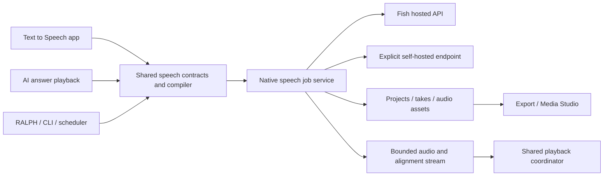

# Text to Speech suite

Research date: 18 October 2026. Status: complete product and architecture proposal; implementation has not started.

Build **Text to Speech** as its own Machdoch app, with Fish Audio **Drama 3** as the initial speech model. The same speech service must power spoken AI answers. This document describes the complete intended suite and its acceptance requirements, without delivery phases or an MVP boundary.

## Product boundary

“Separate app” means a dedicated entry in Machdoch’s application rail, beside Chat, RALPH, and Media Studio, with its own projects, editor, voice library, rendering jobs, and settings. It shares Machdoch’s desktop runtime and design system. A separately installed executable is not assumed by this proposal.

The app serves narration, audiobooks, dialogue, audio drama, game dialogue, instructional content, and voiceovers. It must work equally well for a single paragraph and a book with many chapters. Projects, scripts, references, and finished audio remain locally manageable; selecting Fish Cloud explicitly sends the required synthesis material to Fish.

The full suite includes authoring, expressive direction, casting, voice cloning and design, pronunciation, generation, take comparison, audio assembly, subtitles, export, background jobs, automation, accessibility, and answer playback. Optional creative tools are selectable features of this specification, not a deferred delivery tier.

## What already exists in Machdoch

The repository findings below identify current integration points. The proposed suite is not implemented yet.

| Existing area | Observed behavior | Consequence for this design |
| --- | --- | --- |
| [Application rail](../apps/client/src/tauri/ui/app-shell/app-rail.tsx) and [shell](../apps/client/src/tauri/ui/chat-session-shell.tsx) | Explicit app navigation and lazy-loaded Media Studio | Add a `tts` application identity, lazy-loaded screen, command, activity state, and persisted selection. |
| [Shell state](../apps/client/src/tauri/ui/lib/_helpers/shell-store-normalizers.helper.ts) | `MainAppId` and per-app last-viewed state | Extend the current state contract and its normalization together. |
| [Answer speech controller](../apps/client/src/tauri/ui/chat-session/_helpers/use-chat-session-voice.ts) | Manual speech and automatic responses; OpenAI/Google audio; browser system voices; complete base64 response before playback | Replace the ad hoc synthesis/playback path with a shared speech session. Keep currently offered providers as deliberate choices. |
| [Speech text extraction](../apps/client/src/tauri/ui/chat-session/_helpers/execution-message.tsx) | Regex-based Markdown conversion, code omission, generic message-content extraction | Introduce structured answer-to-speech conversion with an explicit final-answer boundary. |
| [Native voice module](../apps/client/src-tauri/src/voice/mod.rs) | Native OpenAI/Google synthesis; input transcription has a separate cancellation registry | Add cancellable streaming output. Reuse the cancellation ownership pattern, with a separate TTS job lifecycle. |
| [Runtime schema](../apps/client/src/shared/runtime-config.schema.json) | Speech output providers are `openai` and `google`; voice preferences have no Fish profile | Add Fish to speech output and credentials without making it a chat-completion or transcription provider. Regenerate derived contracts. |
| [Settings storage](../apps/client/src-tauri/src/runtime_snapshot/settings_commands.rs) | Native user configuration owns provider keys and voice selection | Use native credential access and expose only availability to the new UI; do not assume the current store is an OS keychain. |
| [Workspace editor](../apps/client/src/tauri/ui/workspace-management/workspace-file-viewer.tsx) | CodeMirror already exists | Reuse its editor technology for a speech-specific language extension. |
| [Media audio generation](../apps/client/src-tauri/src/media/provider_audio.rs) | AudioLDM 2 sound generation, validated files and provenance | Reuse suitable asset/storage primitives; speech production remains its own app and domain. |
| [Fleet settings contracts](../packages/fleet-protocol/src/device-settings.ts) | Remote voice preference/settings operations exist | Remote synthesis, audio streaming, access control, and job ownership need explicit contracts; settings support alone does not establish speech playback. |

## Verified Fish Audio capabilities

The following are documentation findings, not claims of successful Machdoch integration. Availability and audible quality require account-level testing.

| Area | Finding | Source |
| --- | --- | --- |
| Model selection | Hosted TTS accepts `model: drama-3`. Missing or unrecognized model headers can silently select `s2.1-pro`. | [Drama 3 guide](https://docs.fish.audio/features/text-to-speech/drama-3) |
| Direction syntax | Natural-language square-bracket directions, sounds/pauses, and scoped paired delivery tags are documented. Language switching is experimental. | [Drama 3 guide](https://docs.fish.audio/features/text-to-speech/drama-3) |
| Dialogue | Speaker tokens select ordered voice IDs. The open model documents up to 16 speaker slots; verify the hosted limit separately. | [TTS endpoint](https://docs.fish.audio/api-reference/endpoint/openapi-v1/text-to-speech), [model card](https://huggingface.co/fishaudio/drama-3) |
| Voice references | Hosted TTS accepts stored voice IDs or inline audio/transcript references. Inline audio requires MessagePack. | [TTS endpoint](https://docs.fish.audio/api-reference/endpoint/openapi-v1/text-to-speech) |
| Output | Hosted formats include WAV, PCM, MP3, and Opus. Sample-rate and bitrate combinations depend on the format. | [Speech format guide](https://docs.fish.audio/features/text-to-speech) |
| Timed audio | An SSE endpoint streams audio and cumulative alignment snapshots. Drama 3 is present in its model enum. | [Timestamped streaming](https://docs.fish.audio/api-reference/endpoint/openapi-v1/text-to-speech-stream-with-timestamps) |
| Streaming input | The WebSocket API uses MessagePack and supports Drama 3 in its model enum. | [WebSocket TTS](https://docs.fish.audio/api-reference/endpoint/websocket/tts-live) |
| Pronunciation | Manual phoneme tokens and reusable or inline pronunciation dictionaries are documented. | [Pronunciation dictionaries](https://docs.fish.audio/developer-guide/core-features/fine-grained-control/pronunciation-dictionaries) |
| Voice management | APIs list, inspect, create, update, and delete voices. Public publishing uses Fish’s web publishing flow; create requests for public voices are downgraded to private. | [Create voice](https://docs.fish.audio/api-reference/endpoint/model/create-model), [voice discovery](https://docs.fish.audio/api-reference/endpoint/model/list-models) |
| Voice design | A separate `voice-design-1` endpoint generates candidate voices from a description; it is not a Drama 3 TTS parameter. | [Voice Design](https://docs.fish.audio/features/voice-design) |
| Revision and infilling | Model materials advertise contextual revision and audio editing. The inspected hosted TTS schema contains no native history/infilling fields. | [Model card](https://huggingface.co/fishaudio/drama-3), [API schema](https://docs.fish.audio/api-reference/openapi.json) |
| Self-hosting | Fish’s reference FP8 runtime lists Linux/WSL, NVIDIA, and at least 48 GB GPU memory. This does not establish ordinary desktop GPU support. | [Reference installation](https://speech.fish.audio/install/) |
| Quantized serving | SGLang documents an official INT4 checkpoint with 20.8 GB engine weights, versus 37.0 GB for FP8. These figures exclude other required allocations. | [SGLang Drama 3 cookbook](https://sgl-project.github.io/sglang-omni/cookbook/fishaudio_drama3.html) |

Drama 3 is currently presented as Preview, and takes may vary. Record the provider model identifier, generation time, and any returned version evidence; a fixed model alias does not establish reproducible audio. [Drama 3 product page](https://fish.audio/drama-3/)

## App structure and interaction

Use a project sidebar, central script editor, contextual inspector, and collapsible audio/takes panel. At narrow widths, show one working pane at a time with an accessible way to switch. The editor remains the main working surface.

| Surface | Required behavior |
| --- | --- |
| Projects | Create, duplicate, rename, search, archive, delete, import, and export; recent projects; local and workspace locations. |
| Script | Chapters, scenes, speaker turns, bookmarks, source editing, selection preview, and validation. |
| Voices | Provider library, personal voices, favorites, reference sets, casting, voice design, and saved speech profiles. |
| Takes | Alternate performances, A/B audition, ratings or favorites, notes, revision lineage, and selected production takes. |
| Audio | Waveform, transcript, chapter markers, nondestructive edits, assembly, and optional imported background tracks. |
| Jobs | Current generation, queued work, failures, cancelled work, completed renders, progress, costs, and recovery. |
| Settings | Fish connection, explicit backend, shared voices/profiles, answer speech, storage, playback, and export defaults. |

Expose the next useful action and relevant state. Syntax diagnostics belong at the offending range; failed jobs expose their recovery action. Controls must not require reading an onboarding explanation. Keyboard navigation, screen-reader names, focus restoration, contrast, and reduced motion are acceptance requirements.

Switching apps must not cancel a render. Closing a project must offer an appropriate choice only if it would discard unsaved work or stop an active operation. Do not open duplicate copies of a project with independent unsynchronized drafts.

## Script editor and direction language

Use CodeMirror with a focused speech-language parser, completion provider, diagnostics, and source mapping. The saved script and structured view represent the same document; switching views must preserve all supported syntax and undo history.

Required editor capabilities:

- Syntax highlighting for speech, speaker tokens, bracket directions, paired delivery tags, phoneme spans, and comments/structural metadata owned by Machdoch.
- Context-aware completions, matching delimiters, tag closing, selection wrapping, jump to speaker, chapter/scene outline, find/replace, search across chapters, and folding.
- Speaker colors accompanied by names or icons, so color is never the only distinction.
- Validation for unmatched delimiters, crossed tag scopes, invalid phonemes, unmapped speakers, missing voices, and requests exceeding a verified backend limit.
- Free-form directions remain valid; the parser must not pretend that emotions form a closed keyword list.
- Selection preview, current-turn preview, and full-scene rendering. Preview preserves the selected speaker and relevant context.
- UTF-8 byte count, character count, and estimated audio duration in the relevant render/cost surface. Duration estimates remain estimates until audio exists.
- Autosave, full undo/redo, crash recovery, revision history, compare revisions, restore revision, and a visible unsaved/conflict state only when relevant.
- Plain text/Markdown import, structured project import, and CSV/TSV dialogue import with an explicit speaker-column mapping. Do not infer invented speaker identities.

Fish’s documented scoped delivery tags are `whisper`, `emphasis`, `soft`, `fast`, `slow`, `stress`, and `forceful`. [Drama 3 guide](https://docs.fish.audio/features/text-to-speech/drama-3)

Phoneme spans use `<|phoneme_start|>` and `<|phoneme_end|>`. English uses CMU Arpabet, Chinese pinyin, and Japanese romaji-based notation; do not advertise generic IPA support. [Phoneme control](https://docs.fish.audio/developer-guide/core-features/fine-grained-control)

For example, an authored dialogue can compile to:

```text
<|speaker:0|>[calm, measured] The station is quiet.
<|speaker:1|>Then why is the <emphasis>door open</emphasis>?
<|speaker:0|><whisper>Stay behind me.</whisper>
```

Chapter titles, editorial notes, comments, and speaker display names are project metadata unless explicitly marked for narration. The compiler must never accidentally send them as spoken text. Literal brackets or angle-bracket text need a defined literal-text treatment, distinct from authored performance controls. Reject an unsupported literal sequence rather than relying on an invented Fish escaping syntax.

Speech language extensions should be limited to documented model syntax. Unsupported markup is a diagnostic, not silently discarded input. Do not claim full SSML support.

## Casting, voice library, cloning, and design

Search the Fish voice library and the user’s own voices with pagination, language filters, favorites, preview audio, and direct voice-ID lookup. Keep local favorites and project cast assignments stable if a remote search ranking changes. Preserve source, author, visibility, and available rights information; public availability alone is not a commercial-use guarantee.

The model card lists 83 languages, including German, but language coverage does not establish that every library voice performs every language well. Maintain a verified language/voice matrix, support multilingual scripts and RTL editing, and let users audition the actual voice-language combination. [Model card](https://huggingface.co/fishaudio/drama-3)

A cast member has a stable project ID, display name, voice binding, reference set, default direction, and optional per-scene overrides. Compile these IDs into contiguous backend speaker indices for each request; never persist a mutable UI row number as a character’s identity. Validate repeated voices, missing references, and a scene exceeding the verified speaker capacity.

Cloning supports importing or recording references, trimming a working copy, listening, checking clipping/silence, attaching an accurate transcript, and organizing multiple references. Keep original recordings intact. Transcription may use Machdoch’s existing input providers when explicitly selected; it is not automatically a Fish transcription request.

Fish recommends clean single-speaker recordings, at least ten seconds for good results, with several short clips suggested for consistency. These are recording recommendations, not a verified universal upload limit. Store voice-owner permission or the applicable rights evidence with the reference set. [Cloning guidance](https://docs.fish.audio/developer-guide/best-practices/voice-cloning)

Persisted Fish voices are private by default. Show the consequence of uploading, unlisting, or deleting a provider voice at the relevant action. Separate removing a local library entry from deleting the remote voice; other projects must not silently lose a binding.

Voice Design belongs in the full suite as an optional creative action: enter a voice description, compare candidates on the same preview sentence, save one, and use it as a cast voice. Preserve returned candidate metadata and any authenticity signatures required when creating a persistent voice. Its separate model and charges must remain distinct from Drama 3 rendering. [Voice Design](https://docs.fish.audio/features/voice-design), [voice creation](https://docs.fish.audio/api-reference/endpoint/model/create-model)

## Pronunciation and text preparation

Provide project and reusable dictionaries, rule preview, rule ordering/conflict detection, case sensitivity, versioning, import/export, and a view of affected text before rendering. Pin a dictionary revision into every take.

Fish supports up to three dictionaries per request and mutually exclusive inline/reference forms. Inline dictionaries contain at most 5,000 items each in the inspected schema. Matching is literal substring, leftmost-longest; unresolved managed references may be dropped by the provider. Local dictionaries should compile to inline rules for explicit content provenance. Validate managed bindings where possible, and do not call a successful synthesis proof that every managed dictionary was applied. [API schema](https://docs.fish.audio/api-reference/openapi.json)

Dictionary imports must preserve their phoneme alphabet and identify unsupported notation. Include search and preview for names, brands, acronyms, dates, units, numbers, abbreviations, file paths, and technical terms. Never silently “correct” the user’s actual script. [Dictionary guide](https://docs.fish.audio/developer-guide/core-features/fine-grained-control/pronunciation-dictionaries)

Separate normalization, pronunciation, model direction, and playback speed. Fish’s `language` field guides normalization/alignment; it does not set the model’s accent or force a spoken language. Leave it unset for mixed-language content unless a deliberate segment-level choice is made. [Normalization and phoneme control](https://docs.fish.audio/developer-guide/core-features/fine-grained-control)

## Generation, takes, and long-form production

Rendering can target a selection, turn, scene, chapter, full project, or batch of imported scripts. Offer multiple takes per target, audition without overwriting an accepted take, and keep a selected take per production segment. Save settings as named speech profiles shared with answer playback.

The generation inspector exposes voice, direction, quality/latency preference, normalization, and output settings. Advanced settings include supported sampling and chunking controls. Send only parameters supported by the selected backend; do not invent TTS seeds or advertise deterministic regeneration. The inspected hosted TTS schema has no seed field.

Long projects require application-level segmentation and assembly in addition to Fish’s internal chunking. Split at scene/paragraph or sentence boundaries, preserve speaker state, and avoid splitting tags, phoneme spans, abbreviations, or Unicode sequences. Prefer a complete dialogue scene in one request when it fits, to retain interaction between speakers. Respect provider request limits, reference/context budgets, and local storage limits separately.

Each render uses an immutable snapshot of text, cast, references, profile, dictionaries, and model/backend identity. Editing the script while rendering creates a new revision; arriving audio remains associated with the submitted revision. Mark changed segments as needing a new take while retaining their playable previous take.

Cache keys cover the compiled request, voice/reference content hashes, dictionary revisions, backend, model, and all generation settings. “Play again” reuses audio; “Generate another take” deliberately bypasses generation reuse. Preview and production take counts both contribute to usage.

The job queue needs durable progress, priority, batch cancellation, and restart recovery at completed segment boundaries. A restarted app must distinguish completed, interrupted, failed, and uncertain provider requests. Do not automatically replay a request that may already have been billed or partially generated. A retry creates traceable attempt metadata.

For native contextual revision and infilling, keep original audio and an edit range, direction, parent take, and necessary backend history. These operations must be capability-specific. Cloud scene/turn regeneration and nondestructive timeline edits are complete features in their own right; they must not be labeled as native infilling. A native edit is enabled only when its actual endpoint/runtime contract has passed verification.

## Playback, waveform, and editing

One shared playback coordinator manages app previews, production takes, and spoken answers. Requesting another foreground item pauses or replaces the current item according to an explicit queue action. Background rendering remains independent of foreground playback.

Required controls include play/pause, stop, seek, volume, playback speed, sentence/turn navigation, selection looping, chapter navigation, keyboard shortcuts, and an accessible transcript. Separate playback speed from generation speed, so listening faster does not trigger a paid regeneration.

Handle Web Audio activation/autoplay restrictions with an actionable play control. Define behavior for device loss, suspend/resume, headphones disconnecting, and switching output devices where the platform supports it. A blocked or unavailable audio device must not cause a second paid generation.

The waveform editor supports nondestructive trim, split, move, silence insertion, fades, clip gain, crossfades, and take replacement. Chapters/scenes form an ordered production timeline. Imported background music/SFX can be mixed with per-track volume and voice ducking. Generating music or video remains Media Studio’s responsibility.

Keep a lossless working master for editing and export; reuse provider-native compressed audio for lightweight preview when appropriate. Do not repeatedly decode and re-encode selected takes. Compute waveform peaks and audio analysis outside the UI thread, with bounded memory and reusable caches.

Text highlighting and click-to-seek use measured alignment. Fish’s timestamp stream supplies audio chunks independently of cumulative timing snapshots: append audio in arrival order, replace alignment by `chunk_seq`, and add `chunk_audio_offset_sec` to local times. Missing alignment means unavailable timing, not permission to fabricate word timestamps. [Timed stream contract](https://docs.fish.audio/api-reference/endpoint/openapi-v1/text-to-speech-stream-with-timestamps)

A user-requested alignment/transcription job can add timing when a chosen backend does not supply it. Its provider, local/cloud execution, and cost remain explicit. Timeline edits must update or invalidate affected timing; subtitles never use timing from a superseded take.

## Export and project portability

Provide individual clips, selected ranges, scene/chapter files, one assembled master, and speaker-isolated stems where the available clips or verified backend metadata permit them. A mixed provider scene is not automatically separable into clean speaker stems; do not promise lossless separation of overlapping voices.

Exports include WAV, MP3, Opus, FLAC, and chaptered M4B through a pinned, licensed local media-encoding runtime. Provider-native format options and Machdoch conversion options are separate capabilities. Export presets define sample rate, channels, bitrate, loudness, true-peak ceiling, filenames, and chapter metadata. No destructive overwrite without an explicit choice.

Include SRT, WebVTT, plain transcript, timed transcript JSON, and a portable project archive containing script revisions, cast bindings, permitted reference assets, take selections, timeline edits, provenance, and export settings. Never export credentials. Check ownership/permissions before bundling third-party reference recordings. Validate archive paths, sizes, and schema before importing.

Loudness analysis and normalization are explicit, nondestructive export operations. Provide configurable podcast/audiobook presets without claiming distribution-platform certification. Show measured failures such as clipping, missing chapters, unavailable takes, and incomplete timing at export.

“Send to Media Studio” attaches a rendered speech asset with its transcript, timestamps, and provenance for lip sync or video use. It must not duplicate project ownership or silently regenerate the audio.

## Spoken AI answers

Chat and Text to Speech use the same provider profiles, credentials, pronunciation engine, generation service, cache, and playback coordinator. Answer playback must not depend on opening or mounting the TTS app.

| Concern | Required behavior |
| --- | --- |
| Manual actions | Read answer, read selection, pause/resume, stop, replay, save audio, and open the answer in Text to Speech. |
| Automatic speech | Off by default; user can enable it globally and override it per conversation. Speak only newly generated eligible answers. |
| Answer boundary | Only assistant answer content intended for the user. Exclude reasoning, tool requests/results, command output, internal instructions, progress events, and hidden metadata. Use a structured final-content event, not merely `role === agent`. |
| Ongoing answers | User-selectable completed-answer mode or streaming-answer mode. Stream only content marked as final-channel answer text by the provider adapter. |
| Markdown | Use the Markdown AST. Read links by label, headings as text with pauses, and lists in order. Handle tables in row/column order using headers. Skip code by default; users can choose code reading or explicit selection. |
| Complex content | Math and diagrams need a defined spoken representation or a short, truthful omission indication. Do not send raw rendered HTML, Mermaid syntax, or Markdown punctuation by accident. |
| Literal safety | AI answer text is speech content, not trusted Drama 3 control markup. Extract a speakable representation that cannot inject speaker, phoneme, direction, or closing tags. Authored directions come from the selected profile. |
| Voice choice | Fish/Drama 3 profile is an explicit selection alongside currently supported providers and system voices. A Fish error does not silently change provider, model, or voice. |
| Ordering | Stable answer revision and segment IDs prevent duplicate speech when events repeat, a run reconnects, or the UI remounts. Existing history is not automatically read on session entry. |
| Interruption | Stop the current speech on user stop, a new user turn, deletion, answer replacement, or session change. Late audio cannot resume an obsolete session. |
| Speech input | Pause playback before recording to prevent speaker output entering dictation; resuming requires a deliberate policy. |
| Resources | Keep only a bounded amount of speech queued ahead. Automatic speech has its own budget, per-answer cap, and clear recovery action when a configured cap is reached. |
| Persistence | Repeated manual playback reuses completed cached audio. Transient chat speech follows cache retention; saving creates a durable asset/project. |

Streaming answers need an incremental parser that buffers incomplete sentences, fenced code, links, entities, and control-looking text across token boundaries. Commit only complete speakable spans. A completion event flushes the final valid fragment; it must not leak an unfinished tag or code block.

Upstream answer revisions cannot retract speech already heard. Mark committed spans, stop unsent obsolete segments, and require deliberate replay of a corrected answer. A TTS failure must not fail or modify the AI answer itself.

Profiles store backend/model, voice, references if applicable, base delivery, normalization/locale, dictionaries, generation speed, and playback preferences. The studio project can override its profile without changing Chat’s voice. Per-conversation overrides reference the same profile model, avoiding a second Fish configuration system.

## Service architecture



| Proposed location | Responsibility |
| --- | --- |
| `packages/speech` | Shared script AST/compiler, source mapping, profiles, capabilities, speech preparation, segmentation, job/event contracts, and playback coordination. No studio UI dependency. |
| `packages/text-to-speech` | Project/editor UI, voice library, timeline, takes, and job screens. Depends on `speech` and shared product UI. |
| `apps/client/src-tauri/src/speech/` | Native provider transports, credentials access, request validation, queue, cancellation, persistence, asset streaming, and exports. |
| Existing shell/chat modules | App mounting/navigation and answer-source integration. Keep provider implementation out of React hooks. |
| Runtime schema and generated contracts | Add Fish as a speech capability and model/profile types; regenerate TypeScript/Rust output from the canonical schema. |
| Fleet protocol and runtime adapters | Authenticated remote speech commands, scoped events, asset access, and client playback. |

Extract only actually reused primitives from Media Studio into shared modules. Do not make the speech package import studio-specific storage, command helpers, or components merely because existing app code does so. Existing OpenAI/Google/system speech choices remain current functionality through the canonical service, with capability differences represented directly rather than duplicate playback implementations.

The native runtime owns network requests so API keys and WebSocket headers never enter browser URL parameters or frontend storage. Rust already includes streaming HTTP, WebSocket, cancellation, and SQLite dependencies. A MessagePack codec and any new audio/encoder components need explicit dependency and license review.

Return incremental audio through a bounded Tauri channel or equivalent typed stream; persist large assets to files and expose scoped playback handles. Avoid a second full-copy base64 audio payload as the main API. The remote runtime uses authenticated streamed HTTP/WebSocket transport with the same domain events, not raw Tauri calls from a browser.

The proposed live playback format is PCM delivered to a Web Audio AudioWorklet ring buffer, with an explicit sample rate/channel contract and the audio clock driving highlighting. Validate this format on each selected endpoint. Persist the same samples as a finalized lossless master and encode exports locally. Network packets are arbitrary byte fragments: buffer incomplete samples, validate frame counts, apply backpressure, and never decode each transport fragment as if it were a complete media file. The committed playback buffer stays bounded; disk spooling supports long jobs and seeking.

Separate generation state from playback state. Native cancellation must close the upstream stream, cancel queued work, release the account concurrency slot, and reject late callbacks. Pausing playback alone does not imply cancelled generation. A paused queue means no new provider requests; any continuing request remains visible as running.

## Fish provider contract

Use the native Fish API, with an explicit `drama-3` model header on every HTTP request and WebSocket handshake. Do not route through an OpenAI compatibility endpoint or rely on provider defaults. Test the exact header at the wire boundary. Record a returned effective model if available; if Fish exposes no model attestation, retain the requested identity without pretending it proves the served weights.

| Operation | Transport and requirements |
| --- | --- |
| Render existing text | `POST https://api.fish.audio/v1/tts`; bearer auth; JSON for stored voice IDs; MessagePack when sending inline audio. |
| Render with alignment | `POST /v1/tts/stream/with-timestamp`; SSE parser must handle fragmented events and cumulative alignment replacement. |
| Stream generated answer text | `wss://api.fish.audio/v1/tts/live`; authenticated native handshake and MessagePack messages. |
| Browse/manage voices | Documented `/model` and `/model/{id}` operations, with paginated discovery and explicit remote mutations. |
| Design a voice | `POST /v1/voice-design` with `model: voice-design-1`; separate capability and billing. |

The WebSocket lifecycle is `start`, repeated `text`, optional `flush`, then `stop`; receive audio and `finish`. The end-input event is named `stop`, not `close`. A normal finish has reason `stop`; error or premature disconnect is not a completed asset. Distinguish graceful completion from immediate cancellation. [WebSocket contract](https://docs.fish.audio/api-reference/endpoint/websocket/tts-live)

Validate settings at the application boundary using the selected backend’s contract. Hosted sampling includes `temperature`/`top_p` in 0–1 and `chunk_length` in 100–300; `min_chunk_length` is 0–100. Format-specific rates and bitrate enums are constrained controls. Quality/latency selection maps to `normal`, `balanced`, or `low`. Do not invent numeric prosody bounds absent from the schema; verify effective model behavior before offering them. [TTS endpoint](https://docs.fish.audio/api-reference/endpoint/openapi-v1/text-to-speech)

Classify authentication, insufficient credit, invalid input, missing/unavailable voices, concurrency limits, upstream capacity, network failure, malformed audio, and interrupted streams separately. Retry only classified transient failures with bounded jittered backoff. Never retry invalid credentials, invalid scripts, or a generation of uncertain billing status automatically.

## Self-hosted Drama 3

Include an explicit self-hosted connection in the full design, with backend URL, authentication, pinned runtime version, model identity, health check, and verified capabilities. It uses its actual serving protocol; matching `/v1` prefixes do not establish compatibility with Fish Cloud.

SGLang’s documented basic synthesis route is `/v1/audio/speech` with `input`; its examples also discuss continuation using previous takes/VQ context. The cookbook gives a default maximum of 60 seconds per audio reference and 8,192 prompt rows, with additional context constraints. These are SGLang configuration limits, not established hosted-Fish request limits. [SGLang cookbook](https://sgl-project.github.io/sglang-omni/cookbook/fishaudio_drama3.html)

The available documentation mixes high-level editing examples with different request shapes. Native revision/infilling requires inspection of the pinned runtime request/response schema, retention of necessary acoustic context, and a real edit proving continuity. Do not send `previous_takes` to Fish Cloud or treat text-only history as a verified audio-editing contract.

A managed installation needs pinned model/runtime digests, disk and GPU preflight, full dependency inventory, model/codec provenance, license acceptance, restart/cancellation handling, and an uninstall path that preserves projects. Download only explicit model/codec assets; do not retain an unrelated older speech model just to locate a codec. The reference installer documents a shared codec dependency, which must be packaged deliberately. [Reference installation](https://speech.fish.audio/install/)

Hardware eligibility is runtime-specific. The reference FP8 requirement is not reduced by the fact that only 3B parameters are active per token. SGLang INT4 reduces weight memory but does not establish a complete 24 GB deployment. Do not promise Windows-native, AMD, Apple, CPU, or small-GPU inference based on the hosted API or third-party ports. Those are separate runtimes needing their own verified support contract.

Cloud and self-hosted backends are user choices, never automatic recovery paths for each other. Enabling a managed runtime must not trigger silent downloads, cloud uploads, or a switch to S2.

## Persistence and domain contracts

Use transactional local metadata storage and content-addressed immutable audio/reference files, with atomic writes and integrity validation. Reuse appropriate SQLite and blob primitives after separating actual shared responsibilities.

| Entity | Required information |
| --- | --- |
| Project | ID, title, location, owner/scope, active revision, profile, timestamps. |
| Script revision | Parent revision, chapters/scenes/turns, exact source, stable node IDs, source maps, content hash. |
| Cast member | Stable ID, name, provider voice or reference binding, default direction, overrides. |
| Voice/reference set | Provider identity, immutable recordings/transcripts, hashes, visibility, rights evidence, design provenance. |
| Speech profile | Backend/model, voice, generation settings, locale/normalization, dictionaries, playback defaults. |
| Dictionary revision | Immutable rules, alphabet, locale, version, source, validation result. |
| Render job/attempt | Owner, snapshot, compiled request hash, segments, state, progress, timing, retry lineage, cost estimate and actual evidence. |
| Take | Segment/revision, audio hash, exact generation provenance, timing, duration, quality checks, parent take, selection. |
| Timeline | Clip references, ordering, trims, gains, transitions, tracks, chapters, alignment adjustments. |
| Export | Selected take/timeline snapshot, encoder version/settings, output digest, transcript/subtitle versions. |

Typed service operations cover project/revision management, capability and voice discovery, validation/estimation, render/stream/cancel, take selection, asset playback, and export. Events include job state, audio chunk, alignment update, usage evidence, and terminal failure/completion. Every event carries owner/session/job and sequence identifiers.

Keep audio binaries outside JSON project/state snapshots. Orphan cleanup is reference-counted and respects ongoing jobs, saved projects, exports, and cache retention. Project archives use one current schema with explicit validation; no historical import adapters are assumed.

Validate imported audio by decoded format, duration, channels, sample rate, and bounded size, not file extension alone. Apply request/output/disk limits before expensive processing, and constrain any remote reference fetching to the selected backend’s explicit asset contract. Cross-window project edits need revision conflict detection and a recoverable draft rather than last-write-wins data loss.

## Costs, privacy, and licensing

Fish’s 13 October launch post lists Drama 3 at **$50 per million characters**, discounted to **$10 per million characters from 13 October through 12 November 2026**. Its general pricing page describes TTS in **million UTF-8 bytes** and omits Drama 3. The unit and account-effective price are therefore an unresolved billing-contract detail, not interchangeable measures. [Launch pricing](https://fish.audio/blog/fish-audio-drama-3/), [general pricing](https://docs.fish.audio/developer-guide/models-pricing/pricing-and-rate-limits)

Store the measured text byte count and character count, requested takes, estimated duration, pricing unit, currency, effective dates, and source of each estimate. A 100,000-character render would be $5 at the stated character list rate or $1 at the stated launch rate, before additional takes; these are conditional illustrations, not a verified invoice estimate. If a reliable rate/unit is unavailable, say the estimate is unavailable and let the user set a local limit rather than inventing a price.

Provide per-render estimates, project and automatic-answer budgets, usage history, and configured spending limits. Reserve estimated cost before dispatch to avoid parallel jobs overspending a local budget. Budget reservations are local controls, not a provider-enforced billing guarantee. Aborting a stream does not promise a refund.

Fish documents account-wide concurrent-request tiers of 5, 15, and 50, with custom enterprise limits; the quota is shared across keys and API workloads. One scheduler must coordinate app, Chat, and automation requests, prioritize interactive speech, and handle external account usage through 429 responses. [Rate limits](https://docs.fish.audio/developer-guide/models-pricing/pricing-and-rate-limits)

Fish credentials belong to native credential storage, with an explicit policy for environment overrides; do not expose keys in projects, logs, analytics, crash reports, URLs, or remote settings responses. New connection UI needs save/replace/delete/test without returning a secret. OS-backed storage for the new integration should be evaluated explicitly against the existing configuration store.

Cloud transmission and reference uploads need a clear choice at their point of use. Do not transmit the full conversation to render an answer. Private scripts/reference audio are excluded from telemetry, and retention controls distinguish project files, transient playback cache, remote voices, and provider-side data. Fish’s public privacy policy does not establish a blanket zero-retention promise; verify API-specific retention, training use, processing region, and DPA terms before making those claims. [Fish privacy policy](https://fish.audio/privacy/)

The open-weight Community License has commercial revenue conditions and a separate license requirement for defined hosted TTS/voice-cloning services. It distinguishes self-serve speech generation from delivering finished audio and a product’s own spoken assistant replies. Distribution includes attribution and downstream-use conditions. This requires review for the actual Machdoch distribution/hosting model, not a blanket “commercially free” label. [Community License](https://github.com/fishaudio/fish-speech/blob/main/LICENSE)

Keep API-service terms separate from model-weight licensing. Confirm commercial output and voice-library rights under the actual account contract; do not apply the open-weight revenue threshold as an invented hosted API restriction. Preserve model/codec license notices and required attribution for any distributed runtime. Record consent for real-person clones and preserve required provenance/watermarks. [Fish service terms](https://fish.audio/terms/), [Community License](https://github.com/fishaudio/fish-speech/blob/main/LICENSE)

## Automation, remote use, and observability

Expose the same typed render, queue, cancel, and export operations to RALPH, CLI, and Smart Scheduler. Automated actions specify project/revision, profile, output location, and budget; they receive job/asset IDs and can observe completion. They must not simulate editor clicks or access raw Fish secrets.

Remote clients use the owning device’s runtime and credentials through authenticated, scoped operations. Stream only the requested audio/assets; define disconnect cancellation and retained-job behavior. Audio must play on the requesting client unless the user explicitly chooses the host. Cross-device preference transfer must not silently transfer voice reference files or credentials.

Record time to first audio, total generation time, produced audio duration, queue delay, render speed, buffer underruns, cancellation latency, retry reasons, and estimated/returned usage. Distinguish network/provider latency from UI playback latency. Vendor H200 benchmark numbers are not Machdoch performance guarantees.

Diagnostics identify provider/model, request/job ID, error category, and relevant setting names without logging scripts, audio, or secrets by default. A user-generated diagnostic bundle needs a preview of what it includes.

## Included creative and usability features

These are part of the complete product design, with capabilities exposed only when the selected backend can actually perform them:

| Feature | Intended behavior |
| --- | --- |
| Direction palette | Searchable delivery tags, sound cues, user presets, and wrapping of selected words. |
| Assisted direction | Machdoch’s configured text model proposes directions/casting in a reviewable diff; the user applies changes. No assumed Fish Auto Tag API. |
| Director notes | Compare takes and request another performance with a specific note; preserve the original and distinguish regeneration from native contextual revision. |
| Pronunciation rehearsal | Preview difficult words in context and compare dictionary revisions. |
| Voice comparison | Audition several explicitly selected voices on the same passage, with estimated generation cost. |
| Production checks | Flag silence, clipping, suspicious repetition, missing text, unexpected duration, and unrendered segments; do not claim automated checks prove performance quality. |
| Localization | Parallel script variants, reusable cast mapping, and deliberate language/normalization choices; translations never overwrite the original. |
| Reading mode | Follow the transcript, bookmarks, sentence navigation, sleep timer, and resume position. |
| Batch templates | Reusable project/cast/export templates and variable substitution with a preview of resolved scripts. |
| Media handoff | Send selected speech/timing to Media Studio and retain source-project linkage. |

## Acceptance requirements

The suite is complete when all applicable capability contracts and the following user outcomes pass. These are acceptance criteria, not implementation steps.

| Area | Required evidence |
| --- | --- |
| Independent app | Open Text to Speech from navigation/command search, create and reopen a project, switch apps during a render, and recover after restart. |
| Authoring | Source/structured round-trip, correct highlighting, free-form directions, malformed-tag diagnostics, undo/autosave, Unicode/RTL/IME handling, and large-project editing without UI stalls. |
| Provider selection | Captured test transport proves `model: drama-3` on REST and WebSocket; no error path silently selects another model/provider. |
| Voice workflows | Library pagination, missing/private voice handling, casting, multi-reference cloning, permission recording, remote deletion, and voice-design candidate persistence. |
| Real speech | Consent-cleared English and German narration, another supported non-Latin language, mixed-language speech, numbers/technical terms, expressive tags, and a multi-character scene; human listening review accompanies machine checks. |
| Long form | A representative book-length project, selective rerender after an edit, stable take selection, interrupted-job recovery, and complete audio assembly without missing/duplicated segments. |
| Streaming | First audio before full completion, bounded buffering, fragmented MessagePack/SSE parsing, correctly replaced alignment snapshots, stop/finish handling, and valid final audio. |
| Cancellation | Stop during queueing, connection, synthesis, and playback; new user turn/session switch; window closing; no late audio, orphan stream, or leaked slot. |
| Answer speech | Manual and automatic speech of eligible final answers; no reasoning/tool/internal content; Markdown/code policies; split-token control syntax; duplicate/revised event handling; read selection; replay without regeneration. |
| Audio/export | Trim/splice/take replacement, peaks/loudness checks, aligned subtitles, chaptered audiobook, clips/stems with truthful limitations, archive round-trip, and Media Studio handoff. |
| Failure recovery | Invalid key, insufficient credit, unavailable voice, rate limit, network loss, truncated audio, malformed timing, full disk, corrupted cache, and uncertain provider completion. |
| Budgets/privacy | Parallel budget reservation, correct pricing unit handling, no keys/content in telemetry/export, explicit cloud upload, private clone defaults, and deletion/retention behavior. |
| Remote/automation | Authorized job operations, isolated ownership, requesting-client playback, disconnect behavior, and no cross-device secret leakage. |
| Self-hosted capabilities | Pinned model/runtime/codec, measured hardware eligibility, real synthesis/streaming, applicable licensing, and a real continuity edit before enabling native revision/infilling. |
| Accessibility/platforms | Focused UI interaction checks plus actual playback/export verification on each supported Windows, macOS, and Linux runtime; codec or WebView support is not inferred across platforms. |

Use focused compiler/normalizer tests, mocked transport contract tests, persistence/job lifecycle tests, and narrow Playwright interaction tests. Real cloud generation and voice mutations belong in a budgeted opt-in integration fixture with consent-cleared recordings. Real self-hosted tests need eligible hardware and an exact runtime snapshot. Do not claim mock audio verifies the model.

Proposed internal responsiveness targets: cached playback begins within 300 ms, local pause/stop is audible within 150 ms, and upstream cancellation is initiated within 250 ms under the test environment. Benchmark and report p50/p95 first-audio latency for hosted speech rather than adopting a vendor inference-only promise. Long-form assembly and queueing must have measured bounded memory behavior.

## Unresolved evidence and delivery constraints

| Question | Current evidence | Required resolution |
| --- | --- | --- |
| Drama 3 billing unit/rate | Character pricing in launch post; byte pricing and no Drama row in general docs | Check the actual Fish account contract/usage evidence and effective dates before displaying a precise estimate. |
| Hosted request/speaker/reference limits | Multi-speaker documented; open model has 16 slots; no text maximum in inspected hosted schema | Verify actual hosted limits and put them in a versioned capability record, separate from SGLang limits. |
| Native revision/infilling in hosted API | Advertised model capabilities; absent from inspected cloud request schema | Obtain a documented contract or verified pinned self-hosted implementation; keep the distinction visible in capability-dependent controls. |
| Timestamped live-text operation | OpenAPI lists `/v1/tts/live/with-timestamp`; ordinary live and SSE timing contracts are documented | Verify the complete bidirectional timed-stream protocol. Never substitute speculative timings or silently change transport. |
| Prosody, quality guard, and direction reliability | General schema documents controls; backend support can differ | Test Drama 3 behavior and expose only parameters with demonstrated effect. |
| Local hardware support | Reference FP8 requirements and SGLang INT4 memory figures are available | Measure full runtime allocations/latency on each advertised hardware profile. No small-GPU/AMD promise is established. |
| Model/license provenance | Current Fish license says Community License; model-card metadata still contains a research-license label | Pin and inspect the actual accompanying license, model, and codec revisions before redistribution or managed installation. |
| API privacy and distribution rights | Public policy/terms exist; account-specific terms were not inspected | Verify retention/training, DPA/region, voice/output rights, hosted-service licensing, and required attribution for the chosen deployment. |
| Remote audio and codec behavior | Remote voice settings exist; current synthesis wrapper is desktop-only | Verify scoped media transport and real audio on supported clients/WebViews. |

Research performed for this plan: repository source inspection and current primary Fish/SGLang documentation and API-schema review. No application code changed, no development server started, no credentials accessed, and no paid synthesis, voice upload, account mutation, runtime install, or hardware benchmark was performed. Consequently this plan establishes the implementation contract and known evidence gaps, not a working Drama 3 integration.
