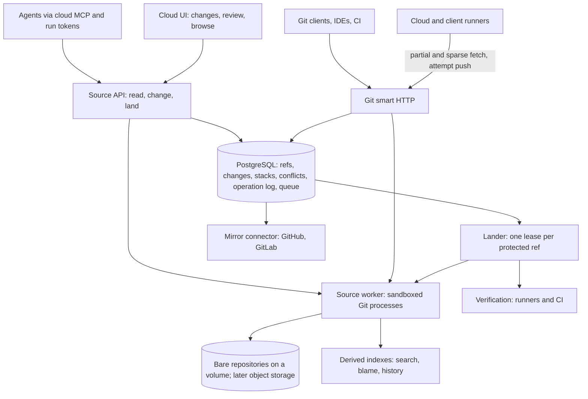

# Keep Git, move the work to the server: an agent-native source layer for machdoch.cloud

Machdoch should not write a new version control system. It should build its own **Git-compatible source layer inside machdoch.cloud**. In that layer, agents never clone a repository; commits, rebases and merges run on the server; and the unit of work is a *change* bound to an issue and a run. One sequenced lander per protected branch integrates the results, and verification is scheduled around it. In 2026 this is where the companies rebuilding code hosting for agents have converged. Cursor's new storage runs "a normal Git repository on disk, using off-the-shelf tooling" behind a write-ahead log in S3 ([Cursor](https://cursor.com/blog/git-at-any-scale)). GitLab's next-gen SCM keeps the Git protocol and adds server-side read and write APIs ([GitLab](https://about.gitlab.com/blog/gitlab-next-gen-scm/)). Entire and Pierre are Git-compatible. Only Anthropic dropped Git, and it calls its system "by no means a suitable replacement for git for general use" ([Anthropic](https://www.anthropic.com/engineering/redesigning-source-control)).

Machdoch is unusually well placed for this. The hard coordination rules are already specified: implementation reservations, fencing epochs, a publication broker, checkpoints and verification of the combined candidate ([execution spec](../docs/machdoch-cloud/execution.md)). What is missing is the layer those rules act on. Today the cloud accepts only `https://github.com/...` repositories ([`cloud-repository.ts`](../packages/fleet-protocol/src/cloud-repository.ts)). The domain schema has no repository, change or review tables, only `cloud_repository_transfers`. Every linked-client attempt also prepares its own clone and checkout while holding a per-worker lock. The code comment says concurrent tasks "queue behind a whole checkout, which runs about ten Git commands of up to a minute each" ([`managed-workspace.ts`](../apps/client/src/core/cloud/managed-workspace.ts)).

Five findings drive the recommendation:

- **Agent volume broke human-scale tooling in 2026.** Anthropic went from about 2,500 merged changes a day in May to over 30,000 in September. It moved its monorepo off Git in five months with a team of seven. GitHub reports that agents started more than 40% of September's pull requests, up from 17% in March ([Visual Studio Magazine on Octoverse 2026](https://visualstudiomagazine.com/articles/2026/10/29/github-octoverse-agents-started-more-than-40-percent-of-september-pull-requests.aspx)).
- **Every rebuild moves the work to the server.** In Anthropic's words, reads replace clones ("in many cases jobs don't need a local repository at all"). Commits and rebases run on the server ("there's nothing to push"). Objects are immutable and content-addressed, and refs move by compare-and-swap.
- **Parallel agents collide often, and a clean merge proves little.** Of co-active agent pull-request pairs, 19.8% conflict textually when written by the same agent and 41.7% when written by different agents. In another set, 47.3% of conflicts occurred between pull requests whose authored files did not overlap. Hard pre-write claims raised pass rates, but they serialized nearly all the work.
- **Landing has to be sequenced, not raced.** In my local probe, 8 writers racing one branch with compare-and-swap needed **418 server-side rebases to land 80 non-overlapping commits**. A sequenced lander needed exactly 80. Both modes merged non-overlapping edits to one shared file on the server, with no checkout and no agent.
- **Review, not storage, becomes the next bottleneck.** Anthropic's reviewers examine "the intent of the change". Entire replaces the pull-request timeline with agent-scored evals. Google's Rosie splits mass changes by ownership and lets a global approver auto-approve expected patterns.

Read the evidence with care. Most 2026 sources are vendor engineering posts or news coverage, and every performance figure from Cursor, GitLab and Entire is the vendor's own measurement. The arXiv papers are recent preprints, and I read their abstracts, not the full texts. The probe ran on one heavily loaded Windows laptop, so it supports counts, not speeds. Effort estimates are my judgment. Nothing proposed here has been built.

## Who built what, and why

| Organization | System | What changed compared with ordinary Git hosting | Git-compatible | Status |
|---|---|---|---|---|
| Google | Piper + CitC; jj on Piper | A central repository distributed over 10 data centers. Cloud workspaces through a FUSE file system, where "an average workspace has fewer than 10 files". Trunk-based development. In January 2015: 86 TB, about 2 billion lines, 35 million commits ([CACM 2016](https://cacmb4.acm.org/magazines/2016/7/204032-why-google-stores-billions-of-lines-of-code-in-a-single-repository/fulltext)) | Piper no; jj is an open-source Git-compatible client with internal Piper backends | Production. jj "reached general availability for developers inside Google" ([JJ Con 2026 recap](https://blog.gitbutler.com/jj-con-2026-talks)) |
| Meta | Sapling + Mononoke + EdenFS | First-class commit stacks with automatic restacking, `undo`/`redo`/`unamend`, smartlog. Lazy history downloads only what is needed, and a virtual file system fetches files on access. Scale: "tens of millions of files, tens of millions of commits, and tens of millions of branches" ([Meta](https://engineering.fb.com/2022/11/15/open-source/sapling-source-control-scalable/)) | Client works with Git repos; server does not | Client open source; Mononoke "not yet supported for external usage" ([repo](https://github.com/facebook/sapling)) |
| Microsoft | GVFS → VFS for Git → Scalar | Virtualized `.git` and working tree for Windows (about 3.5 million files, roughly 300 GB) ([Brian Harry](https://devblogs.microsoft.com/bharry/?p=12996)). Then brought the scaling work into upstream Git, including the commit-graph file, sparse-checkout improvements and Scalar ([Scalar](https://devblogs.microsoft.com/devops/introducing-scalar/)) | Yes | `scalar`, `backfill` and `sparse-checkout` ship with Git (all present in local Git 2.53) |
| Anthropic | Scion + Antique | Changesets in a write-ahead log, content-addressed blobs, refs moved by "a compare-and-swap on a single Spanner row". Server-side commit, rebase and merge, plus sparse and virtualized checkouts. Three cache tiers, each with over 99% hit rate. Infrastructure "200x smaller" than the old mirrors, and CI checkouts take seconds instead of minutes. No merge queue: "post-merge and pre-deploy automated testing" ([Anthropic](https://www.anthropic.com/engineering/redesigning-source-control)) | No | Internal only, October 13, 2026 |
| Cursor | Origin + Continuity, plus Graphite | Git forge built for agent scale. A write-ahead log in S3 with compare-and-swap; disks are "a warm cache", and idle repositories are garbage-collected and rebuilt on demand. Vendor figures: 120 pushes/s on S3 Standard, over 300 on S3 Express ([Cursor](https://cursor.com/blog/git-at-any-scale)). Graphite (stacks, merge queue, AI review) was acquired in December 2025 ([SiliconANGLE](https://siliconangle.com/2025/12/19/cursor-acquires-ai-code-review-startup-graphite/)) | Yes | Early beta ([docs](https://cursor.com/docs/origin)) |
| OpenAI | Reported internal repository host; Pierre | The Information reported in March 2026 that OpenAI was building a GitHub alternative after outages, possibly for sale later ([Dataconomy](https://dataconomy.com/2026/03/04/openai-is-developing-a-code-hosting-platform-to-rival-github/)). On November 4 it agreed to acquire Pierre, whose Code Storage is API-first Git storage "for machines", to fold into Codex ([Unite.AI](https://www.unite.ai/openai-to-acquire-pierre-computer-and-bring-code-storage-to-codex/)). It acquired Ona (agent environments) in June ([eWeek](https://www.eweek.com/news/openai-acquires-ona-to-make-codex-safer-for-enterprise-developers/)) | Yes (Pierre) | Pierre deal pending close |
| GitLab | Next-gen SCM | Keeps the Git protocol. A batch read replaces a clone, a diff-stat request replaces clone-then-diff, and a last-commit-for-path lookup replaces clone-then-blame. Stateless compute runs over S3-compatible storage, and each agent gets minimum visibility. One agent invocation can move 5–10 GB and spend more than 30 seconds on setup. Vendor ceilings: up to 50× faster, 2× fewer tokens, 1,000× less traffic ([announcement](https://about.gitlab.com/blog/gitlab-next-gen-scm/), [scaling post](https://about.gitlab.com/blog/scaling-git-for-the-agentic-software-factory/)) | Yes | Private beta |
| GitHub | Stacked PRs, async merge API | A stack enters the merge queue as one merge group. The async merge API is "the only merge API that supports stacked pull requests" ([stacks GA](https://github.blog/changelog/2026-10-06-stacked-pull-requests-generally-available/), [async merge](https://github.blog/changelog/2026-10-01-github-async-merge-api-generally-available)) | Yes | Generally available, October 2026 |
| Entire (ex-GitHub CEO) | Forge + Trails | A distributed object store and a transactional ref database across US, EU, Australia and India. Trails replace pull requests with eval scores recalculated on every push. Gates cover human approvals, CI and resolved findings. Agent sessions are stored as Git refs linked to commits. Its own benchmark claims 418 pushes/s against GitHub's 4.7 ([launch](https://entire.com/blog/the-git-forge-for-agent-human-collaboration), [CLI](https://github.com/entireio/cli)) | Yes | Launched October 26, 2026 |
| Zed | DeltaDB / Delta | Records "every operation in between" commits, each with a stable identity. Worktrees are CRDT-based, and conversations are anchored to deltas instead of line numbers ([Zed](https://zed.dev/blog/introducing-deltadb)) | Interoperates with Git | Private beta |
| GitButler | Parallel branches | Many active branches in one working directory; "the branch routing is the agent's job". Worktrees are still recommended when agents need separate runtime state or touch the same files ([docs](https://docs.gitbutler.com/ai-agents/parallel-agents)) | Yes (client) | Shipping |

Three conclusions follow:

1. **Only owners of enormous monorepos built non-Git systems.** Google, Meta and Anthropic each also had to build their own review, search and CI around them. Anthropic warns that adopting Scion means migrating "every piece of the development lifecycle".
2. **Everyone else kept the Git object format and protocol.** They changed three things: where the source of truth lives (object storage plus transactional refs), where operations run (the server), and what the review unit is.
3. **Machdoch's customers run ordinary repositories on self-hosted installations.** They need compatibility with Git clients, IDEs, CI and GitHub far more than 100 GB monorepo performance. The Git-compatible path fits them.

## What "optimized for AI" means in practice

| Pattern | Who does it | What Machdoch should do |
|---|---|---|
| **Read without cloning** | Scion answers history, blame and diff-to-merge-base by RPC. GitLab's batch-read, diff-stat and last-commit APIs. Pierre's grep and glob-archive APIs ([HN](https://news.ycombinator.com/item?id=46957629)) | Agent tools that read a tree, file, grep result, history, blame or diff straight from the bare repository, with bounded output. Materialize a sparse, partial checkout only when the agent must build or run something |
| **Write on the server** | Scion: "every commit, rebase, or merge happens on the server". GitLab's write APIs | Create commits from file operations or a patch through the API; sandboxes may still `git push`, but only into their own attempt namespace |
| **Immutable objects, transactional refs, disks as caches** | Scion (Spanner compare-and-swap), Cursor (compare-and-swap on an S3 write-ahead log), Entire (transactional ref DB), GitLab (stateless compute over S3) | PostgreSQL holds the authoritative ref ledger from day one, as it already holds every other authority. Objects start in bare repos on a volume and move to object storage only when measured load requires it |
| **Sequenced landing, verification scheduled around it** | Anthropic dropped the merge queue for post-merge and pre-deploy testing. Uber's SubmitQueue speculates on outcomes and builds independent changes concurrently ([Uber](https://eng.uber.com/research/keeping-master-green-at-scale)). GitHub lands stacks as merge groups | One lander per protected ref serializes the cheap step (rebase plus compare-and-swap). A per-repository policy decides whether tests run before landing, in speculative batches, or after landing with automatic revert |
| **Stable change identity, stacks, conflicts as data** | jj: change IDs survive rewrites, conflicts are recorded in commits instead of stopping the operation, and an operation log supports undo ([jj conflicts](https://docs.rs/crate/jj-cli/0.41.0/source/docs/conflicts.md), [op log](https://man.archlinux.org/man/jj-operation-log.1.en.txt)). Sapling stacks and undo. Gerrit's `Change-Id` trailer and `refs/for/` pushes ([Gerrit](https://gerrit-review.googlesource.com/Documentation/user-changeid.html)) | A change keeps one ID across revisions, and dependent changes form a stack that restacks automatically. Conflicts become stored objects assigned to an owner, not failed commands. Every ref move enters an operation log that can be undone |
| **Review intent, not lines** | Antique "can express complex semantic constraints on approvals". Entire's evals and gates. Google's Rosie shards by project and ownership and sends local owners only the shards that need their context ([SWE at Google, ch. 22](https://abseil.io/resources/swe-book/html/ch22.html)) | Approvals bound to evidence and to the head revision. Rules on paths and kinds of change (for example, sensitive directories or interface changes need a human). Mass changes are split by owner |
| **Provenance** | Entire stores sessions as `refs/entire/checkpoints/…` plus a commit trailer. GitLab attributes agent actions to workflow, model and token. DeltaDB keeps each message together with the edit it produced | Every revision links to its run, attempt, epoch, agent, model, instruction digest and evidence. Use commit trailers and a `refs/machdoch/runs/…` namespace that travels with the repository |
| **Least privilege and discardable space** | Scion applies permissions to individual directories. GitLab gives each agent minimum visibility. Pierre's ephemeral branches are Git namespaces that are never mirrored upstream ([DEV](https://dev.to/gabrielanhaia/openai-is-buying-the-git-host-lovable-and-bolt-use-check-what-lives-only-there-14e4)) | Run tokens scoped to repository, paths and the attempt's ref namespace. Attempt refs are invisible to normal clones, never mirrored, and garbage-collected under a retention policy |

Two less obvious points:

- **Token cost is part of the design.** GitLab claims up to 2× fewer tokens and Entire up to 71% savings from precomputed repository maps (both vendor figures). Both savings come from answering the question the agent actually has: a diff stat, the last commit for a path, the callers of a symbol. Server-side tools should return those bounded, structured answers rather than raw files.
- **Read Anthropic's merge-queue point narrowly.** It dropped a queue that holds a global repository lock while changes are tested, which cannot work at 30,000 merges a day. Scion still moves each ref with a compare-and-swap. My reading: keep the cheap serialized step (rebase plus ref update) and let each repository choose where the expensive tests run.

## Parallel agents: evidence and the design that follows

| Study | Finding | Consequence |
|---|---|---|
| [AI agent PRs on GitHub](https://arxiv.org/abs/2607.04697): 33,596 agent PRs in 2,807 repositories | 40.2% of repositories contain co-active agent pull-request pairs, and those pairs cover 79.4% of all agent pull requests. Textual conflicts: 19.8% for same-agent pairs and 41.7% for cross-agent pairs. 84.4% of conflicted files are source code, and about 42% of conflicts are structural (modify/delete, add/add) | Concurrency is the normal case, and file overlap is not a reliable predictor |
| [MergeGym](https://arxiv.org/abs/2610.04779): 715 pairs | 79 of 167 conflicts (47.3%) occurred despite disjoint authored file sets. Local `git merge-tree` replay took a median 0.02 s, so the authors recommend exact replay over prediction. A scheduling gate removed 91.7% of scope collisions at the cost of 65% longer makespan | Check by replaying the real merge on the server; it is cheap. Predictive scheduling has a real throughput cost |
| [stale](https://arxiv.org/abs/2609.25396): passes alone, fails together | Constructed interface changes broke 97% of combined runs. Mined real Django pairs showed interference in only one of 834 runs. A message describing the completed concurrent change recovered 82% of the constructed runs | Tell running agents what landed under them. Do not assume semantic breakage is common in reviewed real work, but test the combination |
| [Claim Plane](https://arxiv.org/abs/2608.00947): pre-write admission | Static admission raised pair pass from 23.3% to 50.0% and integration success from 65.6% to 96.7%, but it serialized 96.7% of executions. Dynamic admission failed closed on 46 of 90 runs | Use declared intent to schedule and warn, not as hard write locks |

The design:

1. **One workspace per attempt, server-side by default.** An attempt's workspace is a base revision plus its own ref namespace. Reading and editing go through the API, and a sandbox receives a partial, sparse checkout only for building and testing. This replaces today's per-attempt clone under a per-worker lock, and shared objects make a new workspace nearly free.
2. **Declare intent at admission and schedule on it.** The run contract (E-08) already includes allowed repository paths. Add the expected paths and symbols, then use them to place dependent work in a stack, delay overlapping work, or start it with a warning. Do not block writes on them.
3. **Continuous restack.** When a protected ref moves, the server rebases every active workspace and stack in the background with `git merge-tree`. Clean results update the attempt silently; conflicts become stored objects.
4. **Conflicts are data.** A conflict records the paths, both sides, the base and the revisions involved. It is assigned to the owning run as a typed input. The agent resolves it in its own workspace; no human has to notice a failed merge.
5. **Overlap notices.** When a landed change touches the declared scope of a running attempt, inject a short summary of that change into the agent's next turn. This is the intervention that recovered 82% in `stale`.
6. **Verify the combination.** Keep the existing rule that integration uses "a dedicated candidate checkout and verifies the combined result" (E-08). The lander's speculative batches are that candidate.
7. **One lander per protected ref.** A single lease holder per ref drains a PostgreSQL queue. For each change it rebases onto the tip, checks the policy and evidence, applies a compare-and-swap, writes an operation-log entry and restacks dependants. The local probe shows why racing does not work.

## Local probe: racing versus sequencing a branch

I built a bare repository from this workspace (5,945 tracked files, 339 MiB of packs) and landed 80 commits from 8 concurrent writers using only Git plumbing. Each commit was created with `hash-object`, a temporary index and `commit-tree`, and landed with `update-ref <new> <old>` as the compare-and-swap. On a lost race the change was rebased with `merge-tree --write-tree` and retried. The script and raw output are in the [research notes](../research_notes/Keep%20Git%20move%20the%20work%20to%20the%20server/README.md).

| Scenario (80 changes, 8 writers) | Optimistic racing: landed / conflicts / server-side merges | Sequenced lander: landed / conflicts / server-side merges |
|---|---|---|
| Disjoint new files | 80 / 0 / **418** | 80 / 0 / 80 |
| Same file, separate lines | 80 / 0 / **372** | 80 / 0 / 80 |
| Same line | 12 / 68 / 68 | 1 / 79 / 80 |

- **Racing amplifies work about fivefold with only 8 writers.** Tail latency suffers too: the p95 time to land a disjoint change was 35.8 s against a median of 10.8 s. More writers widen the retry window, so I expect worse amplification at higher concurrency, but I measured only 8.
- **Git's three-way merge already resolves non-overlapping edits on the server.** All 80 edits to one shared file landed in both modes, with no working tree and no agent. Every same-line conflict was detected without a checkout. The sequenced run built all candidates from one stale base, so only the first same-line edit landed, which is the expected result.
- **Connectivity checks passed** after both runs, and lock contention on `update-ref` never occurred.
- **Absolute speeds are not meaningful here.** A full local clone took 22.5–52.9 s and a full checkout 10.2–18.8 s across the two runs. One server-side commit (five Git processes) took about 0.5 s. But `git --version` alone took 325–713 ms on this machine during the session, so these figures mostly measure process start-up under load. MergeGym reports a median of 0.02 s for local merge-tree replay. A production lander would run on Linux with long-lived Git processes or a library.

## Requirements

**Must** means needed for a first production release; **Should** means needed soon after.

| Area | Requirement | Priority | Basis |
|---|---|---|---|
| Agents | Read tree, file, grep, history, blame, diff and diff-to-merge-base without a clone, with paging and output budgets | Must | Scion, GitLab, Pierre |
| Agents | Create commits from file operations or a patch, against an expected base revision | Must | Scion, GitLab |
| Agents | Attempt namespaces writable only under the attempt's current fencing epoch; hidden from normal clones; never mirrored | Must | E-04, E-10; Pierre |
| Agents | Partial, sparse checkout for sandboxes through the existing supervised gateway, replacing GitHub-only fetch and bundle upload | Must | [Repository delivery evidence](../docs/machdoch-cloud/implementation.md) |
| Parallelism | Changes with stable IDs, stacks, automatic restacking and first-class stored conflicts | Must | jj, Sapling, Gerrit, GitHub stacks |
| Parallelism | Sequenced lander per protected ref; landing policy per repository: pre-merge, speculative batch, or post-merge with automatic revert | Must | Probe; Anthropic; Uber |
| Parallelism | Declared intent, overlap notices and combined-candidate verification | Must | `stale`, Claim Plane, E-08 |
| Parallelism | Operation log of every ref move, with actor, run, epoch and before/after values; undo | Must | jj, Sapling |
| Humans | Standard Git smart HTTP for clone, fetch and push from any Git client, IDE or CI system | Must | Compatibility |
| Humans | Protected branches, required checks, code owners, signed commits, tags, Git LFS, defined submodule policy | Must | P-09 (code owners, required checks, branch protection); submodule and LFS policy is open release work in the implementation evidence |
| Humans | Change review in the cloud UI: live and committed diffs, evidence, findings, approvals bound to the head revision | Must | P-09; Antique; Entire |
| Humans | Two-way GitHub and GitLab mirroring, with the source of truth chosen per repository | Must | Origin and Entire both start as mirrors |
| Governance | Provenance trailers and run refs on every agent revision; export with the repository | Must | Entire; GitLab |
| Governance | Path-scoped access for people and run tokens; organization isolation of objects, refs, caches and search | Must | Scion; T-23 |
| Governance | Semantic approval rules (paths, interface changes, test edits by the implementing agent) | Should | Antique; E-11 |
| Operations | Self-hosted single node on PostgreSQL plus a volume; optional S3-compatible object storage | Must | [machdoch.cloud install](../apps/cloud/README.md) |
| Operations | Backup and restore that keeps refs and objects consistent; integrity checks; quotas per organization | Must | D-05, T-26, T-27 |
| Operations | Readiness for SHA-256 repositories and reftable; Git 3.0 is planned for spring 2027 ([GitLab on Git 2.56](https://about.gitlab.com/blog/whats-new-in-git-2-56-0/), [Git breaking changes](https://git-scm.com/docs/BreakingChanges)) | Should | Git roadmap |
| Operations | Derived indexes (search, blame cache, path history, symbol graph) built asynchronously from immutable objects | Should | Scion derived data; Entire graph; GitLab Orbit |

## What users see

The aim is "easier, with all features" because Git stays available underneath while the default path never mentions it.

- **Issues produce changes, not branches.** Delegating an issue creates a change with a generated ref. People see the change, its stack, its state and its evidence. Branch names appear only to people who open a Git client.
- **Land is one action.** It is enabled when the policy is satisfied, and the reason is shown when it is not. Landing, restacking and conflict handling run on the server.
- **A conflict appears as work assigned to an agent,** not as an error dialog.
- **Undo is one action** backed by the operation log.
- **Experts lose nothing.** Every repository has a standard Git remote URL, and the desktop app keeps its existing Git tools.

Keep these screens to the change, its state and the decision at hand, as the product's interface rules already require. Do not explain Git in the interface.

## Architecture

| Component | Responsibility | Notes |
|---|---|---|
| Ref ledger (PostgreSQL) | Authoritative refs, revisions, changes, stacks, conflicts, operation log, landing queue | Ref moves are revision-checked row updates in the same transaction as the operation-log entry. Pushes pass through a server-owned `pre-receive` hook that performs the ledger compare-and-swap before Git updates its on-disk refs, which serve as a projection |
| Source worker | Every Git operation: object writes, `merge-tree --write-tree`, `commit-tree`, `update-ref --stdin` transactions, `upload-pack`/`receive-pack` | Run Git in sandboxed processes with only server-owned hooks and `fsck` on received objects; checkouts in sandboxes disable hooks, as the guest already does (`core.hooksPath=/dev/null`). Use long-lived `cat-file --batch` processes for reads |
| Lander | Rebase onto the tip, apply policy and evidence, compare-and-swap, restack dependants, revert on post-merge failure | Generalizes the E-10 publication broker; the ledger already provides one writer per issue and per ref |
| Mirror connector | Import, two-way sync and outage behavior with GitHub and GitLab | Replaces the GitHub-only URL schema with a repository identity; Entire's `entire/unmirrored/` branches during GitHub outages are a model |
| Source API and MCP tools | `read_tree`, `read_file`, `grep`, `history`, `blame`, `diff`, `apply_change`, `restack`, `land`, `list_conflicts`, `declare_intent` | Delegates to the same domain authorization as the REST API (A-07) |

Implement on Git plumbing that already exists. `git merge-tree --write-tree` (stable) merges without an index or working tree. `update-ref` with an old value, and `update-ref --stdin` transactions, give compare-and-swap. `git replay` rebases in bare repositories but is still marked EXPERIMENTAL in 2.53 and 2.56 ([docs](https://git-scm.com/docs/git-replay)). Partial clone, sparse checkout, `backfill` and Scalar cover sandbox materialization. Libraries are not ready to replace the Git binary: gitoxide still lacks push plumbing, merge commits and rebase ([discussion](https://github.com/GitoxideLabs/gitoxide/discussions/2810)). Running Git as a separate program avoids linking GPLv2 code into Machdoch's Apache-2.0 code; the cloud runner's guest image already uses Git this way. The cloud server image does not include Git yet.

How existing concepts map onto the source layer:

| Existing concept | In the source layer |
|---|---|
| `ImplementationReservation` (one writer per issue) | One active change writer per issue; the change ID is the reservation's subject |
| Fencing epoch (E-04) | Write authority for the attempt namespace; the lander rejects revisions from a stale epoch |
| Publication broker (E-10) | The lander for Machdoch-hosted refs; the mirror connector for GitHub |
| Checkpoint source component (E-09) | Change revision plus operation-log position |
| Candidate bundle and patch upload ([`candidate.ts`](../apps/cloud-runner/guest/candidate.ts), [`native-candidate.ts`](../apps/client/src/core/cloud/native-candidate.ts)) | A push to `refs/machdoch/attempts/<attempt>/…` |
| `machdoch/<title>-<run>` branch | The change's generated ref, optionally mirrored as a GitHub branch |
| T-10, T-11, T-17, T-18, T-25 acceptance tests | Unchanged; the source layer must pass them without GitHub |

## Build, embed, or buy

| Option | What it gives | What it costs | Fit |
|---|---|---|---|
| A. Stay on GitHub, add the agent layer | GitHub stacks, async merge and ecosystem today | No self-hosted source of truth; GitHub outages and rate limits stay in the critical path; no server-side agent reads | Do it now as Phase 0; not the end state |
| B. Embed Gitea (MIT) or Forgejo (GPLv3 or later since 9.0, [LWN](https://lwn.net/Articles/986998)) | Mature human forge, repository browser and pull requests | A second identity, permission and issue model beside the cloud's own; human-shaped pull requests; the agent layer still has to be built; Forgejo's copyleft applies to modified copies we distribute | Duplicates what machdoch.cloud already owns |
| **C. Own a Git-compatible, agent-native layer (recommended)** | Changes, lander, agent APIs and provenance in the existing ledger; standard Git for everyone else | Building review and browsing UI; operating Git storage | Matches the cloud's architecture and the market's direction |
| D. New non-Git VCS, like Scion | Maximum control and scale | Every client, IDE, CI system and integration must change; its builders call it unsuitable for general use | Do not build |
| E. Buy hosted storage (Pierre, Origin, Entire) | Fast start | Pierre is being acquired by OpenAI; all three are hosted services, which conflicts with self-hosted machdoch.cloud and with neutrality across providers | Integrate as mirrors at most |

## Roadmap

Effort: **S** up to a week, **M** two to four weeks, **L** one to three months, for one engineer. By my estimate Phases 0–4 total about 6–10 engineer-months. For comparison, Anthropic's non-Git system took a team of seven five months.

| Phase | Build | Effort | Exit evidence |
|---|---|---|---|
| 0. On GitHub now | Provenance trailers and run refs; overlap notices to running agents; declared intent in run contracts; publish dependent work as GitHub stacks through the async merge API | M | Two concurrent runs on one repository: overlap notice delivered, stack lands as one merge group, provenance resolves from commit to run |
| 1. Hosted repositories | Repository identity, PostgreSQL ref ledger, bare repositories on a volume, smart HTTP with scoped tokens, protected refs, GitHub import and two-way mirror | L | A standard Git client clones and pushes; a stale-revision push is rejected; mirror survives a simulated GitHub outage; backup and restore keep refs and objects consistent |
| 2. Agent workspaces | Read and write tools, attempt namespaces under fencing, partial and sparse sandbox checkout, a shared object cache per runner | M–L | T-10 with eight concurrent attempts on one client: no per-worker checkout queue, original checkout unchanged, stale epoch push rejected |
| 3. Lander and changes | Changes, stacks, continuous restack, stored conflicts, operation log and undo, landing policies including post-merge revert | L | Probe workload on Linux: one rebase per change, conflicts assigned to owning runs, T-17, T-18 and T-25 pass without GitHub |
| 4. Review | Change review UI with evidence, findings and head-bound approvals; semantic approval rules; owner sharding for mass changes | L | Reviewer approves by intent with evidence; an approval is rejected after the head moves; a mass change is split by owner |
| 5. Scale-out storage | Object storage and write-ahead log, replicas as caches, derived indexes | L+ | Only after measured need: clone and fetch load, repository size, or landing rate beyond one node |

Phase 0 is valuable even if the rest never ships: it attacks the conflict and provenance problems with no hosting work.

## Don't build

- **A new version control format.** Scion's own authors argue against it for general use, and Machdoch's users depend on Git tools.
- **Shared mutable files for several agents.** CRDT worktrees (DeltaDB) suit people watching agents in real time. The parallel-agent evidence favors isolated workspaces with coordinated integration, and E-08 already forbids several agents editing one checkout.
- **Hard file locks as the coordination mechanism.** Claim Plane got its gains by serializing nearly everything.
- **Pre-merge full test runs for every change at high volume.** Keep that as one landing policy among several.
- **A virtual file system or Spanner-class storage up front.** Google, Meta and Anthropic built those for repositories hundreds of times larger than typical customer repositories.
- **Offline-first agent workflows.** Anthropic skipped offline support because "Claude is by far the heaviest user" and is always online. Humans keep offline Git through the standard remote.

## Risks

- **The forge surface is large.** Browsing, blame, review, notifications and integrations make up most of GitHub's value. Mitigation: keep mirroring first-class and build only change review and browsing that serves the issue flow.
- **Git server security.** Repository content is untrusted. Run Git in the sandboxed source worker without content-provided hooks, fsck incoming objects, and track Git security releases.
- **Two sources of truth during mirroring.** The ledger must record which side is authoritative per repository, and sync conflicts must surface explicitly. Never resolve them silently.
- **Operations burden for self-hosters.** Storage growth, garbage collection while attempts depend on objects (E-06 already forbids pruning then), and backups need runbooks and quotas.
- **Vendor convergence.** GitHub is shipping stacks, async merge and agent features quickly. Machdoch's advantage is the issue-to-run-to-change ledger and self-hosting, not raw Git hosting.

## Limits of this research

- Primary sources were read through a summarizing fetch tool: Anthropic, Cursor, GitLab, GitHub, Entire, Zed, GitButler, Meta and Google's SWE book. Google's CACM figures, Microsoft, Uber and jj at Google come from search results only, and the Gerrit reference is from prior knowledge. The OpenAI items come from news reports; the Pierre deal was announced on November 4 and has not closed.
- Vendor performance figures (Cursor, GitLab, Entire) are self-reported, and Entire's benchmark compares itself with competitors.
- The four arXiv papers are recent preprints read at abstract level. `stale` notes that its constructed failure rates are not estimates of real-world frequency.
- The probe ran on one loaded Windows machine with Git 2.53. It establishes work counts and correctness, not throughput.
- I did not test jj, Sapling, GitButler, Origin or Entire hands-on, and I did not prototype smart HTTP, mirroring or the ref ledger.
