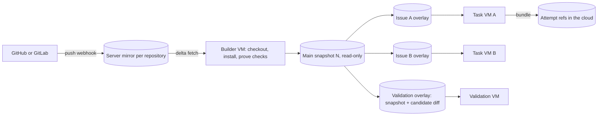
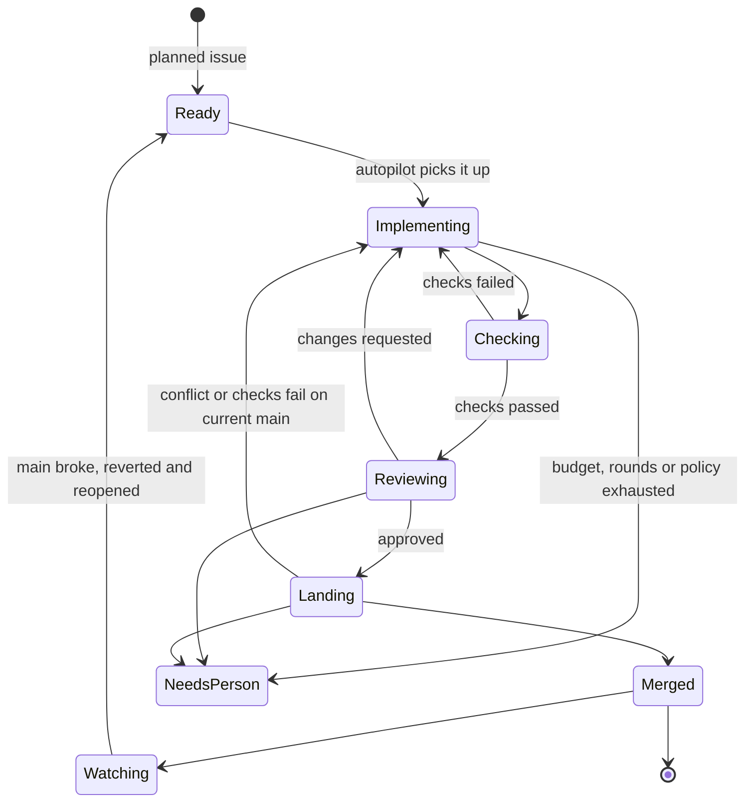

# Plan it, the agents ship it: an autopilot issue pipeline on sandboxed main snapshots

This revises [Sources per project, not clones per ticket](Sources%20per%20project%2C%20not%20clones%20per%20ticket.md) under four constraints: setup must be trivial; everything runs in a sandbox; every ticket starts from `main` and merges back into `main`; and people only plan while agents implement, review and merge.

**Verdict.** Your idea of keeping `main` on disk and keeping each issue's changes on disk until the issue closes is right. Build it with **copy-on-write disks instead of copying files**:

- A **main snapshot** per project: one disk image holding every repository of the project at the tip of `main`, with dependencies installed. It is built inside a sandbox and rebuilt when `main` changes.
- A **thin per-issue overlay** on top of that snapshot. It holds only the issue's changes and stays on the runner's disk until the issue reaches a final state (merged or canceled), then is deleted.

Starting a ticket then means creating an empty overlay and booting a VM, with no download and no copy. Around that, an **autopilot** takes a ready issue through implementation, deterministic checks, an independent AI review loop, revalidation on the current `main`, and merge. People are involved only when a gate cannot be satisfied automatically. Setup becomes: connect GitHub, pick repositories, turn on autopilot. No SHA, no check commands to type.

Read the evidence with care. The review and reward-hacking findings come from recent preprints and vendor guides, and the disk-layer behavior comes from QEMU and libvirt documentation. I did not measure overlay or boot times (no `qemu-img` on this machine), and nothing here has been built. Effort estimates are my judgment.

## What changes from the previous report

| Previous proposal | Now | Why |
|---|---|---|
| Tier 0: edit on the server without a VM | **Dropped** | Everything runs in a sandbox. With copy-on-write snapshots a VM start is cheap, so one path for every ticket is simpler |
| Blobless sparse fetch into each VM | **Dropped for task VMs** | The snapshot already holds the full tree; only the snapshot builder fetches, and only the delta since the last snapshot |
| Source set of repositories per project | **Kept, without configuration** | Repositories are picked from the synced list; branch and commit are resolved automatically |
| Server mirror refreshed by push webhooks | **Kept** | It is how "pull on change" works without hitting GitHub for every VM, and the builder fetches from it |
| Prepared environments | **Merged into the main snapshot** | One image per project contains source and dependencies |
| Sequenced landing and verification of the combined result | **Kept, now mandatory** | Without people, the merge gate is the last line of defense |

## 1. Setup: connect, pick, turn on

Today a profile asks for a name, target, directory, repository URL, a 40-character base SHA, provider, model, minutes, token limit and at least one check command ([`execution-settings.tsx`](../apps/cloud/src/components/cloud/execution-settings.tsx)). Replace that with:

1. **Connect GitHub or GitLab.** OAuth and repository sync already exist ([`git/`](../apps/cloud/src/server/cloud/git)).
2. **Pick the project's repositories** from the synced list. The branch defaults to the repository's `default_branch`, which is already stored. The commit is never entered; each run records which snapshot commit it started from.
3. **Turn on autopilot** for the project.

Everything else is inferred, with organization defaults for model and budget:

- **Checks are discovered, not typed.** When repositories are added, a setup agent runs in the snapshot builder VM. It reads `package.json`, `Makefile`, `pyproject.toml`, CI workflows and similar files, proposes the build, lint and test commands, and **proves them by running them green on `main`**. Proven checks are saved; checks that fail on `main` are not, because they could never gate a ticket. Devin's repository setup and Cursor's agent-led environment setup work the same way. People can edit the result but do not have to.
- **The execution profile disappears from the user's view.** The project carries the repositories, the discovered checks and the autopilot switch. Profiles can remain as an internal record.
- **Readiness is shown, not configured.** The project shows whether its snapshot is ready, building or failed. Failure offers "Fix setup", which starts an agent task on the setup itself.

## 2. Everything in a sandbox, including what processes repository content

Sandboxing the agent is not enough. Anything that *interprets* repository content is an injection surface:

| Step | Runs where | Why |
|---|---|---|
| Fetch into the server mirror | Server, as Git plumbing only (`fetch`, no checkout, no hooks, `fsck` on received objects) | Objects are stored, never executed or checked out on the host |
| Build the main snapshot (checkout, dependency install, setup scripts) | **Builder VM** with an egress allowlist for package registries and setup-only secrets | Install scripts are arbitrary code (`postinstall` and similar) |
| Implement | Task VM, no network, as today | |
| Checks | **Fresh validation VM** from the main snapshot plus the candidate diff | See section 3 |
| AI review | **Read-only review VM** or a server process with no tools beyond reading the diff and evidence, no secrets, no write access | The diff and issue text can contain prompt injections aimed at the reviewer |
| Merge | Deterministic orchestrator, never an agent tool | An injected "approve and merge" cannot act |

The host only ever handles Git objects and opaque disk images. It never mounts a snapshot or an overlay. Results leave a VM only as a Git bundle and patch through the existing guest channel ([`candidate.ts`](../apps/cloud-runner/guest/candidate.ts)), which is already the case.

## 3. Main on disk, changes on disk until the issue closes

**How it works**

- **Main snapshot.** A qcow2 disk image containing `/workspace/<repository>` for each project repository at the `main` tip, with dependencies installed and a normal `.git` in each repository. It is built in the builder VM and marked read-only. QEMU overlays keep the base untouched: writes "go to the overlays and not the base" ([qemu-devel](https://lists.nongnu.org/archive/html/qemu-devel/2015-07/msg05862.html)), and a chain can be checked with `qemu-img info --backing-chain` ([libvirt backing chains](https://libvirt.org/kbase/backing_chains.html)).
- **Pull on change.** A push to `main` updates the server mirror, and the builder makes the next snapshot as an overlay on the previous one: fetch the delta, check out, and reinstall only if the lockfile changed. Rebuilds are debounced, so ten merges in a minute produce one snapshot. Every few generations the chain is flattened with `qemu-img convert` to keep it short.
- **Per-issue overlay.** When an issue starts, the runner creates an empty qcow2 overlay backed by the newest ready snapshot and attaches it as the VM's workspace disk. That is a metadata operation, not a copy. The overlay keeps the agent's edits, build output and caches between attempts and review rounds, so follow-up rounds start instantly.
- **Lifetime.** The overlay lives until the issue enters a final state, using the workflow status categories that already exist (`complete`, `canceled`; [`workflows.ts`](../apps/cloud/src/server/cloud/workflows.ts)). Then the overlay and the issue branch are deleted. A snapshot is deleted once no open overlay depends on it and a newer one is ready.

**Four refinements your idea needs**

1. **The overlay is a cache, not the record.** Runner disks fail. After each attempt the candidate commit is already uploaded as a bundle; keep doing that, and store it as an attempt ref in the cloud. If the overlay is lost or the issue moves to another runner, it is rebuilt from the latest snapshot plus that ref. An overlay that has been idle for a long time can be evicted under the same rule.
2. **Validation never boots the agent's overlay.** The agent can change anything on its disk: dependency folders, caches, Git configuration, files Git ignores. Checks run on a **new** overlay made from the main snapshot plus only the candidate's Git diff, which is what the current fresh-VM rule intends ([`task-workflow.ts`](../packages/cloud-client/src/worker/task-workflow.ts)). With copy-on-write that costs almost nothing.
3. **"Merge with main again" must be verified.** While an issue is open, `main` moves. Before merging, the lander rebases the candidate onto the current `main` on the server (`git merge-tree`), then runs the checks again on the **current** snapshot plus the rebased diff. Two branches that each pass can still break `main` together; merge-time revalidation is what prevents it. One lander per repository merges in order, as the earlier source-layer report showed.
4. **Changes are bound by disk and time quotas.** Overlays grow with build output. Each project gets a disk quota and an idle limit; when a limit is reached, the issue resumes from its attempt ref instead of failing.

**What must change in the code**

| Today | Needed |
|---|---|
| Read-only root image plus a 512 MiB tmpfs `/workspace` ([`boot.sh`](../apps/cloud-runner/guest/boot.sh)) | A second virtio-blk device: the workspace overlay, mounted at `/workspace` |
| Each VM fetches the base through the broker, and validation fetches it again ([`task-environments.ts`](../packages/cloud-client/src/worker/task-environments.ts)) | No fetch in task VMs; the builder fetches deltas from the server mirror |
| 1 GiB RAM, 2 vCPUs ([`machine-launch.ts`](../packages/cloud-client/src/worker/sandbox/machine-launch.ts)) | Sized per project; real builds need more |
| No network in any VM | Unchanged for task, validation and review VMs; registry allowlist for the builder VM only |
| `baseCommit` typed into the profile | Resolved from the snapshot; recorded per run |

## 4. Autopilot: from ready issue to merged

**The review loop**

- **An independent reviewer.** Use a fresh context and, when the organization has one, a different model provider. The reviewer sees the issue, its acceptance criteria, the diff and the check evidence, but not the implementer's reasoning. Evidence on cross-model review is mixed: one preprint found a fresh-session same-model reviewer about as good as a different model on code. Fresh context is therefore the requirement, and a different provider is a bonus. Self-review blind spots are well documented ([cross-context review preprint](https://arxiv.org/pdf/2603.12123)).
- **A structured verdict.** The reviewer returns `approve` or `request_changes` with findings, each with a severity, a file and line, and a reason. Only blocking findings return the work to the implementer. Low-priority findings are recorded but do not block; blocking on them trains everyone to ignore the reviewer ([Augment](https://www.augmentcode.com/guides/ai-agents-pull-request-approval-guardrails)).
- **Fixes as new commits on the same overlay.** Force pushes were "the strongest negative predictor of merge" across 33,596 agent pull requests ([AgentPatterns](https://agentpatterns.ai/code-review/review-then-implement-loop/)), and new commits keep the reviewer's context.
- **Bounded loops.** Allow at most three review rounds and a token budget per issue. If the same blocking finding returns twice, or the candidate stops changing (already detected in `task-workflow.ts`), escalate instead of looping. Unbounded agent-to-agent iteration is the known failure mode.
- **Approval is bound to the head commit.** A new commit invalidates the approval. `git_merge` already refuses when the head moved ([`automation-git-actions.ts`](../apps/cloud/src/server/cloud/automation/automation-git-actions.ts)).

**Merge gate: agreement between agents is not enough**

Agent agreement must never be the exit condition; every round needs independent evidence ([Sonar](https://www.sonarsource.com/resources/library/what-happens-when-two-ai-agents-review-code/)). The orchestrator merges only when all of these hold:

| Gate | Check |
|---|---|
| Checks | All discovered checks pass on the current snapshot plus the rebased candidate |
| Review | Reviewer approval for exactly this head commit, with no open blocking findings |
| Tests not weakened | Deleted tests, newly skipped tests, lowered thresholds and edits to check or CI configuration block an automatic merge. Agents do delete or game tests: EvilGenie observed explicit reward hacking by Codex and Claude Code and test-file deletion by Gemini ([EvilGenie](https://alphaxiv.org/abs/2511.21654)) |
| Acceptance tests written blind | For medium-risk issues, a separate agent writes tests from the acceptance criteria without seeing the implementation, and they must pass. This is the held-out-test idea SpecBench uses to expose hacking ([SpecBench](https://arxiv.org/abs/2605.21384)) |
| Protected paths | Changes to authentication, secrets, billing, schema migrations, infrastructure and CI configuration go to a person regardless of confidence. Greptile's auto-approve excludes authentication, secrets and billing in the same way |
| Size | Diffs above a project limit go to a person or are split into stacked changes |

**After the merge**

- **Watch `main`.** If checks fail on the new `main` snapshot, open an automatic revert, merge it through the same lander, and reopen the issue with the failure evidence. Anthropic relies on post-merge testing at high volume ([Anthropic](https://www.anthropic.com/engineering/redesigning-source-control)); a fast revert is what makes that safe.
- **Clean up.** The issue moves to its final state, and its overlay and branch are deleted.

**Reaching 90%**

No public source shows a production system that merges fully autonomously at that rate; current guidance still puts a person in front of exceptions. Two levers decide whether it is reachable:

- **Planning quality.** Autopilot only picks up issues with acceptance criteria, as admission already requires. Small, well-specified issues are what agents finish. When an issue is too large, the planning agent should split it before implementation starts.
- **Autonomy earned per project and risk class, by measurement.** Track, per project: share merged without a person, revert rate, hotfixes within seven days, and escalations. Start with automatic merging for low-risk issues (no protected paths, small diff) and widen it automatically while the revert rate stays under a threshold. Derive the threshold from your own data, not from vendor benchmarks ([Augment](https://www.augmentcode.com/guides/ai-agents-pull-request-approval-guardrails)). In this model, "user in the loop" means a person sees only the escalation queue.

## What already exists and what is missing

| Exists | Missing |
|---|---|
| Git connections, repository sync with `default_branch`, push webhooks | Server mirror; project-to-repository links |
| Automations with `issue_created`, `pull_request_opened`, `checks_failed` triggers and `delegate`, `git_review`, `git_merge` (head-bound), `git_update_branch` actions | An autopilot preset that chains them without per-rule setup; a review task kind with a structured verdict |
| Admission that requires acceptance criteria and blocks on unfinished prerequisites | Planning-time splitting of large issues |
| Fresh-VM validation, candidate bundle and patch export, repair loop with "candidate did not change" detection | Snapshots, overlays, builder VM with registry allowlist, second workspace disk |
| Publication ledger with intents and receipts ([`effects.ts`](../apps/cloud/src/server/cloud/execution/effects.ts)) | Branch push, pull request creation, the lander, merge-time revalidation, automatic revert |
| Workflow status categories (`complete`, `canceled`) | Cleanup of overlays and branches on final states |

## Roadmap

Effort: **S** up to a week, **M** two to four weeks, **L** one to three months, for one engineer.

| Step | Build | Effort | Exit evidence |
|---|---|---|---|
| 1. No SHA | Pick repositories from the synced list; resolve the `main` tip at admission; remove the SHA field | S | A new project runs its first task without anyone typing a commit |
| 2. Server mirror | Bare mirror per repository, refreshed on push; broker serves from it | M | Concurrent tasks cause one upstream fetch; repositories over 64 MiB work |
| 3. Snapshots and overlays | Builder VM, main snapshot per project, per-issue overlay as workspace disk, validation overlay from the diff, cleanup on final states | L | A second ticket starts without any fetch or copy; validation never sees the agent's ignored files; a canceled issue frees its disk |
| 4. Discovered checks | Setup agent proposes checks and proves them green on `main` | M | Adding a Node repository yields working checks with no typing |
| 5. Publication and lander | Branch push, pull request, rebase onto current `main`, revalidation, ordered merge | L | Two issues that each pass but conflict semantically: the second fails revalidation and returns to implementation |
| 6. Review loop and gates | Review task with structured verdict, bounded rounds, head-bound approval, test-weakening and protected-path gates | M | A planted defect is requested for change; a candidate that deletes a test is not merged automatically |
| 7. Autopilot preset and metrics | One switch per project; autonomy, revert and escalation metrics; automatic revert after a broken `main` | M | A low-risk issue goes from Ready to Merged with nobody involved; a broken `main` is reverted and the issue reopened |

Steps 1 and 2 are prerequisites. Step 3 is the core of your idea. Step 6 is what makes removing the person safe.

## Risks

- **False approvals.** Reviewers catch real bugs but also approve code they should reject. The merge gate, blind acceptance tests and post-merge revert exist for this; no single reviewer verdict is trusted.
- **Snapshot freshness and build cost.** Frequent merges cause frequent rebuilds. Debounce, build incrementally, and start new issues from the newest *ready* snapshot; the lander handles any further movement of `main`.
- **Runner disk as a single point.** Mitigated by treating overlays as caches and keeping attempt refs in the cloud.
- **Builder VM egress.** Package registries are a supply-chain vector. Use an allowlist, lockfile-frozen installs and setup-only secrets, and never give task VMs network access.
- **Silent scope creep in autonomous changes.** Bounded diffs, protected paths and the escalation queue keep large or sensitive changes visible to people.

## Limits of this research

- Review-loop evidence comes from vendor guides (Augment, Sonar) and practitioner write-ups; the reward-hacking findings come from benchmark preprints (EvilGenie, SpecBench), which are lower bounds from specific runs and not real-world rates.
- The one large empirical study of AI-to-AI review (248,641 agent pull requests, [arXiv 2608.21311](https://arxiv.org/abs/2608.21311)) describes review volume and comment patterns, not defect or false-approval rates.
- Overlay behavior is from QEMU and libvirt documentation and mailing-list answers. I did not measure overlay creation, boot time or disk growth, and I did not test qcow2 backing chains under WHPX.
