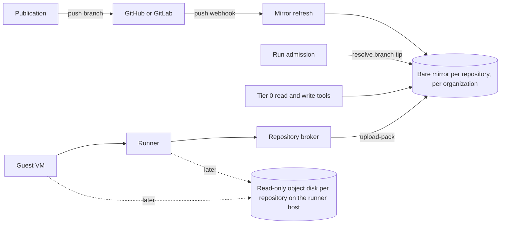

# Sources per project, not clones per ticket: extending the sandbox issue fixer

> Superseded in part by [Plan it, the agents ship it](Plan%20it%2C%20the%20agents%20ship%20it.md): every ticket now runs in a sandbox (no server-side edit tier), and task VMs start from a per-project main snapshot with a per-issue overlay instead of fetching.

**Recommendation.** Yes, assign repositories to projects, as a versioned **source set**: each project lists its repositories, each with a role, a mount path, a default branch and default sparse paths. A run pins one commit per repository at admission. Stop paying for a full download on every ticket by doing three things. First, **route each ticket to the cheapest execution tier that can still verify it**; a one-word translation fix needs no VM build at all. Second, **serve source from a mirror that Machdoch keeps per repository**, refreshed by the push webhooks it already receives, instead of proxying GitHub for every VM. Third, **fetch only what the task touches** (blobless, sparse, batched). Do not write a new version control system. Git already has the primitives (partial clone, sparse checkout, `--reference`/alternates, `clone --revision`, `backfill`, bundle URIs). What is missing is where Machdoch runs them and what it keeps between tickets. This extends [Keep Git, move the work to the server](Keep%20Git%20move%20the%20work%20to%20the%20server.md): the server-side mirror proposed there is also the cache this problem needs.

Read the effort estimates and the measurement with care: the estimates are my judgment, and the measurement ran locally against one repository (details in [the research note](../research_notes/Sources%20per%20project%20not%20clones%20per%20ticket/README.md)).

## What the code does today

| Area | Current behavior | Where |
|---|---|---|
| Repository per profile | An execution profile belongs to a project and holds **one** `repository` URL and **one** `baseCommit`. Projects have no link to the synced `cloud_git_repositories` rows, which already store `default_branch` | [`cloud-execution.ts`](../packages/fleet-protocol/src/cloud-execution.ts) lines 61–77; [`005-execution.sql`](../apps/cloud/src/server/cloud/migrations/005-execution.sql); [`044-github.sql`](../apps/cloud/src/server/cloud/migrations/044-github.sql) |
| Base commit | A person types a 40-character SHA into the profile form. Issue runs use it unchanged; only pull-request runs substitute the head SHA. Every automated issue fix therefore starts from whatever commit was typed when the profile was last saved | [`execution-settings.tsx`](../apps/cloud/src/components/cloud/execution-settings.tsx) line 359; [`admission.ts`](../apps/cloud/src/server/cloud/execution/admission.ts) line 102 |
| Fetch path | Guest `git fetch --depth=1` → in-guest HTTP gateway → virtio-serial → runner → cloud server → upstream `git-upload-pack`. No cache at any hop | [`guest/repository.ts`](../apps/cloud-runner/guest/repository.ts); [`repositories.ts`](../apps/cloud/src/server/cloud/execution/repositories.ts) |
| Server broker | Buffers the **entire** pack response in memory before streaming it on. Limits: 64 MiB per transfer, 512 MiB and 128 transfers per run, 4 concurrent per organization, 8 per server, 45 s upstream timeout | [`repositories.ts`](../apps/cloud/src/server/cloud/execution/repositories.ts); [`cloud-repository.ts`](../packages/fleet-protocol/src/cloud-repository.ts) |
| Fetches per task | The agent VM fetches the base. The fresh validation VM fetches the base **again** (`restore` → `start` → `prepare_repository`) and imports the candidate bundle. Each repair attempt starts another agent VM and another validation VM, each fetching again | [`task-environments.ts`](../packages/cloud-client/src/worker/task-environments.ts); [`task-workflow.ts`](../packages/cloud-client/src/worker/task-workflow.ts) |
| Guest limits | 1 GiB RAM, 2 vCPUs, `/workspace` is a 512 MiB tmpfs, `/tmp` 128 MiB, **no network adapter**, read-only shared root image | [`machine-launch.ts`](../packages/cloud-client/src/worker/sandbox/machine-launch.ts); [`boot.sh`](../apps/cloud-runner/guest/boot.sh) |
| Dependencies | No package registry egress and no prepared dependency images, so checks that need `node_modules` or similar cannot run yet | [implementation evidence](../docs/machdoch-cloud/implementation.md) lines 159 and 228 |
| Submodules | Rejected in the local-source path; recursive delivery "remain[s] rejected" on the client | [`local-repository.ts`](../apps/cloud-runner/guest/local-repository.ts); [implementation evidence](../docs/machdoch-cloud/implementation.md) line 254 |
| Publication | The publication ledger exists, but nothing pushes a branch or opens a pull request yet | [`effects.ts`](../apps/cloud/src/server/cloud/execution/effects.ts); [implementation evidence](../docs/machdoch-cloud/implementation.md) line 20 |
| Specification | Already requires "Link one or more repositories, pin a default development branch per repository, and support monorepo subpaths" (P-03) and a partial multi-repository acceptance test (T-25) with "no fictitious atomic merge across repositories" | [product](../docs/machdoch-cloud/product.md) line 50; [delivery](../docs/machdoch-cloud/delivery.md) line 72; [execution](../docs/machdoch-cloud/execution.md) line 278 |

Two consequences matter more than the per-ticket download cost:

- **A moderately sized repository cannot run in sandbox mode at all.** A depth-1 fetch of this workspace's own repository is 276 MiB, over four times the 64 MiB transfer cap, and its working tree would not fit the 512 MiB tmpfs next to its objects.
- **Automated fixes target a stale base.** With a hand-typed SHA, the agent fixes old code, and every candidate conflicts once publication exists.

## Measurement

I cloned this repository locally over `file://` with Git 2.53 (6,450 files at `HEAD`, 403 MiB of blobs, 344 MiB of packs).

| Fetch | Objects on disk | Wall time |
|---|---|---|
| `--depth=1`, full tree (today's guest command) | 276 MiB | 48.3 s |
| `--depth=1 --filter=blob:none --sparse`, then `sparse-checkout set packages/recurrence` | 0.4 MiB | 3.5 s |

That is roughly 700× fewer bytes for a change confined to one directory. Times come from a busy Windows laptop and mainly reflect local process cost; the byte counts are the meaningful result. Two caveats apply. A sparse checkout only helps when the task's paths are known or discoverable, and a build or test step usually needs much more than the edited directory. That is why the tiers below decide the materialization, not a blanket sparse default.

## How others handle multiple repositories and repeated setup

| Product | Multiple repositories | What it reuses between tasks |
|---|---|---|
| Devin | All configured repositories coexist on one machine snapshot, each cloned into its own directory with its own setup ([Devin](https://docs.devin.ai/onboard-devin/snapshots), [multi-repo article](https://knowledge.cognition.ai/articles/5095130098-projects-that-require-multiple-repos-to-be-on-the-same-machine)) | Machine snapshot with version history and rollback |
| Cursor cloud agents | Since May 2026, "a single environment with all the repositories an agent needs for its work, with re-use across sessions" ([changelog](https://cursor.com/changelog/05-13-26)) | Dockerfile environments with layer caching; build secrets "scoped to the build step and aren't passed to the running agent's environment" |
| Claude Code (cloud) | "You can add multiple repositories to work across them in one session." It still "clones the repo fresh every session" ([quickstart](https://code.claude.com/docs/en/web-quickstart)) | Filesystem snapshot after the setup script, reused for about seven days or until the script or network hosts change ([environments](https://code.claude.com/docs/en/cloud-environments.md)) |
| OpenAI Codex cloud | Not stated; the docs describe "your repo" at a branch or commit | Container state cached "for up to 12 hours"; a maintenance script updates dependencies when a cached container resumes on a newer commit; internet during setup only by default ([environments](https://learn.chatgpt.com/docs/environments/cloud-environment)) |
| GitHub Copilot coding agent | Single repository; cross-repository context only through MCP ([docs](https://docs.github.com/en/copilot/how-tos/use-copilot-agents/coding-agent/customize-the-agent-environment), [workaround write-up](https://dev.to/danielwe/how-to-give-github-copilot-cross-repo-context-today-1o1e)) | Actions runner setup steps |
| Ona (Gitpod) | Extra repositories cloned by a lifecycle command into `/workspaces/<name>` ([multi-repository](https://ona.com/docs/ona/configuration/multi-repository)) | Prebuild snapshots per environment class, expiring after 7 days ([prebuilds](https://ona.com/docs/ona/projects/prebuilds)) |
| Buildkite (CI) | n/a | One bare mirror per repository per host; checkouts use `git clone --reference` ([git mirrors](https://buildkite.com/docs/agent/self-hosted/configure/git-mirrors)) |
| GitLab Gitaly (server) | n/a | Pack-objects cache deduplicates identical concurrent fetches; GitLab's own analysis found at most 1 in 3 large CI clones unique within 30 minutes ([GitLab](https://about.gitlab.com/blog/git-fetch-performance-2021-part-2/)) |

The pattern is consistent. Multiple repositories belong to the **environment or project**, not to the individual task. What is reused is the **prepared environment** (toolchain plus dependencies) and the **object store**, never a previous task's working tree. Nobody in this list replaced Git to get there.

The dependency layer deserves emphasis. For most real projects, `pnpm install`, `pip install` or a Docker pull costs more than the Git fetch, and Machdoch guests currently cannot do it at all. Every product above solves it with a snapshot built once per environment revision and invalidated by configuration changes.

## Design

### 1. Repositories belong to projects as a source set

| Field | Purpose |
|---|---|
| `repositoryId` | References `cloud_git_repositories`, not a free-text URL, so access, identity, renames and webhooks come from one place |
| `role` | `primary` (always materialized) or `available` (materialized on demand) |
| `mountPath` | Directory inside the workspace, for example `web/` and `api/` |
| `branch` | Default development branch; defaults to the synced `default_branch` |
| `sparsePaths` | Optional default cone, for example `apps/web` in a monorepo (the P-03 "monorepo subpaths") |
| `checks` | Required checks, each with an optional **path scope** (see tiers) |

- **Profiles reference the source set** instead of carrying `repository` and `baseCommit`. A profile keeps model, budget and target; the project owns what source exists.
- **The run manifest pins one commit per repository at admission,** resolved from the mirror's branch tip. `baseCommit` disappears from the profile form. The manifest becomes `sources: [{ repositoryId, commit, mountPath }]`, which keeps `inputDigest` reproducible and lets T-25 reason per repository.
- **Repositories marked `available` are not fetched up front.** The agent gets an `open_repository` tool, and the runner materializes the repository only when it is first used. This is how a two-repository project avoids paying for both on a ticket that only touches one.
- **Do not use submodules or a meta-repository for this.** Submodules pin the second repository inside the first repository's history, need recursive delivery the guest currently rejects, and make a cross-repository change look atomic when it is not. A manifest of pinned commits, as in Google's `repo` tool ([manifest format](https://gerrit.googlesource.com/git-repo/+/maint/docs/manifest-format.md)), is the established alternative, and the project's source set is that manifest.
- **Publication is per repository, linked as one change set.** Each repository gets its own branch and pull request, ordered by declared dependency (for example `api` before `web`). The issue completes only when the required set lands. This is what T-25 and the execution spec already demand.

### 2. Route each ticket to the cheapest tier that still verifies it

| Tier | Materialization | Typical tickets | Verification |
|---|---|---|---|
| **0. Server-side edit** | None. The agent reads through bounded server tools (`read_file`, `grep`, `list_tree`, `history`) and writes with `apply_change` against the pinned base | Translation strings, copy, configuration values, documentation | Path-scoped deterministic checks run on the server or in a minimal VM over just the changed files (JSON and YAML parse, locale key parity, schema validation, formatter), followed by the repository's own CI on the pull request |
| **1. Sparse sandbox** | Blobless, sparse checkout of the touched paths plus the cone the agent requests, in a VM | Localized code changes where the checks are scoped to a package | Scoped checks in a fresh VM |
| **2. Full sandbox** | Full tree of the needed repositories, plus the prepared environment (dependencies) | Cross-cutting changes, builds, end-to-end tests | All required checks in a fresh VM, as today |

Three rules keep this safe:

- **The checks decide the tier, not a classifier.** Each required check declares the paths it covers. If every changed path is covered only by tier-0 checks, the run can finish at tier 0; any changed path outside that scope escalates the run. A model may *propose* starting at tier 0, but it cannot lower the verification the profile requires. This follows the existing rule that "failure to run a required check is a blocked result, not a pass" ([execution](../docs/machdoch-cloud/execution.md) line 200).
- **Escalation is one-way and keeps the work.** A tier-0 change becomes the starting candidate for a tier-1 or tier-2 environment; nothing is redone.
- **Tier 0 still goes through the same admission, fencing and publication ledger.** Only the execution placement differs.

For tier 0, the write path should be Machdoch's own mirror (`hash-object`, `mktree` or a temporary index, `commit-tree`; see the earlier report's probe), then a normal push of a branch. Provider commit APIs exist as an alternative: GitHub's `createCommitOnBranch` with `expectedHeadOid` ([GraphQL reference](https://docs.github.com/en/enterprise-cloud@latest/graphql/reference/commits)) and GitLab's commit endpoint with `create`/`update`/`delete`/`move` actions ([Commits API](https://docs.gitlab.com/17.6/api/commits)). They fit poorly: GitHub authors the commit as the token owner and cannot set author or committer, and each provider would need its own code path. Writing on the mirror keeps one implementation and Machdoch's provenance trailers.

### 3. Keep one mirror per repository and serve every VM from it

- **Server mirror (build first).** A bare mirror per repository, refreshed on the push webhooks already parsed in [`github-webhooks.ts`](../apps/cloud/src/server/cloud/git/github-webhooks.ts) and before admission if the mirror is stale. The broker runs `git upload-pack --stateless-rpc` against it and **streams** the response instead of buffering the whole pack. That removes upstream latency, rate limits and outages from every VM start; removes the in-memory buffering; lets the 64 MiB transfer cap become a budget per repository; and makes concurrent identical fetches cheap (the Gitaly lesson). It is phase 1 of the earlier report in its smallest useful form: read-only, no ledger yet. The server image (`node:24.22.1-bookworm-slim`) needs a Git binary, run as a separate sandboxed process with no repository-provided hooks.
- **Partial fetch in the guest.** Replace the full shallow fetch with `--filter=blob:none` plus sparse checkout, then fetch the needed blobs in **one batch** with `git backfill --sparse` (Git 2.49+, [release notes](https://github.blog/open-source/git/highlights-from-git-2-49/)). The batch matters: the in-guest gateway allows one transfer at a time and the server allows 128 per run, so lazy per-blob promisor fetches would fail. Allow the agent to widen the cone with a tool call that triggers another batched fetch. For full-tree tier 2, keep `--depth=1`; GitHub's guidance is that shallow clones suit throwaway builds, blobless clones suit repeated work, and you should "never fetch from a shallow clone" ([GitHub](https://github.blog/open-source/git/get-up-to-speed-with-partial-clone-and-shallow-clone/)).
- **Do not fetch the base twice.** The validation VM and repair VMs should receive the base from the same cache path. With the server mirror, the second fetch is cheap. Later, a runner can reuse the objects it already holds.
- **Runner host cache (only after measurement).** A read-only virtio-blk disk image per repository and organization, containing a recent pack. The guest points `objects/info/alternates` at it and fetches only the delta. This is Buildkite's `--reference` mirror, adapted to a VM without host-folder mounts. Keep it read-only, scope it per organization, and rebuild it rather than mutating it. Buildkite's documented failure mode (checkouts break when the mirror they borrow from changes) is avoided because the guest never sees a mutable mirror.

### 4. Prepare environments once per project revision

- **A setup step runs in a separate build VM with registry egress and setup-only secrets,** then produces a read-only qcow2 overlay holding the toolchain and dependency store at a base commit. Tasks boot from the shared root image plus this overlay and run an incremental install (Codex's "maintenance script") when the lockfile digest differs.
- **Invalidate on lockfile digest, setup definition, image security update, or age** (Claude Code uses about seven days, Ona seven days, Codex 12 hours).
- **This is already the specification:** "Setup-only secrets are issued separately from task credentials and removed before snapshots/warm images" and "Warm images must contain no run/customer data or active credentials. Snapshot reuse is scoped by trust/organization" ([execution](../docs/machdoch-cloud/execution.md) lines 133–135).
- **Raise guest limits for tier 2.** 1 GiB RAM and a 512 MiB tmpfs workspace cannot hold a real dependency tree. Give tier-2 environments a per-run disk-backed scratch volume and size them from the profile.

## Should Machdoch build its own Git?

No. The previous report reached the same verdict for parallel agents, and this problem adds no reason to change it:

- **Every cost identified here is caused by where Git runs and what is discarded,** not by Git's format. A mirror, partial and sparse fetch, a batched backfill and prepared environments remove almost all of the per-ticket download without new formats.
- **Independence from GitHub comes from the mirror,** not from a new VCS. With a mirror, reads, admission and tier-0 work continue during a GitHub outage. Publication still targets wherever the customer's source of truth lives, which must remain a standard Git remote for their IDEs and CI.
- **The only systems that left Git** (Google, Meta, Anthropic) did so for monorepos hundreds of times larger than typical customer repositories, and each rebuilt review, search and CI around it. Anthropic calls its system "by no means a suitable replacement for git for general use" ([Anthropic](https://www.anthropic.com/engineering/redesigning-source-control)).

What is worth owning is a **Git-compatible source layer**: the mirror now, and later the ref ledger, attempt namespaces and lander from the earlier report.

## Roadmap

Effort: **S** up to a week, **M** two to four weeks, **L** one to three months, for one engineer.

| Step | Build | Effort | Exit evidence |
|---|---|---|---|
| 1. Live base | Resolve the branch tip at admission from the synced repository; remove the hand-typed SHA from the profile | S | An automated issue run on a repository with new commits starts from the current tip; the manifest records the resolved SHA |
| 2. Source sets | Project-to-repository links with role, mount path, branch, sparse paths and path-scoped checks; profiles reference them; manifest `sources[]`; guest layout `/workspace/<mountPath>`; `open_repository` for `available` repositories | M | A two-repository project: a ticket touching one repository fetches only that repository; a ticket touching both produces two linked candidates |
| 3. Server mirror | Bare mirror per repository refreshed on push; streaming broker from the mirror; Git binary in the server image | M | Eight concurrent tasks on one repository cause one upstream fetch; a simulated GitHub outage does not block admission or fetch; a 300 MiB repository runs |
| 4. Partial fetch | Blobless and sparse materialization with batched `backfill`; validation and repair VMs reuse the same path | S–M | Measured bytes per task drop for a one-directory change; checks still pass in a fresh VM |
| 5. Tier 0 | Server read tools, `apply_change` on the mirror, path-scoped checks, one-way escalation | M | A translation fix completes without a task VM; a change outside the scoped paths escalates and runs the full checks |
| 6. Prepared environments | Build VM with setup egress, per-project overlay images, lockfile-based invalidation, larger tier-2 guests | L | A Node project's tests run in the sandbox without per-task installs; a lockfile change triggers one rebuild |
| 7. Change-set publication | Branch push and pull request per repository, ordered and linked; issue completion on the required set | L (shared with publication work) | T-25 passes: partial landing is visible and the issue does not complete early |
| 8. Runner object disks | Read-only per-repository object images on runner hosts | M | Only if measured fetch time from the server mirror still dominates VM start |

Steps 1 and 4 are cheap and valuable on their own. Step 3 unblocks any repository over 64 MiB, which is most real projects. Step 5 gives the "one translation word" case its fast path.

## Risks

- **Tier routing could weaken verification.** Mitigated by letting declared check scopes, not model judgment, decide the final tier, and by keeping repository CI on every pull request.
- **Mirror storage and freshness.** Each organization's repositories are stored again. Keep quotas, garbage-collect only when no active run pins an object (execution spec line 121), and refresh before admission when a webhook may have been missed.
- **Mirror security.** Repository content is untrusted. Run Git on the server without repository hooks, with `fsck` on fetched objects, and isolate mirrors per organization.
- **Cross-repository changes are not atomic.** Expose the change set honestly; never imply that two pull requests merged together.
- **Snapshot leakage.** Environment overlays must never contain run data or credentials, and must be rebuilt, not resumed, after security updates.

## Limits of this research

- Product behavior comes from vendor documentation read through a summarizing fetch tool on 15 November 2026. The Cursor details come from its changelog; the Devin, Ona and Copilot details are partly from secondary sources or older documentation pages.
- The measurement covers one repository over a local transport on Windows. It shows byte counts, not network throughput, and it does not measure dependency installation.
- I did not prototype source sets, the mirror, tier routing or prepared environments, and I did not test sparse checkout through the in-guest gateway.
